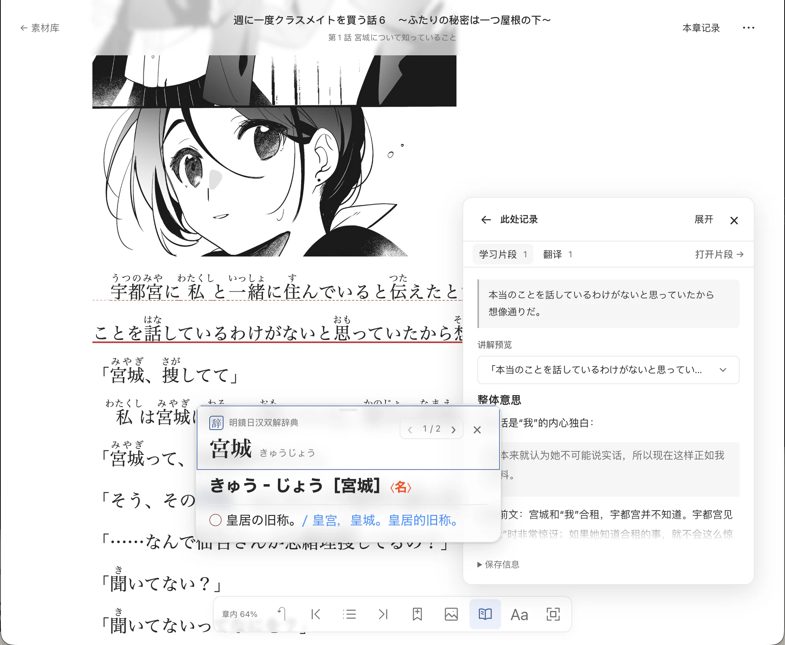

# Folio-J

Folio-J 是一个运行在本机的日语原版阅读与学习工具。读一本日文 EPUB 时，遇到生词可以在书里查词。碰上每个词都认识、整句却读不懂的地方，可以选中原文，结合前后文看翻译。还有疑问，就把这段话留下来，围绕它问下去。

值得记住的解释可以单独保存。下次读到同一句话，点开书里的标记，就能看到当时的讲解，也能重新读一遍让你产生疑问的那段原文。



*词卡显示「宮城」的词典释义，右侧的「此处记录」保留了这句话在故事里的解释。*

## 从一本日文书开始

1. **打开书，按习惯读。** 在「素材库」选择或新建一个来源，导入 EPUB，再点书封开始阅读。你可以保留原书注音，也可以为未标注的汉字补充振假名。横排、竖排都能读，下次打开会回到上次的位置。

2. **遇到生词，就地查。** 在「设置 → 词典」导入自己的 Yomitan format 3 词条词典 ZIP，再从阅读器底部的「即时查词」开启「点击查词」。点正文里的词就能看释义，释义或例句里还有生词，也可以接着查。

3. **读不懂整句时，带着前后文看。** 划选原文，点「翻译」，就能查看结合语境的译文，默认译为简体中文。同一处已有译文时，会先打开上次的结果。想听原句，可以直接点「朗读」，使用设备上可用的日语声音。

4. **保存想再读的片段。** 划选原文，点「保存为学习片段」。应用会按你的偏好带入前后文，如果同一位置已有译文，也会填进草稿。你可以修改或清空这些内容，再连同书中出处一起保存。打开片段就能继续提问，比如「这里省略的主语是谁？你是从前面哪句话判断的？」

5. **给片段留一份讲解。** 普通问答保存在对话里。想留下便于重读的解释，可以请 AI 把讨论整理成独立讲解，也可以直接点「创建 AI 讲解」。如果习惯用外部 AI，点「复制讲解提示词」就能带走原文、语境和自己的学习偏好，再把回答粘贴回来。讲解也可以自己用 Markdown 写。以后重读，从书里的标记或「本章记录」就能在原文旁展开查看。

想找一句记得的原话，可以搜索书内正文。想知道某个词在这本书里还出现在哪里，可以从「书籍详情」打开词汇页，按词频排序，或输入词形、读音查找，再跳回具体段落。

## 用「来源」整理书与片段

一个来源可以是一套轻小说，也可以是你自己定的专题。例如，把同一部作品的几卷放在一个来源下，读到第三卷时，仍能从来源目录找回第一卷留下的片段。每个从书中保存的片段都保留自己的书名、章节和原文位置。

手头只有一段日文时，也可以在来源下手动添加片段，直接写讲解或开始讨论。

## 快速开始

Folio-J 目前从源码启动，供单人在本机浏览器中使用，支持导入普通可重排 EPUB。项目已在 macOS 上验收。Linux 尚待完整验证，原生 Windows 暂不支持。

准备 **Python 3.11**、**Node.js 24**、`uv` 和 `pnpm 10`。

**第一次执行迁移或启动前，先确认数据位置。** 新安装默认把数据库保存在 `~/Folio-J-Data/app.db`，以后更换程序目录仍可使用这份数据。想换位置时，先按[应用配置](docs/USAGE.md#应用配置)创建或编辑 `~/Folio-J-Data/app.toml`，将 `[database].path` 设为包含文件名的绝对路径（可用 `~/`）。

**已经保存过数据时，先备份再更新。** 未显式指定数据库且当前程序目录有旧 `data/app.db` 时，会继续使用该旧库。换到新程序目录前，请按[升级与备份指南](docs/UPGRADING.md)固定旧库的绝对路径，或备份后恢复整组数据。

克隆仓库后，若已安装 `just`，在仓库根目录运行以下命令安装依赖并查看选中的数据库路径。

```bash
just setup
```

如果调整了配置，可用 `just data-path` 再次核对。确认位置后，启动应用。

```bash
just start
```

若未安装 `just`，可在仓库根目录依次执行：

```bash
uv sync --project backend --locked
pnpm --dir frontend install --frozen-lockfile
uv run --project backend python -m app.config
```

确认显示的数据位置后，再运行以下命令。

```bash
uv run --directory backend alembic upgrade head
pnpm --dir frontend build
uv run --project backend python scripts/run.py start
```

启动时终端会显示实际数据库路径和访问地址。默认打开 [http://127.0.0.1:8010](http://127.0.0.1:8010)；更改端口后以终端地址为准。在终端按 `Ctrl-C` 停止服务。

### 按需接入 AI

阅读、查词、保存片段、编写或粘贴讲解都无需配置模型。只想用自己惯用的 AI 聊天工具时，也可以直接使用「复制讲解提示词」。

要在 Folio-J 内翻译、讨论或生成讲解，请到「设置 → 模型与服务」接入自己的 OpenAI 兼容服务并登记模型。讨论模型在「模型配置」中选择，翻译模型在「设置 → 翻译」中选择。调用时，原文和本次所需的上下文会发往你配置的服务，费用由该服务决定。具体步骤见[使用指南的模型设置](docs/USAGE.md#模型设置)。

## 项目方向

Folio-J 从 EPUB 阅读开始。后续希望让保留下来的片段和讲解能用于知识点整理与复习，也希望同一来源能容纳漫画、有声书等不同形式的原版材料。当前可用功能与已知限制见[实施基线](docs/handovers/MVP_IMPLEMENTATION_BASELINE.md)，长期设想见[产品方向](docs/PRODUCT_DIRECTION.md)。

## 文档与反馈

- [使用指南](docs/USAGE.md) · 阅读器操作、词典导入、模型配置与讲解管理
- [开发指南](docs/DEVELOPMENT.md) · 开发环境、热重载与检查命令
- [升级与备份](docs/UPGRADING.md) · 保存数据、升级数据库与恢复备份
- [文档导航](docs/README.md) · 产品规范、系统架构与阶段记录

Folio-J 还在早期开发中。欢迎在 Issues 里聊聊一次具体的阅读经历：你当时想弄懂什么，在哪一步停了下来，希望怎样继续读？如果遇到故障，请附上复现步骤、操作系统和浏览器版本。也欢迎提交 PR，修复问题、改进阅读体验或补充文档。
