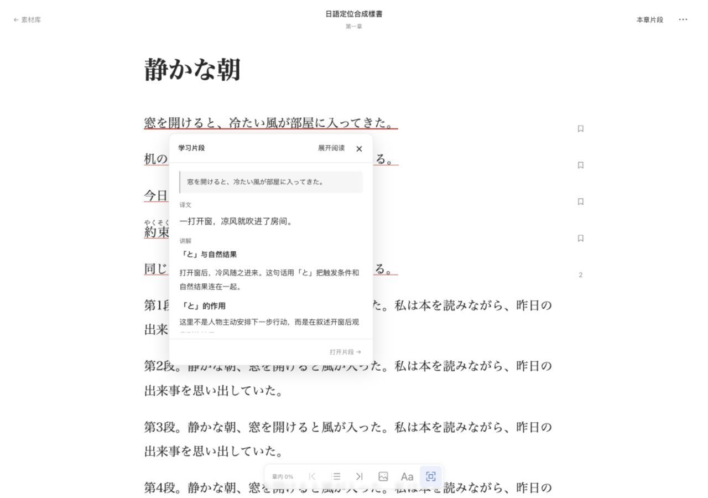

# Folio-J

**沉浸，积累，利用**

**Folio-J** 是一个为优化日语沉浸学习链路而开发的系统。

在沉浸式学习的实践中，也许你遇到过以下问题：

- 需要在阅读器、词典、AI 聊天窗口和笔记工具之间频繁切换
- 尽管知道一段内容每个词的含义却仍然无法理解整体的含义
- 使用 AI 辅助时，每次都要重新交代前因后果；讲解散落在对话记录里，难以回顾、利用

**Folio-J** 希望把“沉浸阅读”、“上下文辅助”与“知识沉淀”连接起来：按需提供如翻译、AI 讲解等多层次的辅助，并从原理上兼容如 yomitan 等成熟工具。你可以按需将选定片段与对应讲解连同原书语境保存，方便随时回看。

> 当前从 EPUB 阅读切入，以本地单用户 Web 应用运行，需要从源码启动。阅读、翻译辅助、片段保存、AI 讨论与讲解回看等主要能力已可使用，更多功能与交互仍在打磨。

## 核心工作流示例：从一本日文书开始



*界面示例：点击已保存片段的标记，在原处查看译文与讲解。截图使用原创合成样书和人工讲解。*

Folio-J 遵循沉浸式学习的要义，以帮助学习者恢复对原文的理解为首要目标，同时进一步允许学习者积累更详细、更丰富的学习产物或资源。你可以按自己的节奏使用它：

1. **导入并沉浸阅读**
   导入 EPUB 书籍。阅读器支持目录导航、全文搜索、横竖排切换、补充振假名注音以及阅读进度恢复。书籍详情可查看统计，并进入材料词汇页按词性、词频、词形或读音查找，回到具体原文。在阅读器导入自己的明镜词典后，可以直接点正文查词，也可以在释义和例句里继续查。见[即时查词](docs/USAGE.md#即时查词)。
2. **轻量辅助，不打断心流**
   遇到卡壳的片段，直接划选即可查看结合上下文的日译中结果，或在浏览器支持时调用设备朗读。
3. **留下值得深究的片段（Segment）**
   遇到你认为真正值得学习的表达时，可以一键保存为“学习片段”。系统会自动提取并预装该句的前后文与精确出处，免去手动复制背景的麻烦。
4. **围绕难点讨论与沉淀讲解（Analysis）**
   打开学习片段，向内置的教学 Agent 提问并讨论，普通提问默认在对话中回答；也可点击「创建 AI 讲解」，在新对话中请求创建并保存独立讲解。系统会自动带入你的学习背景、讲解偏好与片段语境。你可以将讨论成果整理为独立自足的 Markdown 讲解，也可以完全脱离原生的 AI 功能、直接手写或从外部粘贴笔记。
5. **随时回到原文印证**
   保存的内容会在书中留下低强调的标记。继续阅读或日后重读时，轻点标记即可在原文旁直接预览译文与讲解，也可随时跳转回完整的片段工作台。

翻译和 AI 讨论需要接入自己的模型服务，请求会发送到你配置的服务，并可能产生费用。后续，我们可能会维护并实时更新一些可直接使用的免费渠道。


## 按“来源（Source）”组织你的积累

不同于传统的“一本书对应一个孤立笔记本”，Folio-J 主张采用 **来源（Source）** 来组织原版素材与学习记录。

* **自由定义范围：** 一个“来源”可以是一部轻小说系列、某个特定 IP，或是你自定义的任何专题。
* **多材料汇聚：** 同一个来源下目前可导入多本 EPUB（如同一作品的不同卷），也可以脱离书籍、直接手动录入零散的日文句子进行讨论与笔记。
* **面向未来的多模态：** 长期来看，同一来源将逐步容纳漫画、有声书、视频等不同形式的原版素材，让围绕同一作品的学习积累汇聚一处，同时保留各自精确的材料出处。

## 快速开始

### 1. 环境准备与启动

请确保本地已安装 **Python 3.11**、**Node.js 24**、`uv` 和 `pnpm 10`。

克隆仓库后，若已安装 `just`，可直接运行：
```bash
just setup   # 安装前后端依赖
just start   # 初始化/升级数据库，构建前端并启动服务
```

若未安装 `just`，可在仓库根目录依次执行：

```bash
# 1. 安装锁定的后端与前端依赖
uv sync --project backend --locked
pnpm --dir frontend install --frozen-lockfile

# 2. 初始化／升级数据库
uv run --directory backend alembic upgrade head

# 3. 构建前端并启动应用
pnpm --dir frontend build
uv run --project backend python scripts/run.py start
```

启动完成后，打开 [http://127.0.0.1:8000](http://127.0.0.1:8000)。在终端按 `Ctrl-C` 停止服务。

### 2. 首次使用与模型配置（BYOK）

* **开始阅读：** 在“素材库”新建一个来源并导入 EPUB；也可以直接进入“来源目录”手动添加日文片段。
* **按需配置 AI：** 纯阅读、保存片段和手写 Markdown 讲解**无需配置任何模型**。如需使用划选翻译或 AI 讨论，请在「设置」中接入你自己的 OpenAI 兼容模型服务（请求直连你配置的服务，可能产生相应 API 费用）。
* **数据与升级：** 默认数据保存在本机 `data/app.db`。已有数据的用户更新并启动前，先阅读[升级与备份指南](docs/UPGRADING.md)。

---

## 演进方向

### 长期演进方向

EPUB 阅读是当前的起点，后续计划沿以下方向探索：

* **扩展原版素材形态：** 逐步接入漫画、有声书、视频等素材，保留各自原生的阅读与观看体验。
* **从理解延伸到持续内化：** 在讲解基础上提取并关联知识点，结合个人积累推荐值得复习的内容。
* **连接外部工具与 Agent：** 支持学习资料导出及与 Anki 等外部工具集成；允许受信任的外部 AI Agent 在授权范围内读取个人学习上下文并协同操作。

项目动机与更多长期思考见[产品方向](docs/PRODUCT_DIRECTION.md)。

### 当前已知边界

* **功能范围：** 目前支持导入普通可重排 EPUB；知识点提取与积累库、书内直接对话、其他媒体播放及主动复习尚未开放。
* **运行环境：** 绑定本机 `127.0.0.1` 单用户运行，同一数据库仅允许运行一个后台实例。当前进程锁依赖 macOS／Linux 的 `fcntl`，原生 Windows 暂不支持；实际验收环境为 macOS，Linux、Safari、Firefox 及实体触屏尚未完成验证。
* **数据安全：** API 密钥保存在数据库旁的私有目录中，依赖本机文件权限保护（尚未加密）；备份时请同时保管数据库与凭据目录。

详细能力、验收范围和已知缺口见[实施基线](docs/handovers/MVP_IMPLEMENTATION_BASELINE.md)。

---

## 文档导航与反馈

如果你在试用中遇到问题或有想法，欢迎从具体的场景出发提供反馈（如：你想做什么但是不支持、在哪一步感到别扭、期待怎样继续演化），提交 Bug 时请附上复现步骤、运行环境与必要截图。

- [使用指南](docs/USAGE.md)：阅读器操作、模型配置、AI 讨论与讲解管理。
- [开发指南](docs/DEVELOPMENT.md)：环境版本、热重载、开发检查命令与仓库快照。
- [升级与备份](docs/UPGRADING.md)：数据存储位置、数据库迁移与旧数据处理。
- [产品方向](docs/PRODUCT_DIRECTION.md)：项目起源、核心假设与长期演进设想。
- [文档导航](docs/README.md)：PRD 规范、系统架构、实施基线与研究记录。

---

项目处于草创阶段，功能尚不完善，我们会保证后续尽可能不做破坏性更新，欢迎随时试用。期待大家的宝贵反馈！
