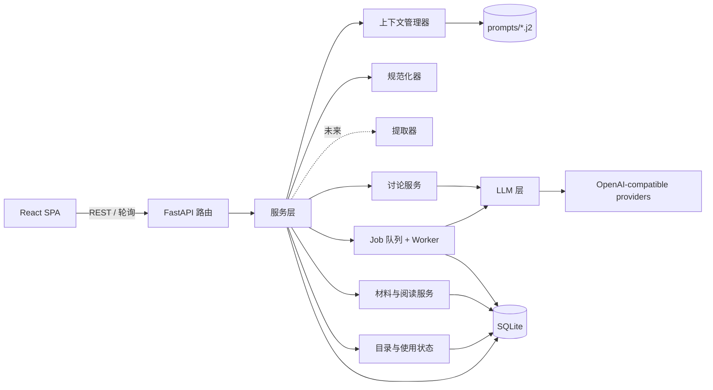
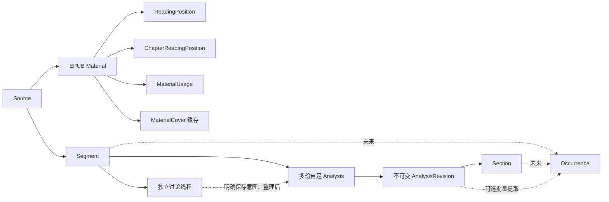
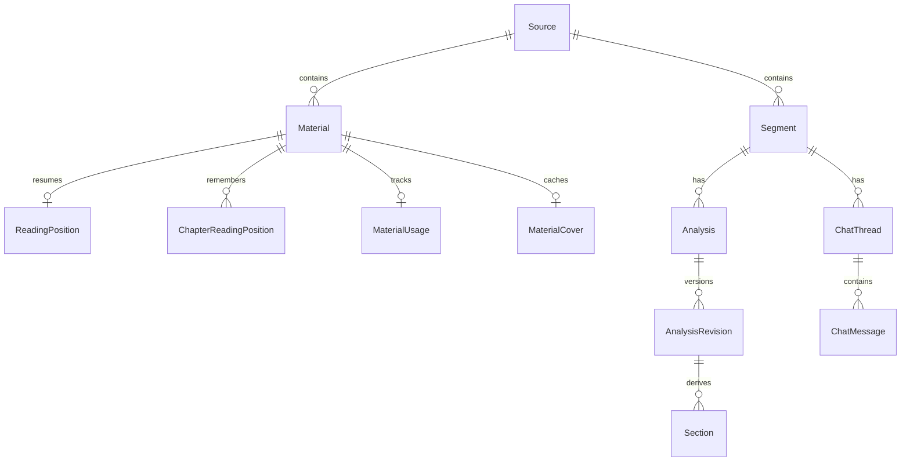

# 架构设计

> 草案 v0.3。本文维护模型、模块、执行机制与不变式，未来草图单独标明。配套文档：[PRD.md](PRD.md)、[TECH_STACK.md](TECH_STACK.md)、[GLOSSARY.md](GLOSSARY.md)。`[TBD-xx]` 编号与 PRD 一致。
> 当前交付状态与验收入口见 [MVP 实施基线](handovers/MVP_IMPLEMENTATION_BASELINE.md)；接口以代码、模板和生成 OpenAPI 为准。

## 1. 总览



分层规则：

- **路由层**只负责参数校验、调用服务层和序列化返回，不包含业务逻辑。
- **服务层**负责编排业务数据写入（Job worker 通过服务层写入）；服务／Job执行层负责持久记录每次经LLM层发起的调用及其Run。
- **LLM 层**是唯一允许发起模型请求的地方。适配器负责协议与流式输出；服务／Job执行层在调用前后持久记录Run并协调预算。当前SDK关闭自动重试（`max_retries=0`），本地开发缓存尚未实现。
- **规范化器**是纯函数，不访问数据库，也不访问网络。

## 2. 核心数据流

当前有两条内容路径：Source 下的 Material 承载 EPUB 阅读，Segment 承载片段讨论与讲解。材料中的选区学习和材料对话按 [PRD 4.7](PRD.md#47-当前-epub-阶段安排)接入。下图同时标出已有关系与未来的 Occurrence 路径。



讨论、成果保存和条目整理的产品路径见[PRD 6.3–6.5](PRD.md#63-形成并阅读讲解)。实现以Segment为共同归属：新建Analysis创建独立身份，编辑已有Analysis创建不可变Revision；Occurrence须定位目标原文并引用实际保存的Revision／Section，历史引用不漂移。当前Analysis已实现，Occurrence和可选提取尚未实现；用户直接整理不伪造Run。

删除范围及用户确认见[PRD F2](PRD.md#f2-source-与片段)。当前 Source／Material／Segment／Analysis 使用 deleted_at 逻辑删除，相关事务和迟到结果检查阻止内容重新可见；独立 Material 删除保留 Source、Segment 及其学习内容。Section 删除只在新修订中移除。Occurrence 关联删除与最终物理清理仍待其持久化契约落实。

## 3. 领域模型

当前模型覆盖 Source／Segment、设置与模型验证、讨论与 Analysis，以及材料、阅读位置、使用状态、封面缓存和独立翻译。来源与片段字段见[第一阶段契约](handovers/archived/STAGE_1_SOURCE_SEGMENT.md)，Analysis 执行见第 3.5 节，材料与目录见第 3.1 节，翻译见第 4.8 节。

设置按界面分组保存：`PATCH /api/settings` 接收完整的可选 profile 分组和字段可选的 defaults，仅校验、更新明确提交的字段；同次 profile 与 defaults 在一个事务提交，失败不部分写入。省略字段保留存量值，模型及预设身份显式 null 表示清除。既有 PUT 接口保留完整替换契约。验证历史按 Run 中保存的 Provider／登记模型身份及状态过滤后分页，不依赖配置仍然存在；只返回未软删的 verification Run。

Source、Material、Segment 使用 `deleted_at` 逻辑删除；删除来源在同一事务内标记所属片段，材料通过 Source 存活门禁变为不可见。独立材料删除保留 Material 身份墓碑并清理其托管副本及派生阅读数据，不改 Source、片段、讲解、讨论或片段任务；独立翻译任务按第 4.8 节撤销。接受问答、成功保存持久讲解或建立精确材料出处时，在对应短写事务中首次设置 `text_locked_at`；共同保护函数不提交事务、不递增片段记录 revision，也不重写已有锁定时间。原文编辑、来源／片段删除共用事务校验边界。

数据库生命周期由应用 lifespan 管理。`0001_schema_baseline` 以固定 Alembic DDL 从空库直接建立当前 28 张业务表及其字段、服务器默认值、外键、CHECK 和索引，包括材料软删除与活跃材料部分唯一索引、精确出处、语境设置及翻译表；版本脚本不导入运行时 ORM，也不调用自动建表。旧开发阶段的回填、批量重建及中间 revision 已移除，历史编号与当时的数据保护事实保留在阶段验收中。

迁移与应用读取同一配置的数据库路径，连接始终启用外键。迁移使用显式 `BEGIN IMMEDIATE` 与事务性 DDL，提交前执行全库 `foreign_key_check`；执行或校验失败会回滚 DDL、数据及版本记录。初始基线支持显式完整降级到 base，该操作删除全部应用表，包含自引用历史的降级回归已通过。`just dev`／`just start` 先执行迁移，不自动删库或修改版本标签。需保留日常数据或发布第一版后继续维护增量升级路径；旧开发库边界见[升级与备份](UPGRADING.md#当前迁移基线)，等价性及本机对齐证据见[迁移基线验收](handovers/archived/DATABASE_MIGRATION_ACCEPTANCE.md)。

### 3.1 实体

Source、Segment、Material、Analysis 等独立记录使用 ULID 身份；Profile／Defaults 为单例整数主键，全书阅读位置、使用状态与封面以 `material_id` 为主键，各章位置以 `material_id` + `chapter_id` 为主键。下表概述已实现实体及 Occurrence 的未来草图，字段以 ORM 和生成 DTO 为准。模型位于 `models.py`、`settings_models.py`、`chat_models.py`、`analysis_models.py` 、`material_models.py` 与 `segment_context_models.py`。

| 实体 | 关键字段／关系 | 说明 |
|---|---|---|
| 学习背景（`Profile`） | `native_language`、`explain_language`、`level_note` | 单用户学习背景 |
| 讲解预设（`Style`） | `name`、`body_md` | 命名预设，默认选择由 `Defaults.style_id` 维护 |
| `Defaults` | 三种用途的模型 ID、`style_id`、`permission_mode` | 新操作与新线程采用的默认设置 |
| `SegmentContextSettings` | enabled、两侧句数／字符上限、revision | 独立单例，版本条件保存；读取缺省不写库 |
| `SegmentMaterialProvenance` | segment_id、material_id、version_id、范围 payload、请求身份及请求依据 | 一对一精确出处与创建凭据，材料删除后保留 |
| `Source` | `title`、`note`、来源描述 | 用户声明的来源范围；未来可容纳不同形式的输入，不等于文件或 Collection |
| `Segment` | `source_id`、`text`、译文、语境、备注、听写、`source_ref`、`text_locked_at` | 学习目标原文入库做 NFC；`source_ref` 为自由文本出处，精确材料出处经独立关系保存；片段分词数据待后续接入 |
| `Material` | `source_id`、标题、源字节摘要、`version_id`、产物摘要、契约版本、原 EPUB 字节、压缩编译包 | 同 Source 同源字节复用身份；版本、正文与资源不可变，章节及 spine 资源在包内表达 |
| `MaterialCustomCover` | `material_id`、媒体类型、用户上传图片字节 | 持久展示覆盖，独立于可重建封面缓存；信息修订由 Material 的 `metadata_revision` 管理 |
| `ReadingPosition` | `material_id`、`revision`、位置与三项阅读设置的 `payload`、`updated_at` | 每材料最多一条，按条件版本更新；位置绑定具体版本、章、part 和资源 |
| `ChapterReadingPosition` | `material_id` + `chapter_id` 复合主键、位置 `payload`、`revision`、`updated_at` | 各章最后位置；revision 为该次材料位置写入的版本，与全书最后位置原子更新 |
| `MaterialUsage` | `material_id`、状态、独立 `revision`、`last_opened_at`、`last_action_id` | 每材料最多一条；未开始／进行中／已完成与最近打开独立于位置保存 |
| `MaterialCover` | `material_id`、媒体类型、图片字节、`rule_version`、诊断原因 | 每材料最多一条可重建缓存；`data=NULL` 表示无可用封面，版本 2 可重提旧缓存 |
| `Run` | `purpose`、`job_id`、实际 Provider／模型／协议／参数、消息、输出、用量、状态、时间 | 每次模型调用均记录；以用途和 Job 关联区分验证与讨论调用 |
| `Analysis` | `segment_id`、文档身份与展示元信息 | 一个 Segment 可有多份独立的完整或专题讲解；当前普通入口不自动选第一份，精确入口可指定文档／修订 |
| `AnalysisRevision` | `analysis_id`、`parent_revision_id?`、`origin`、`run_id?`、`source_md`、`normalizer_version`、`warnings` | 一经生成不可变；`source_md` 为文本真相，来源可追溯 |
| `Section` | `revision_id`、`uid`、`handle`、`kind`、`display_no`、`title`、行号、`raw` | 由规范化器派生，可从原 Markdown 重算 |
| `Occurrence`（未来） | `segment_id`、`revision_id`、`section_uids`、原文 `surface`／`spans`、`anchors`／`anchor_keys`、`gloss`、类型／标签／状态、创建来源 | 尚未建表；学习点引用具体 Revision／Section，生产字段契约待落实 |
| `ChatThread` | `segment_id`、选定模型、权限模式、`active_job_id`、`revision` | 各线程历史独立，空闲时可切换模型和权限；资料与写入目标由操作表达 |
| `ChatMessage` | `thread_id`、`job_id`、顺序、角色、状态、正文 | 消息归属线程和 Job，模型调用通过 Job 关联 |
| `Job` | `kind`、`status`、`input_snapshot`、`model_snapshot`、`execution_state`、`execution_token`、错误及时间 | 当前chat_jobs保存后台任务状态，一个Job可关联多个Run |

Occurrence整理行为见[PRD F5](PRD.md#f5-学习条目创建与整理)。存储契约保留pending／learning／reference及独立的软删除编码（待定），不得用dismissed混合忽略与删除。出处引用具体不可变修订，整理或再次调用不能迁移历史引用。创建来源、引用约束及删除保留策略仍须在实现前落实。

预留、不建表的实体：`ReviewItem`、`KnowledgeCluster`、`Lexeme`。`materials` 与 `reading_positions` 保存 EPUB 材料与全书阅读位置；原始字节、不可变编译包和版本身份由 Material 承载，资源与逻辑章节在版本包内表达，不为每个逻辑层单建表。发布、删除与恢复约束见本节；初次导入切片的设计及验收证据见[历史契约](handovers/archived/epub-reading/SLICE_1_DRAFT.md)与[EPUB 阶段入口](handovers/epub-reading/README.md)。

EPUB 已确定的不变式：原始素材字节不可变，材料归属 Source；处理版本保存规则、实际产物与摘要，版本内资源保留原始 spine 身份。引用绑定具体版本、资源、Unicode 码点半开范围及原文快照；正文全局 NFC，ruby 的 `rt`／`rp` 不参与偏移，布局与分词不影响身份。DOM 使用 UTF-16，适配器必须转换并核对正文，不能逐节点规范化后直接相加；不能校验的引用明确失败。材料文本投影与第 4.3 节 Analysis 规范化器分别执行各自契约，不改变后者的可复原保证。具体隔离试验、范围限制和证据见 [EPUB 阶段入口](handovers/epub-reading/README.md)；持久化、删除及权限不由试验自动定案。

目录解析与章节构建复用每资源叶子索引；少量实际请求的 NFC 边界按需计算并缓存，多边界时再建立来源索引。跨叶组合或重排序导致的无效章节边界继续拒绝。阅读章是版本内资源范围的呈现组织：优先采用书内目录标题与入口、按 spine 顺序连续呈现图文，不改变资源局部引用身份。阅读位置保存逻辑章和资源内锚点，百分比派生展示；布局变化允许近似恢复，精确引用仍须严格校验。原书 ruby 优先于分词生成注音，自动注音属于可重建显示层，不改核心正文。样书调查与早期分章设计保留在上述阶段文档，作为历史证据。

`POST /api/sources/{source_id}/materials` 接受 `application/epub+zip` 原始请求体，流式读入内存，上限 32 MiB；类型不符返回 415，超限返回 413，无效／不支持的 EPUB 返回 422。编译、压缩及完整分词生成移出事件循环，不占写事务。短写事务重新核对 Source 存活、按源字节 SHA-256 对活跃材料判重，将原始字节、压缩编译包、材料身份和首个分词资产原子发布；未提交的失败／取消由事务回滚，响应丢失后同字节重导可核实已有活跃材料。并发重复只发布一个活跃对象，响应的 `reused` 表达实际复用事实；同 Source 同字节保留活跃材料的用户编辑信息，跨 Source 保留独立材料与版本身份，不按标题／文件名判重。删除后显式重导创建新的 material_id 和 version_id，不恢复旧位置、展示信息或历史出处；迟到的旧材料操作仍受删除门禁约束。

前端提交后关闭导入弹窗，以当前标签页内存保存文件、来源与请求状态，站内导航不取消该请求；网格占位不是正式 Material。后端仍通过同步 HTTP 请求完成编译与完整分词并原子发布，不新增持久导入任务或 API／schema。成功后刷新目录与来源计数，当前筛选或页码未包含结果时保留临时可点击入口；失败允许同文件重试或移除提示。刷新或关闭页面后不承诺恢复该内存状态；响应丢失后的同字节重导沿用后端复用规则。

素材库、来源素材与来源概览共用导入任务投影。实际呈现的正式书卡 ID 用于隐藏重复入口；目录成功刷新且停止获取后，才消费相应成功记录。来源全部书籍窗口打开时，后方预览不消费成功反馈，避免当前筛选窗口的临时入口丢失；材料及来源删除的失效清理独立于该消费资格。

原 EPUB 与编译包均存 SQLite BLOB，避免文件和数据库的双提交；备份须遵循 WAL 一致性规则。编译不解包到磁盘，不读取远程资源或开放任意包成员路径；拒绝路径穿越、重复成员、加密／DRM 及不支持的固定版式。归档上限为 5000 项、总展开 128 MiB、单成员 16 MiB、展开比例 200，编译产物上限 64 MiB；构建时计入标题、属性、警告及 JSON 转义和结构，超限及时终止；安全预算失败不能降为可选资源警告。受支持的固定图片 spine 页仅保留图像并给出不恢复固定几何的警告。作者 HTML 经白名单清洗，脚本及活动节点不进入呈现包；CSS 仅展开包内 import，深度上限 8、展开预算 4 MiB。每个 part 使用无脚本同源 sandbox iframe，CSP 禁止脚本、连接和外部资源，仅允许受控 data 图片／字体与内联样式。

编译器先检查全部 ZIP 成员元数据及 DRM 声明，再读取成员；归档只打开一次、每个成员只读取一次。私有 `_Publication` 保存已校验文件、包文档、类型化资源、临时完整资源 HTML 与全书输出预算，供清洗及目录组章共享。完整资源 HTML 仅在编译期间用于目录解析和分片，不进入最终产物；清洗构建预算及完整资源与章节同时存在时的保守工作预算继续保留，最终 JSON 预算只计实际产物。

最终逻辑契约为 `epub-reading-v2`：`CompiledResource` 保留正文、正文摘要、样式、html/body 属性、资源身份与元数据，不含 `html`；`ChapterPart` 保留章节 HTML、资源／spine 身份、码点范围与定位叶子信息。正文、样式、章节 HTML 与定位语义保持原样，产物摘要按新模型及规则重新计算。章节切分会补齐祖先标签，不能通过直接拼接片段恢复原样完整资源 HTML；托管原 EPUB 继续保留。逻辑模型拒绝额外字段，旧资源 `html` 即使为空也会拒绝。

编译包的物理编码由 `epub_storage.encode/decode` 集中维护，只采用 `FJEPUB` 和版本字节 `2` 标识的图片池格式。其 zlib JSON 保存资源元数据和正文、空章节 HTML 骨架、章节片段及共享图片池，不含 `resource_html`；无图书籍使用空池，小图书籍也采用同一格式。章节片段中的相同图片 data URI 按原字符串共享，严格整数引用与普通文本片段分开，解码后完整还原章节原字符串，不转码图片、不改正文和位置。编码只进行一次 zlib 压缩。

存储 envelope 解压上限为 128 MiB，为片段结构开销留出有界空间；逻辑 JSON 编码与还原仍各限 64 MiB。解码检查格式版本、整条压缩流、章／part 数量、空骨架及引用类型／范围，先检查骨架逻辑大小，再累计全书 JSON 转义后的片段字节数，重复图片引用在拼接 HTML 前逐次计入预算。v1 图片池包、旧裸 zlib 包、无版本 JSON、未知版本及含冗余 `resource_html` 的 envelope 均拒绝，不设转换或回退。阅读、出处、翻译、片段和统计共用该 interface；章节 HTTP 响应本就不含完整资源 HTML，本次不改变该响应结构，注音资产沿用原格式。开发库重建与历史数据边界见[升级与备份](UPGRADING.md#epub-存储格式与开发库重建)，收益与验证范围见[存储验收](handovers/archived/EPUB_STORAGE_ACCEPTANCE.md)。

`DELETE /api/materials/{material_id}` 在短写事务中核对所属 Source 存活，设置 Material.deleted_at 并清理该材料的托管副本和派生阅读数据，成功返回 204。保留 id、source_id、title、源字节摘要、版本身份及创建／删除时间等出处依据；original_bytes 与 compiled_bundle 清为空 BLOB，warnings 清空，仅已删除材料允许缺少内容。活跃材料及其已发布内容仍保持不可变。删除该材料的全书／章节位置、使用状态、自动／自定义封面、分词当前指针与全部分词代次；先删指针后删代次，清理与删除标记同事务提交，失败全部回滚。重复删除补齐清理后仍返回 204，不存在或所属 Source 已删除返回 404。该操作不调用 Source／Segment 级联删除，不中断保留片段的任务。首版无恢复、移动或一并删除积累参数。

存储回收沿用 SQLite 的空页复用：清空 BLOB 和删除派生行后，释放的页可供后续写入使用，数据库文件不保证立即缩小。每次材料删除不执行全库 VACUUM，避免一次删除引入全库重建、额外磁盘需求及锁竞争；本轮不改变 auto_vacuum 设置。需要向操作系统立即归还空间时，另行设计低频维护入口。依据见 [SQLite auto_vacuum](https://www.sqlite.org/pragma.html#pragma_auto_vacuum) 与 [VACUUM](https://www.sqlite.org/lang_vacuum.html)。

材料读取、派生查询、封面及写入均核对 Material 与 Source 存活，耗时生成发布和统计缓存返回前再次核验，删除后返回 404。材料列表、目录总数、来源材料数和 Source 删除影响只计活跃材料；Source 删除仍使其余材料不可见并按原规则级联学习内容，其托管字节暂不物理清理，材料对话的删除影响留待其切片。前端成功删除后取消并清除旧材料查询，刷新目录和来源计数，迟到结果不回填可读正文。未来外置资源须另建可恢复发布协议，不改变既有内容保留语义。

阅读位置通过 `PUT /api/materials/{material_id}/reading-position` 使用材料级 `expected_revision` 条件写入，陈旧请求返回 409；版本、章节、part、资源及文字／图片范围不符返回 422，不可见材料返回 404。文字 offset 为资源局部码点，图片以 `image_id` 和 0–1 的局部比例恢复；spine 出现身份由 part 核验，不将图库 ordinal 当作位置身份。字号默认 20、范围 12–40，行距默认 1.8、范围 1–3，排版默认 `horizontal-tb`，另支持 `vertical-rl`，随位置保存。阅读恢复允许在同版本、同章尽力回到附近并明确降级；精确引用仍须严格核对范围与快照。布局和图片尺寸稳定前隔离中间滚动，避免恢复过程覆盖已有位置。

章节记忆由 `chapter_reading_positions` 保存；初始基线直接创建该表，早期从全书位置回填章节记忆的迁移事实见[历史验收](handovers/archived/epub-reading/CHAPTER_MEMORY_ACCEPTANCE.md)。位置 PUT 沿用材料级 CAS，同一事务更新全书最后位置和当前章；GET 材料按章序返回 `chapter_positions`，查询无写入副作用。

位置 JSON 中的 `at_chapter_end` 表示实际内容末端已进入当前稳定视口的可读区域，旧记录缺字段时默认为 false，无须数据库迁移。前端在全部 part 就绪、重排恢复完成后测量并缓存各 frame 非空白正文与图片的末端；排除零尺寸及 `visibility:hidden/collapse` 内容，并取文字／图片与祖先 `overflow:hidden/clip` 裁剪范围的可见交集；忽略作者／阅读器尾部留白和空白 part。滚动采样沿阅读轴比较全章内容末端和 `readingViewport` 的底边／左边（容差 1 CSS px），不要求到达物理滚动极限。一屏完整呈现的短章视为已到章末。锚点优先取包含阅读起始边缘的非空 frame；直接进入超长空白尾部时，从已滚过的非空 frame 获取可恢复锚点。

GET、PUT 与前端即时显示采用相同进度口径：章末标志为 true 时 `progress=1`，包括纯图片章；否则按有序 part 的正文码点跨度派生，比例上限为 0.99。文字锚点使用当前 part 内偏移；图片锚点使用该图前 locator 正文拼接、整体 NFC 后的码点数，图片内部的 `image_progress` 仍只用于恢复。前端从已验证的正文投影派生图片偏移，后端从不可变 part HTML 派生，无须修改编译包或图片锚点字段。正文跨度保留规范空白；未到末尾且章内没有非空白正文时返回 null。比例不表达累计已读，章末状态不改变材料阅读三态。

章末标志与原文字／图片锚点经同一 CAS 写入全书及当前章记录，回看时可清除。首次打开或新导航代次恢复有效的章末记录时，先核验并恢复原锚点，再补足让末端内容进入可读区域所需的滚动距离，不跳到无内容的尾部留白。`ReaderLayout` 在稳定呈现成功后消费该导航意图，失败或资源未就绪时保留。同章字号、方向、窗口及资源重排继续恢复原锚点，再采样当前章末状态。

前端位置队列在同一材料 revision 下串行写入，只合并同章待写值；更新待写章时将其移至末尾，兼顾各章记忆与全书最后位置的时间顺序。成功呈现位置与等待恢复的目标分别维护，切章或卸载不保存尚未呈现的目标。缓存同时合并全书位置和对应章记录，章节恢复沿用当前阅读设置。

无记录章与显式回章首在当前代次资源就绪后将阅读容器归零，再采样实际锚点，保留开头插图；该意图在呈现后清除或由新导航替换。重复回章首以稳定视口的阅读轴偏移判断，避免前导空白造成锚点差异而覆盖返回点。首图前空白按横竖排方向归入首图位置，前置非空白正文阻止此回退。

底部相邻切章与目录共用 `ReaderNavigation` 的章节顺序、记忆位置选择及目标校验，沿用返回点和串行位置保存链路。工具栏切章保留面板，目录来源只关闭左侧；返回入口沿用原关闭行为。导航 module 管理请求与呈现期间的切章锁，只有对应 surface 稳定呈现才正常解锁，旧章重排不能结束正在请求的切章；取消、失败和替代导航释放对应锁。位置保存错误独立于呈现错误，不阻断仍可阅读章节的相邻导航；执行与测试安排见[全量注音与分词资产](#313-全量注音与分词资产)。

工具审核需持久记录所属线程、目标及基础版本、具体拟执行操作、用户决定／附加指令与执行结果。当前Analysis工具把具体方案、决定与执行事实保存在Job.execution_state中，状态包含waiting_review；Occurrence及复杂组合方案仍待设计。待审核方案与正式 AnalysisRevision／Occurrence 分开，批准后仍可能执行失败，二者不能混为一条成功记录。

### 3.1.1 目录与材料使用状态

材料使用状态以 material_id 关联，保存可空 last_opened_at、not_started／in_progress／completed 及独立 revision，不变更 Material 版本或 ReadingPosition revision。`GET /api/materials/{material_id}/usage` 无记录时返回未开始、revision=0、打开时间为空，不创建记录。`POST .../opened` 仅在新进入成功呈现目标章后执行，更新真实打开时间，未开始转进行中，已完成保持完成；`PUT .../usage` 只改用户指定状态，保留位置与打开时间。GET、预取、refetch、换章和设置变化不记新打开。

两类状态写入均在短事务内核对 `expected_revision`；opened 的 `action_id` 为 1–100 字符，以 `last_action_id` 对最近一次动作有限去重，同动作重试先于版本检查返回真实当前状态，其余陈旧请求返回 409。客户端冲突后读取真实状态，不循环盲重试；状态失败不破坏位置队列，缓存更新不重挂载阅读器。

目录由服务端先完整筛选、排序再分页，返回 items、真实 total 和分页参数；page 默认 1，page_size 默认 50、范围 1–100，非法参数返回 422。`q` 默认空，按普通文字匹配并转义 LIKE 通配符；标题比较使用 SQLite BINARY 码点序，不承诺自然卷序或拼音序。同值按 ID 升序排列，最近打开的空值在两个方向均置后。

| GET 路径（省略 `/api`） | 筛选与搜索范围 | 排序白名单与默认值 |
|---|---|---|
| `/materials` | type 固定 book，可选 source_id、status；q 匹配材料／Source 标题 | title／created_at／last_opened_at；默认 title 升序 |
| `/catalog/sources` | q 匹配 Source 标题 | title／created_at／updated_at；默认 title 升序 |
| `/sources/{source_id}/catalog/segments` | q 匹配原文／自由文本出处 | created_at／updated_at；默认 created_at 降序 |
| `/sources/{source_id}/catalog/analyses` | q 匹配讲解标题／摘录 | title／created_at／updated_at；默认 title 升序 |

Source 目录提供材料、未删除片段与讲解的真实计数，概览仅取有界预览。讲解聚合仅关联未删除 Segment，携带所属片段、确切当前修订和最多 160 码点原文短摘，避免前端 N+1；书籍目录平铺 usage 字段。旧列表接口保留原响应形状。查询、封面和写入检查完整 Source 可见性链，不可见来源或材料返回 404。

封面规则版本 `2` 优先采用有效的 EPUB3 cover-image／EPUB2 meta name=cover 声明，再按 spine 中 XHTML `img`／SVG `image` 的包内引用、manifest 图像顺序回退首张可用静态 PNG／JPEG；重复候选只尝试一次，不依赖 ZIP 物理排列。引用必须属于 manifest，SVG image 仅提供静态图片引用。坏候选继续，全局归档安全失败整体拒绝，不请求远程图片。图片限制为 4 MiB、1600 万像素；APNG、GIF、WebP、SVG 不作为有效封面候选，无可用候选时使用占位。标准库校验 PNG 结构／CRC 和 JPEG marker、有效帧／扫描组件及非空熵数据，要求 EOI，允许 EOI 后最多 1024 字节；这不是完整像素解码，浏览器加载失败仍占位。

`GET /api/materials/{material_id}/details` 从不可变编译包读取原书标题与章节数，并返回当前展示信息，不记录阅读打开或触发注音准备。`PATCH .../metadata` 使用独立 `metadata_revision`（初值 0）与非负整数 `expected_revision` 条件写入，书名去两端空白并 NFC 后须为 1–300 字符；`cover_action` 为 keep／replace／reset，默认 keep，仅 replace 要求且允许图片。图片须为严格 base64 的静态 PNG／JPEG，解码后不超过 4 MiB、1600 万像素，格式与大小错误返回 422。

每次合法保存均在短写事务内原子更新书名、自定义封面和信息修订，陈旧提交返回 409，不可见材料返回 404。`material_custom_covers` 保存用户覆盖，封面读取优先覆盖，reset 只清除覆盖并回到自动提取／占位规则；自动缓存升级不覆盖用户图片。目录与详情封面 URL 包含信息修订，避免沿用旧图片或失败状态。编辑保留 source_id、原始字节、摘要、材料与版本身份、编译包、位置、使用状态、历史注音代次及 Source 标题；同字节重导保留用户信息。移动与删除当前只有禁用入口，实施及验证事实见[书籍管理验收](handovers/archived/book-management/ACCEPTANCE.md)。

首次封面读取在线程中提取并缓存成功／失败，资源 URL 带 `?v=2&revision=<metadata_revision>`；服务端按自身规则判断缓存版本，客户端不能切换提取规则。旧成功／失败缓存均懒重建，仅已确认的当前规则失败使目录 URL 为空；发布缓存前重验 Source 存活及缓存版本，并保持自定义覆盖优先。缓存保存候选来源 declared／spine／manifest、去重的跳过原因，全部失败保留 no_images、资源／路径／格式、unsafe_archive 或 invalid_package 诊断。封面无可用内容返回 404，响应使用 no-store 与 nosniff。前端失败状态绑定材料及具体 URL，URL 更新或用户重试可重新加载。缓存保持原始字节、编译包和版本不变，目录不逐书解压；回退与旧缓存恢复证据见[素材库验收](handovers/archived/library-a1/ACCEPTANCE.md)。

`material_usage` 与 `material_covers` 分别保存使用状态与封面缓存，缓存含规则版本和诊断。早期使用状态回填与缓存升级事实见[历史验收](handovers/archived/frontend-refresh/ACCEPTANCE.md)。Query key 包含全部条件；导入、状态、Source 和 Analysis 变更刷新受影响目录及计数，旧请求不污染新条件，失效页码回有效页。DTO 由 [OpenAPI](../backend/openapi.json)生成，业务位于 services，本节维护长期查询与写入约束。

### 3.1.2 阅读器 R1.1 呈现与只读派生查询

前端 `materials/ReaderSessionHost.tsx` 从真实 location 识别当前材料，保留最近一个阅读会话，并在片段页暂停该会话。纯 `navigation/retained-session` 策略负责身份替换、恢复代次和暂离十分钟的租期，过期检查同时覆盖定时淘汰和直接返回。打开其他材料替换旧实例，离开适用路由释放。缓存只存在当前标签页内存，不持久化书籍正文，也不增加依赖。

宿主将稳定的 `{ materialId, location }` entry 显式传给 `MaterialReaderSession`；`MaterialOpening` 消费入口 location，Reader 接收已校验的 `returnTo`。`MaterialReader` 仅为独立路由挂载保留薄适配，导航由真实 Data Router 处理，宿主不构造嵌套 `Routes` 或冻结 Router context。`navigation/view-activity.tsx` 提供 `ViewActivityProvider` 与 `useViewActivity`，统一传递 active／activation 生命周期；接入视图据此停止隐藏期间的输入、布局及查询副作用，最终卸载仍执行资源清理。保留状态不替代 TanStack Query 的服务端数据缓存。

Reader 暂停时保留 iframe 与正文投影，停用输入、重排与位置采样，完成离开前稳定锚点的串行写入。恢复协调先等待写入队列，再读取材料与片段出处并核验注音代次；同身份复用现有 DOM，版本、代次或外部位置修订变化时安全重建，失效不展示旧正文。返回刷新当前学习标记、译文及相关资料，有 `segment` 参数时通过既有精确校验与导航定位原文，不通过更改 React key 重建整页。真正淘汰才清理 frames 与监听；读取失败和重试保留目标。

阅读页在现有 `presented` 稳定呈现信号后执行 240ms 轻淡入，标题独立上移 8px；正文视口和 iframe 不做动画位移，保留定位及浮卡坐标。书卡按压反馈独立保留，进入阅读器使用普通导航，不捕获加载页快照或延长数据加载。书籍与章节的加载文案延后 150ms 显示，就绪即移除；错误与返回入口即时可用。减少动态效果时关闭入场动画，保留加载提示防闪延迟。保留会话再次显示时可重播轻入场，租期与恢复核验不变。

搜索与图库按不可变编译包派生，不新增领域实体、持久索引或数据库表，不改变原字节、正文、版本及产物摘要。DTO 见 [OpenAPI](../backend/openapi.json)；浏览器兼容与历史成本观测见[阅读器验收](handovers/archived/reader-r1/ACCEPTANCE.md)和[历史 API 记录](handovers/archived/reader-r1/API.md#本机只读查询成本记录)。服务层在线程中执行解压、扫描、HTML 解析与图片解码；当前无派生缓存，每次非空搜索／图库请求仍解析有界全书包。每个请求核验 Material、所属 Source 和必填 version_id；缺失／不可见返回 404、查询版本不符返回 409、参数错误返回 422，不改变位置写入的版本／范围错误 422 契约。

`GET /api/materials/{material_id}/search` 的 q 默认空、输入至多 160 码点，服务去两端空白并 NFC；空白查询返回空页且不解压扫描。搜索与 `GET .../illustrations` 共用 offset 默认 0 且非负、limit 默认 40 且范围 1–100。搜索按章节／part／spine 顺序扫描资源局部正文，排除 rt／rp 与 UI 标题；重复和重叠字面命中均保留。同资源同 spine 的连续 part 可衔接，不跨章、资源或 spine 出现拼接；命中归 start 所在 part，保留资源码点半开范围与前后各至多 40 码点摘录，不能把 start 当作摘录偏移或 UTF-16 索引。分页只保留请求页并统计完整范围，不构造全量命中数组。

`GET .../illustrations/locate` 按 version、chapter、part 和 image_id 一次扫描得到精确出现项及总数；版本或材料失效仍分别返回 409 或 404。图库按已清洗 part HTML 顺序保留每个有效图片出现项，包括重复图与纯图片章。ordinal 为版本内从零开始的清单序号，不能跨版本引用；导航仍核对 chapter／part／resource／image_id。清单保留原始 alt、不虚构宽高、不携带全图 base64；`GET .../illustrations/{ordinal}/content` 仅按需读取包内带 data-epub-image 的 PNG／JPEG／GIF／WebP，不接受任意路径、ZIP 成员或远程 URL，不提供 SVG。编码与字节受 64 MiB 编译预算约束；编码超限返回 413，解码、MIME 签名或字节校验失败返回 422，出现项不存在返回 404。签名核对不保证浏览器完整解码成功。响应 MIME 与识别类型一致，带 nosniff 和 private, no-store；封面的 4 MiB 专用预算不套用正文图片。GET 均不写 Run、usage 或 reading_positions。

Reader 使用独立外壳与专属 token，保留每 part 的无脚本同源 sandbox iframe 和正文投影。父应用绑定并注销有效 frame 事件；跨 frame 指针坐标转换到阅读视口。工具临时可见性与专注偏好独立，面板与图片查看器阻止静置隐藏；阅读工具面板非模态，不设置正文 inert 或圈定焦点。工具切换递增导航票据，旧定位不能覆盖新意图；目录／搜索同一面板保留查询状态，工具栏只留一个导航入口，两种页签状态均按同一工具开关。左右面板分别持有状态；同侧切换及各侧关闭互不清除另一侧的查询／图库状态，导航完成仅关闭发起侧。正文视口延伸至底部，侧栏底部留12px并采用完整圆角；导航书名／阅读信息／页签为固定区域，内容有独立滚动容器。窄屏保留两侧状态，将被覆盖的一侧暂时移出交互与可访问树；浮动工具栏按内容宽度覆盖，章内进度在工具栏内部，工具栏外区域不阻断正文／面板交互。主题／ruby 原地呈现；几何设置沿用稳定锚点、有效代次恢复与串行 revision 写队列。搜索高亮使用 DOM Range 与 CSS Highlight，不改定位叶子；重复 spine 按实际出现位置核验，跨 part 范围按其资源局部映射处理。

图片查看器由正文与图库共用，独立于工具面板尺寸和图库滚动。查看器保存入口来源与当前图片出现项，正文入口不隐式打开图库；关闭后正文位置及原有工具状态保留，图库入口关闭后回到原图库页和滚动位置。查看器使用模态覆盖层，背景虚化、压暗并暂停交互，焦点留在查看器内；关闭后恢复入口焦点。缩放与拖动只改变查看器内图像几何，切图重置为适合窗口；“在图库中查看”按当前 ordinal 切到对应有界页并突出出现项，不导航正文。复制图片通过浏览器剪贴板写入图片表示，下载从可信正文源或受控 content URL 读取原图并保留 MIME 与文件格式；这些操作不改编译包或位置。正文点击直接使用从不可变章节 HTML 绑定的可信图片源显示，后台定位完成后启用序号、切图和图库定位；定位失败保留当前图片并允许重试。frame 有效性和原始节点映射隔离扩展注入及后续 DOM 属性改写。跨 iframe Escape 优先关闭查看器；选图、翻页、关闭或材料切换均隔离迟到的初始定位与图片操作结果。

图片缓存由 Reader 会话持有，保存最多 400 个出现项、32 MiB 原图 Blob 和按字符串长度保守计费最多 16 MiB 的可信正文源关联；超预算原图可查看但不驻留；超关联预算的正文源不缓存关联，图库按需读取。解码像素与在途请求不计入缓存预算。已关联的正文源与通过精确定位核验的图库 URL 共用字节，复制、下载及缩略图复用；同图多次出现仍保留各自位置。并发同图请求共享，取消一个等待者不取消其他等待者；会话释放时撤销对象 URL、清除缓存。返回保留会话先核验材料可见性与版本。

TanStack Query key 包含材料／版本／查询／分页，输入法组合期间不发中间查询；新输入立即隔离旧结果，约 200ms 后请求。面板卸载和材料切换取消可取消请求，迟到响应仅归属原查询缓存，不重新打开面板。图库仅显示当前有界页，正文图点击按确切章节／part／image_id 解析当前版本内的图片出现项；查看器与图库使用相同身份及受控内容接口。浏览不写正文位置，明确前往才进入共享原点及正常保存链路。新增 UI 偏好经枚举／范围校验后保存在浏览器，不混入严格位置 DTO。跨书键 `folio-reader-ui-v1` 保存 theme（system／white／black，默认 system）、focus（默认 true）及工具栏不透明度；旧 soft 主题映射 white。逐材料版本键 `folio-reader-book-ui-v1:<编码 material_id>:<编码 version_id>` 保存 font（mincho／gothic，默认 mincho）、ruby（show／on-demand／hide，默认 show）、rubyScope（original／all，默认 original）与 width（有限数值 560–1040，默认 760）。损坏值逐字段回默认，Storage 不可用或写失败时内存继续可读，不承诺跨设备同步。

`toolbarOpacity` 为跨书浏览器偏好，范围 0–100，默认 80；有效新值优先，缺失或无效时将有效旧 `toolbarTransparency` 按 `100 − 旧值` 迁移，两者均无效时回默认。Reader 通过 CSS 变量设置背景 alpha，标题栏与工具栏共用随主题变化的背景色及 backdrop blur；文字和图标不使用整体 opacity。该偏好只更新外壳呈现，不触发正文重排或位置写入。

横排滚动容器从屏幕顶部延伸到底部，上 padding 为桌面 82px／窄屏 78px，下 padding 为 80px 加安全区；首尾留白随正文滚动，标题栏背景模糊为 3px。`viewport.ts` 的 `readingViewport` 按实际 padding 返回无遮挡阅读边缘与尺寸，供锚点采样／恢复、图片尺寸和翻页步长共用；布局恢复仍按物理 client size 判断稳定。竖排使用零 padding，并以相同上下间距限定容器，保证每列可读。位置仍保存正文码点或图片锚点，留白不进入定位正文与章内比例。

`scroll.ts` 计算正文外留白的滚轮转发与竖排轴映射，按行高或阅读视口归一化 line／page 单位；其他正文手势沿用原生滚动。父页面以非被动监听只接管外壳／正文容器自身事件，iframe 单独绑定并核验原始节点边界，不接管工具面板。记录主动输入后再阻止已转发事件的默认动作。平滑只用于键盘主动滚动，逐次读取减少动态效果偏好；滚轮转发与位置恢复保持即时，未给容器设置全局 CSS 平滑。

### 3.1.3 全量注音与分词资产

`nlp/tokenization.py` 使用 SudachiPy、core 词典和 A 粒度，按标点／换行起始分块并对长输入设 UTF-8 字节预算，一个完整生成操作复用分词器。generate 接收 `nlp/contracts.py` 的有序 TextResource，不依赖 EPUB 或 API DTO。分块与结果位置严格核对资源原文；输出保存表层、资源码点范围、整词读音、词典形、规范形、六项词性及未登录词标记。兼容字符改写可能产生零宽 token，其元数据保留，显示层跳过。Sentence 不作为持久内容实体。

`material_readings_generations` 与 `material_readings_current` 保存分词资产。每个不可变代次保存材料／版本、配置、结果摘要、token 数与压缩 JSON；当前表保存材料到代次的指针。配置包含分析器、词典、模式、分句／分块及结果格式版本，资源结果包含正文摘要。新书完整生成后才将材料与资产同事务发布；已有材料经显式 POST 准备或重建。生成在工作线程中完成，不持有写事务，不产生 Run。

`services/readings.py` 在发布事务内重验 Source 可见性和材料版本，以观察到的当前代次阻止迟到生成覆盖新结果，按完整结果与配置摘要复用相同代次。失败保留旧资产与指针。GET 按章节／part 过滤资源 token，可指定 `generation_id` 读取本阅读会话的确切代次；代次必须属于所请求材料与版本。普通准备复用当前结果，词典升级不在打开时静默重算；后端保留显式重建 API，阅读设置不提供重建入口，当前会话固定使用准备时返回的代次。

前端准备成功才挂载 Reader，查询键包含材料、版本、章节和代次。`ruby.ts` 一次构建规范正文码点到原 DOM UTF-16 边界的映射，保守装饰单个 Text 内的可用汉字读音；与原书 ruby 完整范围有交集、跨格式／part 或无法核验的候选跳过。词首、词尾连续假名与读音对应且剥离后仍有读音时，从注音范围去除；不匹配的边缘保留，读音被耗尽时回退整词，词内假名不拆分。`rubyLabel` 返回相对 token 的码点起点，装饰范围与整词核验范围分别映射到原 DOM UTF-16 边界；裁剪不能绕过原书 ruby、跨节点或原文失配检查。包装后重新建立 Text 投影，排除 rt／rp；复制只保留正文，搜索高亮按正文 Text 分段，不把读音纳入范围。

原书／全量与展示／按需／隐藏分别保存为逐材料版本偏好，旧淡化值迁为展示。设置变化保留 section、iframe 身份及 srcDoc，`useLayoutEffect` 原地更新排版、投影与几何并在绘制前恢复锚点；自动 ruby 首次装饰后保留，原书范围通过局部 CSS 折回普通正文几何。新增节点显式登记到阅读器事件边界，不把扩展后插节点一并放行。显示方式用透明度保持几何；按需支持悬浮、轻点、选区和正文 R 键。

全量数据未成功时先保留现有偏好与正文，请求完成后才应用。`preference-submission.ts` 的 `ReaderPreferenceSubmission` 集中资源等待、意图失效、有效提交、几何变化分类与存储结果；页面在 layout effect 绑定最新章节与 QueryClient／显示适配，卸载时使旧请求失效。新的偏好意图、章节切换与恢复默认都隔离旧成功和旧失败；再次挂载不会恢复旧请求的提交资格。独立布局修订确保每次恢复失效都有对应布局提交，重复恢复默认不会卡住位置保存；ResizeObserver 依实际正文就绪条件绑定，覆盖正文先到、注音后到的挂载路径。章节导航仍建立新 surface，按代次隔离旧任务。

纯显示方式、主题与原书范围下迟到的读音数据只更新呈现，不触发 iframe 尺寸探测。`reader-layout.ts` 的 `ReaderLayout` 集中稳定锚点、延迟保存、布局票据、几何判定与资源就绪集合；页面提供 DOM 测量和定位适配。几何提交仍在 `useLayoutEffect` 内同步执行：需要布局时先通过 `stabilize` 收尾旧行内动画，再替换 surface、采样并保留锚点、取消延迟保存和进入恢复状态，随后更新排版／尺寸；纯配色跳过该准备步骤，普通行内动画的 `reflow` 不调用它。DOM 恢复流程完成并通过票据校验后才执行返回点处理并开放采样。新 surface 即使几何参数相同也使旧采样许可失效。首次字体与图片全部就绪后只执行一次受当前 surface 校验的恢复，重复或过期就绪通知不重测。这样避免临时 1px 测量把滚动压回章首后，再被误保存为新的阅读位置。

`reader-navigation.ts` 的 `ReaderNavigation` 集中目录、搜索、图库、章首、相邻章和返回的导航意图、目标校验、章节记忆选择、临时原点及切章锁。页面绑定当前设置、章节读取和 DOM 呈现 adapter，读取同一状态快照；每次导航只调用一次章节加载入口，继续沿用现有 QueryClient 与缓存键。请求身份和已接受的 surface 身份分别管理：新章取回前旧章仍可正常呈现和保存，旧完成不能解除新请求锁；工具切换使旧请求失效，正常导航只关闭发起侧。不可用状态解除忙碌锁并继续禁用相邻操作，保留原呈现回调供重试。卸载使旧请求与完成永久失效，重新绑定取得新资格；相同快照不重复通知页面。

`MaterialReader.tsx` 保留 DOM 代次、测量与定位，用一次呈现回执连接导航 module 和 `ReaderLayout`。恢复开始时捕获回执，布局及资源校验完成后才执行其完成回调；导航 module 再核对 surface、目标内容身份和原点修订，只有实际返回定位成功才消费原点，失败保留并提示重试。文字矩形在增加正文留白前检查原始几何，零尺寸或非有限矩形不冒充定位成功。新回归直接测试生产导航 interface，原有布局、位置队列与阅读检测测试保留。导航深化的证据见[本轮验收](handovers/archived/READER_NAVIGATION_REFACTOR_ACCEPTANCE.md)，全量注音的原始验收及兼容限制见[全量注音验收](handovers/archived/full-ruby/ACCEPTANCE.md)。

`return-origin.ts` 的 `JumpReadingSession` 管理连续查阅与继续阅读的边界，阈值集中在 `JUMP_READING_POLICY`。页面将正文 wheel／阅读键／触摸移动及滚动条操作关联到稳定视口采样，横竖排统一为正向阅读轴；每次输入仅允许后续 800ms 内的位移计入，净前进至少一视口且首末移动跨越 5 秒后确认继续阅读。移动间隔超过两分钟重建候选，页面失焦／隐藏、工具开关及几何恢复丢弃未确认信号与旧几何基准。确认不清空原返回点，下一次通过目标校验的导航才替换为当时的稳定位置并重置检测；失败请求保留信号。章首显式撤销与返回定位成功后消费原点的规则沿用原逻辑。

### 3.1.4 文本分析与统计契约

B1 已建立 `nlp/contracts.py` 的词法契约、`nlp/assets.py` 的完整资产解码与 `services/epub_readings.py` 的格式适配。解码预算按输入正文规模集中计算，检查压缩流完整性、资源顺序／身份／摘要、原文范围和六项词性，保留合法零跨度。旧阅读 DTO 以原类名重导出，API wire format 未变；完整资产解码无需 chapter。B2 的纯计算位于 `nlp/statistics.py`，资源读取位于 `services/statistics.py`，API 包装在 `statistics_schemas.py`。

2026-10-20 在 S0 确认，按 B1／B2 实施；交付状态见[实施基线](handovers/MVP_IMPLEMENTATION_BASELINE.md)。词法分析接收有序文本资源，每项仅含 `resource_id`、NFC `text` 与 `text_sha256`，不依赖 EPUB 呈现类型。EPUB adapter 负责转换；原始资源顺序与重复 spine 条目、token 字段、配置和资产摘要语义保持兼容。内部词法契约与阅读 API DTO 分开，完整资产解码独立于 chapter；章节投影留在 EPUB 适配。现有构建／发布与代次门禁继续生效。

统计纯函数消费正文资源和确切代次的完整词法结果。规则 v1 按 resource_id 去重，同 ID 要求正文摘要和分析结果一致；不同 ID 即使文本相同也分别计入。过滤零跨度、空白表层及词性首项为 `空白`／`記号`／`補助記号` 的记录，保留助词、助动词、数字和 OOV；词典形缺失、空白或 `*` 时回退 surface，不用表层读音作归并键，不修改原资产。令有效词次为 N、词种为 V、频次为 1 的词种为 H，单次词种比例为 H/V；空分母返回 null。

覆盖率按频次降序、同频词典形稳定排序，前 k 种的累计词次除以 N；80%／90%／95% 取完整序列上的最小 k。曲线最多 512 点，保留起点、终点及三个阈值点；空序列没有曲线。字符数按定位正文的 Unicode 码点计，含空白与标点；汉字按 Unicode 名称前缀 `CJK UNIFIED IDEOGRAPH-`／`CJK COMPATIBILITY IDEOGRAPH-` 计，记录 Unicode 数据版本，计算不同汉字数与单次汉字数。这里不做 NFKC，也不计入々、〇或兼容符号展开后的汉字。

GET `/api/materials/{material_id}/statistics` 接受明确的 version_id 和可选 generation_id。返回正文统计、可空词法统计、范围／规则版本和确切代次；无当前代次时正文统计可用，不隐式准备分词。显式代次必须属于材料与版本，缺失为 404；材料版本冲突为 409。正文缓存依赖版本、正文摘要、范围和字符规则；词法缓存另依赖代次及词法规则。标题、封面、usage、阅读位置不参与键。

统计按需在线程中计算，解压／扫描不阻塞事件循环、不占写事务或聊天 Job 名额。缓存和并发均有集中上限，相同键合并计算，重启可重建；不新增数据库表。缓存读取和耗时计算返回前检查 Source／Material 可见性，响应始终保留实际输入身份，代次切换不得混合两批结果。统计错误或等待不阻断详情与阅读，GET 不写 Run、usage 或位置。前端经独立 TanStack Query 读取汇总，用现有 SVG 展示，不下载全书 token。

`StatisticsRuntime` 由每次应用 lifespan 创建，保存冻结结果的 JSON bytes，LRU 默认上限 128 条／8 MiB，计算并发 2、在途含等待任务最多 16；超大单结果返回但不缓存，失败不缓存。请求取消不取消同键共享计算；关闭时排空实际线程再释放数据库。每次读取及完成后使用新短会话核验可见性，缓存不能绕过 Source 删除。缺省代次在请求开始固定，途中切换仍返回原代次身份，下次读取采用新指针。

前端 `catalog/BookStatistics.tsx` 在详情信息后独立加载；查询键包含材料、版本和可选代次，与目录／元信息查询分离。重新进入或显式刷新读取当前结果，普通信息编辑不重新请求统计。加载、失败、无代次与零词次分别显示，错误不继续展示缓存中的旧正文；说明区呈现实际分词配置和规则版本。纯逻辑测试、缓存竞争和浏览器证据见[B2 验收](handovers/archived/text-study/B2_ACCEPTANCE.md)。

### 3.2 关系

下图为已实现实体关系。Occurrence 未来关联 Segment 和具体 AnalysisRevision／Section，契约见上表与第 4.4–4.5 节。



### 3.3 三个版本号

以下为版本追溯规则；prompt与normalizer版本已记录到当前调用／产物，extraction_schema_version留待提取实现：

- `prompt_version`：每个 prompt 模板文件头部声明，渲染时写入 Run。
- `normalizer_version`：规范化器的规则一旦变化就递增。**格式契约 prompt 与规范化器是一对**，修改其中一方时必须检查另一方。
- `extraction_schema_version`：提取 schema 或 anchor 规则 `[TBD-03]` 变化时递增。

### 3.4 2B 问答历史基线

[2B实施契约](handovers/archived/STAGE_2B_ASYNC_QA.md)固定本阶段的实体字段、API、状态机和验收矩阵；实现位于`chat_models.py`、`chat_schemas.py`、`services/chat.py`、`services/context.py`及`jobs/runtime.py`；API类型已从OpenAPI生成，相关表纳入当前初始基线。以上实体表仍是完整MVP草图，2B已落实下列边界：

- ChatThread归属Segment，ChatMessage归属线程和Job；同线程只有一个活动Job，数据库唯一约束与active_job_id共同维护。创建线程不锁原文，接受问答在同一短写事务内保存不可变输入／模型快照、用户消息、助手占位及Job，并首次设置text_locked_at。
- 接受请求以线程内request_id幂等，原样重放返回原身份，异payload或并发新轮冲突；Segment用户编辑revision和Thread.revision用于拒绝陈旧提交。片段编辑、来源／片段删除必须同步参与事务保护，不能只修改新入口。
- Job在接受时存在，Run在实际调用前创建；新增Run.purpose区分verification与chat，旧数据为verification。chat不进入模型验证历史／能力汇总，删除学习内容后也不能通过Run详情重见原文。
- 2B实际输入为现有Source／Segment、学习背景、适用预设、本轮问题及本线程成功的完整历史；管理备注不自动发送，失败／中断残文保留展示但不自动拼入后续请求。messages接受时渲染并保存，worker不读取新的默认值、资料或模板替换输入。持久讲解的确切版本读取已由2C工具落实，见第3.5节。
- 2B交付时没有成果工具、审核等待或修复循环，单Job一次生成且60秒调用预算；这是历史切片边界。当前2C已增加工具循环、生成分支和具体操作审核，预算见第3.5节。TBD-16的Analysis执行部分已落实，Occurrence部分仍未实现；TBD-17继续保持未决。

### 3.5 2C Analysis 与工具执行实现

`analysis_models.py`、`analysis_schemas.py`、`services/analyses.py`和`services/normalizer.py`实现持久Analysis、不可变Revision和派生Section，相关表纳入当前初始基线。Analysis.current_revision_id指向最新版本，编辑以基础修订校验并创建新版本；未修改块保留uid和原文。创建／编辑的操作身份与payload共同保证幂等，不能跨Segment重用操作身份。

`jobs/agent.py`执行主对话工具循环与内部写作分支。Job.execution_state持久保存实际协议历史、预算、成果和具体待审方案，一个Job可关联多个Run；Run结束、成果保存和Job完成分别判断。`waiting_review`仍占用线程活动任务身份，批准或拒绝须绑定方案版本；拒绝可附加指令，批准不把附加指令悄悄写进已展示方案。重启中断执行中的任务，待审核方案可重新打开；已保存的成果始终保留。

当前预算常量集中在`jobs/agent.py`：最多8次模型调用，单次调用上限180秒，累计计时上限600秒，输出和上下文各200000字符。累计值通过`execution_state.model_seconds`持久保存各次`_invoke`的实际耗时（包含其内部授权核对／入口等待），不是整个Job的墙钟时长；人工审核等待和外部工具处理不计入。下一次调用时限取180秒与剩余累计时间的较小值。分支与主循环共享计数和全局并发名额，不在审核恢复时重置预算。停止撤销执行标识，后续调用和保存均再核对持久状态；已进入的模型调用仅尽力取消，不能保证远端不再计费。

消息历史默认保留正向 `after_ordinal` 分页；`direction=backward` 配合可选 `before_ordinal` 从最近消息向前读取，页内始终按 ordinal 升序。助手消息附带 `job_summary`，仅包含成果引用、错误与失败重试输入；页查询投影所需 JSON 字段，不载入完整调用历史。前端首屏取最近50条，再由用户按需加载更早消息。

公开接口包括片段Analysis列表、指定Analysis／Revision读取、删除影响与用户删除，以及Job的具体审核决定。AI生成与Section写入经Job执行及工具审核；用户人工创建与全文修订使用第5节的业务接口，不启动Job或工具审核。实际字段以生成的OpenAPI和版本化工具模板为准；Occurrence尚未实现，见[2C验收记录](handovers/archived/STAGE_2C_ANALYSIS_TOOLS.md)。

## 4. 模块设计

2A 已落地设置与模型验证：`settings_models.py`／`settings_schemas.py`、`services/settings.py` 与 `llm/adapters.py`；配置保存在SQLite，凭据使用数据库旁 `<数据库文件名>.secrets/` 的独立文件（0700目录／0600文件）。验证 Run 固定非敏感配置和凭据引用，后台最多并发2次，每次只调用一次，60秒超时；页面只观察持久记录，重启不自动重放。非流式响应脱敏留存，流式保存脱敏聚合正文与终止元数据，不记录可能重组出密钥的逐包碎片。详见[2A契约](handovers/archived/STAGE_2A_MODEL_SETTINGS.md)。2B已实现片段上下文与持久问答；2C在此基础上实现Analysis成果工具、内部生成分支、多Run和具体操作审核。Occurrence及复杂组合方案仍留后续切片。

### 4.1 上下文管理器（`services/context.py`）

职责：`services/context.py`组装主对话接受快照与历史，`jobs/agent.py`在实际工具触发点追加模板化写作指令与工具结果。资料范围遵循[PRD 4.5](PRD.md#45-讨论共享资料与成果保存)和[F7](PRD.md#f7-片段讨论与成果整理)：读取工具校验当前Segment归属，不搜索其他线程聊天历史；跨线程只共享本Segment持久成果。内容与执行状态依据持久记录，实际使用的出处留痕，不默认载入全部资料。当前已实现Analysis读取，Occurrence读取仍是目标约束。

当前主对话加载`prompts/chat/system_v4.j2`、`user_v2.j2`和`tools_v4.json`，组合版本记录为`v4+tools_v4`。system区分普通问答、专题／总体讲解及内部写作场景；完整文档组织预设只在明确请求对应产物时生效。背景、预设、材料和本轮要求以user后缀加入，接受时固定。旧Job／Run的实际输入与版本不随升级改写，用户数据库中的预设也不自动覆盖。`generate_analysis`可传入独立的`title`（去除首尾空白并做NFC规范化后为1–200字符），省略时沿用首个二级标题／正文摘录的系统取名；总标题不随Section编辑改写。快捷总体讲解继续由系统自动取名。

用户重命名使用 `PATCH /api/analyses/{analysis_id}`，提交新 `title` 与打开时的 `expected_title`，返回当前 `AnalysisListItem`。短写事务核验讲解及父级可见性，仅更新名称与更新时间；同名请求幂等返回，名称已变化返回 409。名称不属于修订，重命名不改 Markdown、Revision、Section、引用或 Run，不需要数据库迁移；当前和历史详情均读取讲解现名称。前端只合并缓存中的名称与更新时间，再刷新详情、列表、来源聚合和本章记录，保留所读修订及正文。

内部生成分支以主对话触发点的完整上下文快照启动，保留材料、已讨论要求、已读取资料和截至触发点的有效消息，不先摘要替代全文。分支沿用父调用的Provider、模型、协议、参数、system、工具定义及完整有效消息前缀；真实触发工具调用先以真实委派开始结果闭合，再在末尾追加`analysis/writer_v2.j2`，以`tool_choice=none`直接生成Markdown。快捷总体讲解复用同一能力；没有既有讨论时以片段材料和本次要求建立上下文，不伪造assistant工具调用。生成校验通过后保存Analysis及初始Revision。

保持相同前缀以争取Provider缓存命中，是执行意图而非命中率保证；实际命中通过服务端usage的cached／hit／miss字段观察，缺失值保持未知，不伪造为0。分支不切换解析默认模型或替换system，不以缓存为理由静默省略资料或沿用失效权限。主模型不在工具参数中搬运已有要求、上下文或完整新文档；主对话只接收成果身份、确切修订及真实保存结果，正文按需读取，写作模板与全篇正文不重复回灌主上下文。局部Section编辑在主对话执行，不自动推断Section语义依赖；该分支是Job内部过程，不等于用户可管理的聊天分支树。

同协议历史保留实际reasoning与工具字段。旧版本或协议切换时，无法合法重放的原生消息作为按原顺序保留的历史资料追加，不伪造私有推理或用摘要替代内容。已保存但收尾失败的成果在下一轮以持久事实恢复。渲染后的messages、工具定义和模板版本写入快照及Run；长期依据为[主对话system](../backend/prompts/chat/system_v4.j2)、[本轮输入模板](../backend/prompts/chat/user_v2.j2)、[工具定义](../backend/prompts/chat/tools_v4.json)、[内部写作模板](../backend/prompts/analysis/writer_v2.j2)及[上下文实现](../backend/src/app/services/context.py)。历史转换与成果恢复另使用`chat/history_material_v1.j2`、`saved_artifact_v1.j2`和`recovered_artifacts_v1.j2`；临时聚合审阅快照不是生产依据。

**持久讲解格式契约**（占位，`[TBD-07]`）：

- 可选的前置总述（preamble），建议包含整句翻译和结构概览；
- 每个学习对象用一个二级标题（`## `），标题简洁地点明对象；
- 学习对象内部可用三级标题（`### `）组织，不使用一级标题；
- 不要求 JSON，不规定学习对象的内部写法。

### 4.2 LLM 层（`llm/`）

- **统一接入配置**：Provider、模型和用途默认值通过设置 UI 经服务层维护。`config.py`读取应用运行TOML，模型接入配置由`services/settings.py`维护SQLite来源；服务层按 PRD F1 解析用途默认值、片段预选、对话线程选择及单次覆盖，不将 `providers.toml` 设为唯一入口。
- **配置快照**：任务被接受时确定 Provider 配置身份、base_url、模型 ID、有效协议与参数，保存非敏感的实际请求配置。worker 执行时不得重新读取最新默认值来改变目标。凭据已采用独立文件及内部引用，更新产生新引用，删除检查包含活动Job（含待审核），不能把密钥复制进 Run 或普通配置响应。
- **协议适配**：基于 `openai.AsyncOpenAI` 分别适配 Chat Completions 与 Responses 的文本请求、响应及流式事件。上层业务使用统一文本与原生工具调用接口，不承担协议字段映射。2C覆盖两种协议普通／流式的工具结果、reasoning回放和缓存用量；结构化提取仍待Occurrence切片。
- **结构化提取输出（未来）**：对已支持的 Provider／模型／协议组合优先采用原生结构化输出；明确采用兼容方式时，在 prompt 中给出 schema 并校验、重试。记录实际使用方式；鉴权、网络等错误不自动触发换协议或换模型，兼容输出同样不得绕过业务校验。
- **模型发现与验证**：列表获取与用户手动模型登记并存；缓存列表并记录刷新结果。列表、文本调用与输出能力分别验证，不能把模型出现于列表当作完整能力声明。验证能力属于具体配置组合，不只属于模型名称。
- **本地对话历史**：首轮文本问答在本地保存完整消息与来源，允许后续回复改选模型；Provider 远端会话标识不是唯一历史依据。协议内部状态的处理留在适配层。
- **Run 记录**：每次模型调用前创建 Run，结束时写入输出、用量和状态；用户触发的模型调用验证同样记录。配置失效明确报告，不悄悄采用其他默认值。
- **有限执行预算**：底层临时故障重试、结构化输出修复和 Agent 继续尝试需受协调后的有限预算约束，不能各自重新获得一套预算而无界叠加。当前Analysis主循环和分支由`jobs/agent.py`共享第3.5节预算；2A验证保留单次60秒预算。未来提取修复须复用协调预算；所有实际模型调用继续记录Run。
- **开发缓存（未来预留，当前没有dev_cache配置项或本地缓存实现）**：缓存身份包含 Provider 配置身份与端点、协议、模型、实际参数、消息和输出契约等非敏感请求内容，避免不同接入方式共享错误结果；缓存到 `data/llm_cache/`。未来测试录制与回放可复用同一套机制（见第 8 节），不将凭据内容写入缓存。
- **流式观察**：当前2A轮询持久Run，问答／Analysis轮询Job的持久状态和聚合正文，不新增SSE。后续SSE须为每个订阅者独立分发并支持从持久记录补读，不能用单个消费队列让不同页面分走事件。离开与重连不重复发起生成，具体协议见 [2B实施契约](handovers/archived/STAGE_2B_ASYNC_QA.md)。

2A 已确定配置持久化与凭据更新规则：每次接入配置或模型参数变更提升版本，旧能力验证失效；运行结果仅在版本仍一致时更新能力状态。停用Provider阻止新验证，不改已接受快照；存在未完成验证时拒绝删除，否则逻辑删除并保留Run。凭据不回显，旧引用暂保留；物理清理策略及未来多步骤Job的凭据生命周期随后续执行契约细化。

模型登记以 `(provider_id, model_id)` 唯一索引约束；重复登记返回 409。单独删除模型只移除登记，拒绝存在 queued/running 验证的删除；历史 Run 保留原内部身份与快照，默认值保留旧 ID 并显示失效，重新登记获得新身份。配置修改、模型登记／删除、接受验证及验证终态更新使用 SQLite 短写事务串行核对与写入；发现请求不持有写锁，返回时检查 Provider 修订，过期结果不覆盖新配置。接入配置变化清除旧发现状态，普通刷新失败仍保留当前配置的缓存。数据库拒绝重复登记，不自动合并或删除记录。

### 4.3 规范化器（`services/normalizer.py`）

签名：`normalize(source: str, prev: NormalizedDoc | None = None) -> NormalizedDoc`，是纯函数。

规则：

1. 用 markdown-it-py（CommonMark）解析，只关注 `heading_open` 中的 `h2` 和 `h3`，利用 token 的 `map` 字段取得行号范围（ATX 和 Setext 两种标题写法都能正确处理；代码块中的 `##` 不会被当作标题）。
2. 按**行**切分：第一个 h2 之前的所有行构成 `preamble`（可以为空）；从每个 h2 所在行到下一个 h2 之前的行构成一个学习对象（LO）。
3. h3 只作为 LO 内部的子索引（记录标题和行号），不单独切块。
4. 编号：LO 的 `display_no` 依次为 `LO-1..n`，preamble 为 `P`。每个块有 `uid`（ULID）和 `handle`（`s_` 加 uid 的 4 至 6 位后缀，在同一文档内保证唯一），供 LLM 引用。
5. `prev`参数保留但不参与当前纯切分；修订时由持久化服务依据明确编辑操作保持未变动块的`uid`和`handle`，**不做内容相似度匹配**。
6. 警告（只记录，不阻断）：没有 h2、出现 h1、LO 正文为空、LO 标题重复。

首次持久身份由`services/analyses.py`分配；纯函数内部不生成随机ULID。持久化层在新修订中显式延续未修改块身份。行切分只识别CommonMark的CRLF／CR／LF，保留原始文本，不将Unicode段落分隔符误作Markdown换行。

**不变式**（必须有性质测试覆盖）：

- R1 可复原：`"".join(b.raw for b in blocks) == source`，逐字符相等（包括末尾换行）。
- R2 幂等：对同一输入多次规范化，得到的切分结果（行号范围、标题）相同。
- R3 不改写：规范化器不修改任何文本。

### 4.4 可选批量提取（未来模块，`services/extraction.py`尚不存在）

产品范围与再次整理行为见[PRD F5](PRD.md#f5-学习条目创建与整理)。未来批量提取以明确选定的AnalysisRevision为讲解依据，目标原文仅用于定位核对，不读取独立讨论补充或自行补讲。

输出契约带 `extraction_schema_version`，包含受控的 `kind`（`grammar`／`lexis`／`expression`／`other`）、受控 `tags`（见 GLOSSARY 第 4.1 节）、原文 `surface`、`anchors`、语境 `gloss` 与 `section_refs`。`surface` 必须定位到目标原文，`section_refs` 必须属于所选修订；系统补充 Segment、Source、具体 Revision／Section 和提取 Run 的出处。字符偏移以 Python `str` 码点计，anchor 比较使用 NFKC。具体的不连续定位、重复文字消歧及按类型制定的 anchor 规则 `[TBD-03]` 尚待设计。

未来写入层将Agent创建限制为pending；每项必须可独立识别、校验并完整保存，失败项只存诊断，不形成无效Occurrence，整体不可解析时不猜测部分成功。校验通过不证明教学正确或覆盖完整。内容与出处修改须作为同一方案保存，不能按相同anchor或位置自动合并，不能迁移历史引用；不强制建立用户管理的提取批次，但每次操作及来源须可追溯。

校验错误回传具体问题，恢复核实与幂等见第4.5节，预算见第4.2节。旧的固定“最多重试两次”不能作为与Agent循环叠加的独立策略。候选保存与继续执行协议仍见`[TBD-16]`；用户整理及部分失败行为由[PRD F5](PRD.md#f5-学习条目创建与整理)、[F8](PRD.md#f8-状态与诊断)维护。

### 4.5 讨论与成果保存（Analysis已实现，Occurrence待设计）

讨论行为及目标判定见[PRD F7](PRD.md#f7-片段讨论与成果整理)。执行层要求实际操作带明确对象身份与基础版本，不能用标题或聊天指代替代定位，提示词不能替代权限／数据校验。候选必须引用实际保存的Revision／Section，待审方案不能充当正式出处。修订保持不可变；显式身份映射可延续uid，全量替换无映射则分配新uid。生成内部机制集中在第4.1节。

#### 已实现Analysis工具与Section写操作契约

当前提供Analysis生成／保存、列表／确切版本读取和按块编辑；候选查询、创建一个或多个pending、修改pending仍为首轮目标，尚未实现。Analysis 删除业务接口不注册为首轮 Agent 工具；候选手动创建入口暂缓，状态操作保留给用户界面。

当前Section写操作显式传入目标信息；实际工具名称和字段见[tools_v4.json](../backend/prompts/chat/tools_v4.json)：

```text
update_analysis_section(analysis_id, base_revision_id, sid, title?, body?)
insert_analysis_sections(analysis_id, base_revision_id, after_sid?, sections[])
delete_analysis_section(analysis_id, base_revision_id, sid)
update_analysis_preamble(analysis_id, base_revision_id, body)
```

- `analysis_id` 表达目标文档，`base_revision_id` 表达本次依据的不可变快照，`sid` 表达该快照中的稳定块身份；不能以展示编号或未限定文档的短 handle 跨文档定位。当前sid使用读取返回的uid，section_ids也使用uid；展示handle不能替代uid。
- 读取返回可直接用于写操作的文档、修订和块标识。写入检查 Analysis 属于当前 Segment、修订属于该 Analysis、目标块／插入锚点属于该修订，并检查基础修订仍是当前可写版本。标识不一致或版本已变化时反馈冲突，不隐式切换文档或猜测目标。
- `update_analysis_section` 省略字段保持原值，改名与正文改写均针对同一块；整体替换指单个 Section 的内容替换。普通块仍需满足一个二级标题对应一个块的格式约束，块身份通过显式编辑映射保留。
- `insert_analysis_sections` 插入的每个普通块有独立新身份，`after_sid`省略表示插在正文开头、Preamble之后；当前工具schema未声明JSON null，不能把省略和null混为一谈。`delete_analysis_section` 仅在新修订中移除目标块。
- Preamble 可更新或清空正文，不强制普通标题；不能把它误当普通 Section 改名或物理移除。当前由`update_analysis_preamble`单独表达。
- 审核绑定这些目标信息与具体变更。成功应用返回新的 Revision 及块标识；连续后续修改应基于实际返回的新修订，不能反复提交最初的基线。每次成功应用的文档变更形成新修订，当前逐操作应用与审核，复杂组合提交仍待设计，不按聊天回合隐式覆盖全部历史。

编辑规则集中在 `services/analyses.py`：审核与保存共用目标归属／基础版本读取和纯 Markdown 变换，统一 NFC、标题空白、二级标题边界、插入锚点、行终止与块身份映射。审核中的原内容和拟保存内容来自该变换；Job 负责权限、等待审核及执行授权。实际保存仍在写事务中重新核对目标、当前基础版本和操作身份，再生成不可变 Revision，不使用审核预览缓存代替执行校验。

以上为当前基本工具；生成通过`generate_analysis(title?)`进入内部写作分支，列表／读取通过`list_analyses`和`read_analysis`完成。不预设所有高频组合工具；后续Shortcut tool应复用相同归属、校验、审批和修订规则。

#### 工具审核与执行边界

用户权限模式、操作分类及同意／拒绝附加指令的行为由[PRD F9](PRD.md#f9-agent-工具权限与审核)维护，删除范围见[F2](PRD.md#f2-source-与片段)。执行层保留以下机制：

- 线程空闲检查控制模式切换；模式与实际操作决定留痕。按工具实际效果核对权限，混合效果不能借免审创建跳过修改审核；Full access不扩大工具集合。整份Analysis删除不注册为Agent工具，Section删除仍形成新修订。复杂组合展示／恢复保留`[TBD-17]`未决。
- 审核方案持久绑定明确对象、基础版本与已展示内容；决定只应用该方案，附加指令不改写已批准payload；同意并附带要求时先保存该方案，成功后再继续后续要求，失败明确反馈。应用前重新检查版本；陈旧方案不能覆盖新内容，需重新准备。审核模式重新提交方案，Full access重新核对但不增加审批；操作身份与payload幂等防止重复应用。
- 未来候选写入限制创建pending、只修改当前pending且不改变整理状态。写入前同时核对存在性、内容及整理状态；检查与写入不得留下竞争窗口，旧方案不能把已收录／仅参考／删除的目标退回pending。两种模式均执行原文定位、引用归属、不可变修订和删除范围校验。
- 审核等待、决定与实际执行结果分别记录；拒绝／权限不允许不触发技术重试，审批通过不代表写入成功。依赖操作只有实际成功保存后才可继续。

#### 保存核实与失败恢复

产品反馈与修复行为由[PRD F8](PRD.md#f8-状态与诊断)维护。执行层依据持久结果区分已保存、未保存及待核实，返回成功身份与具体错误；当前Analysis通过artifacts、工具结果及Job错误反馈，候选逐项schema仍待设计。

- 无效字段、定位或引用不落库；目标内容／状态改变先重新读取。写入不确定先核实本地实际成果，不盲目重复创建。
- 完整独立保存的成果是恢复边界；失败修改保留旧内容，后续失败／中断／预算耗尽不回滚已保存成果。只修复未成功部分，未保存创建仍走创建，已保存对象走修改及其审核，不重建成功项。
- 操作身份／payload支持Analysis保存核实和去重，已保存但收尾失败的成果在后续轮恢复为持久事实。候选继续执行、核实与去重须在实现前落实。预算耗尽停止自动修复，持久保存成功记录及剩余问题；预算由执行层协调，不能只写在prompt中。

### 4.6 Job 与 Worker（`jobs/`）

- 当前Job使用queued／running／waiting_review／stopping／succeeded／failed／interrupted状态；lifespan先取得同一数据库的单进程排他锁，再恢复中断状态并启动调度。调度按持久queued任务领取，问答／Analysis与2A验证共用并发上限2。2B交付时每Job一次生成、60秒调用预算；当前工具循环及内部写作分支使用第3.5节统一预算，不新建第二套并发名额或独立重试循环。实际实现见[`jobs/runtime.py`](../backend/src/app/jobs/runtime.py)与[`jobs/agent.py`](../backend/src/app/jobs/agent.py)，2B历史边界见[归档契约](handovers/archived/STAGE_2B_ASYNC_QA.md)。
- 调用入口和停止／来源／片段删除的提交共用短进程互斥，并在进入适配器前核对持久状态；互斥不覆盖网络等待。每次进度／终态写入检查execution_token、活动Job身份与对象未删除；停止先持久撤销token，再取消执行，收尾后释放线程。当前多个Run及已保存成果分别留存，助手消息、Job终态与线程释放由收尾事务维护，不能用2B单次调用的终态规则推断整轮成果回滚。
- 流式进度在单次调用内聚合，持久写入间隔至少250ms，结束或异常立即刷新已有脱敏正文；每次写入仍核对持久授权，停止或删除后的缓冲与迟到回调不能落库。
- 当前Job.kind为`chat_reply`和`generate_analysis`，覆盖普通讨论／工具循环与快捷总体讲解；可选提取任务仍为预留，尚无对应实现。离开页面不取消任务。
- 接受事务检查线程空闲，数据库唯一活动Job约束和active_job_id阻止同线程运行／待审时接收新轮；审核决定走既有Job，不建立消息队列。独立线程按全局资源调度。用户草稿与等待行为见[PRD 6.6](PRD.md#66-异步操作与离开页面)。
- 停止语义见[PRD 6.6](PRD.md#66-异步操作与离开页面)。执行层持久记录停止意图、撤销token并取消未执行方案；后续调用／修复／保存再核对授权，提交竞争依据实际持久结果反馈，收尾完成才释放线程。迟到结果不能恢复旧任务或方案；Analysis并发保护已落实，候选写入仍待其切片。
- 当前重启将残留queued／running／stopping任务及关联未完成消息、Run统一标为interrupted并释放线程；waiting_review不在中断集合内，保留具体方案与线程活动身份供用户继续决定，不自动重放；已终态历史不改。2A验证Run仍沿用其中断语义，不能只修改Run而留下忙碌线程。重复后台实例拿不到进程锁时须直接退出，不运行恢复逻辑。
- Run调用结束、工具保存成功和Job完成分别判断，查询依据持久成果返回成功项与未完成原因；恢复及预算复用第3.5／4.5节机制，不因任务终态抹去成果。产品反馈见[PRD F8](PRD.md#f8-状态与诊断)。
- 审核等待与模型执行中分开表达。持久保存待审核方案及依赖关系，离开页面或后台重启都不替用户决定或自动执行；返回后可继续处理。依赖写入的后续动作等待其实际成功，Analysis已实现方案版本绑定、重复决定幂等和待审恢复，待审不占用模型并发名额；复杂组合依赖和候选恢复仍待设计。

### 4.7 知识库查询（未来模块，`services/library.py`尚不存在）

- 列表：按 `kind`、`status`、`source_id` 筛选；文本搜索匹配 `surface`、`anchors` 和 `gloss`（MVP 用 `LIKE`，P1 改用 FTS5）。
- 分组：`group_by=anchor` 时按 `anchor_keys` 展开后分组；一条 Occurrence 有多个 anchor 时出现在多个组中 `[TBD-08]`。
- 查询排除已删除记录；整理行为见[PRD F5](PRD.md#f5-学习条目创建与整理)，阅读与筛选范围见[F6](PRD.md#f6-知识库)。积累库默认展示哪些未删除状态仍待PRD收口。

### 4.8 阅读翻译与设备朗读

设备朗读由前端共享控制器管理目标快照与偏好，播放器及声音浮层供 Reader 和 Segment 复用。暂停／继续调用设备适配器并复用当前 utterance；取消、换目标、重播及离页递增代次隔离迟到事件。浏览器取消可能保留全局暂停状态，适配器取消后及新 utterance 入队后检查并恢复，避免重播挂起；偏好只用于下次新播放，恢复当前 utterance 不重新解析。纯逻辑和假设备测试覆盖该状态协调，实际设备表现以实测为准。

产品行为由 [PRD 4.8](PRD.md#48-阅读翻译与设备朗读)维护。translation_settings、translation_tasks、translation_results、translation_adoptions 四表由当前初始基线直接建立，不改变 Provider、模型或 Segment 身份。现行共 28 张业务表，空库与重复升级检查覆盖 ORM 一致性；历史增量迁移的记录见对应阶段验收。

`services/translations.py` 提供独立任务生命周期，不借用 chat_jobs 或虚构线程。目标复用精确材料出处值，受理时 prepare／写事务 recheck 并固定原文、实际语境、方案修订、Provider／模型配置、模板及凭据内部引用。请求身份全局唯一，同键异文或路径材料身份不同返回冲突／无效请求。历史按材料分页，可用规范出处摘要筛选；成功结果引用不可变任务输入，正文不原地修改。

翻译使用 [translation-v2 系统模板](../backend/prompts/translation/system_v2.txt)，仅翻译 `target`；user 消息以 JSON 分别提供目标语言、`reference_context` 与 `target`，语境只用于理解。受理时固定实际 system／user messages，执行时原样写入 Run 并传入两种协议的 adapter。旧 v1 任务继续使用已保存的单条 prompt，历史结果不随模板升级改写。

专用 worker 同时执行一项翻译，真实调用仍占全局模型并发限制。Run 以 translation 用途、task.run_id 关联，job_id 留空；调用经过 llm，每任务最多一次，无 SDK 自动重试。成功结果与任务终态原子提交；适配器已返回的截断、拒绝或空输出仍在 Run 保存脱敏输出、用量及原始响应，任务保持失败且不创建成功结果。停止、材料或 Source 删除在写事务中撤销 token，尽力取消进程内调用，迟到输出不得发布。重启未完成任务标 interrupted，不自动重放。材料删除保留可见 Segment 采用过的结果；结果、任务、Run 详情同样检查来源及可见关系，不能借直接 ID 绕过门禁。

`SegmentCreate.translation_result_id` 可用于带精确材料出处的新建；手动片段禁止传入该字段。服务验证成功结果、可见性及确切目标，在同一事务创建 Segment、原选区出处和 `TranslationAdoption` 收据，采用快照保存实际译文和片段语境，不复制翻译历史语境。请求体及 UUID 在首次提交时冻结，重试先核实原请求。此次复用既有 ORM 和表，无新迁移。

翻译匹配保留材料／版本、resource、spine 出现和资源摘要，按 Unicode `White_Space` 裁掉有序完整目标两端后核对码点坐标与原文；内部空白、标点和同文异址不忽略，匹配不回写原选区出处。前端优先本 Reader 会话最近在详情显式选择的有效匹配成功结果，否则取最新匹配成功结果；选择不写偏好。保存草稿仅预填一次完整译文，字段修改或清空、开始提交后不接收迟到覆盖，选用已有片段不改其译文或语境。

旧 adopt 服务保留兼容，产品不再提供独立采用表单。该兼容请求仍原子新建 Segment／出处或更新已有字段并保存凭据。已有片段核验确切出处、原文摘要及 expected_revision；普通 Segment 编辑只提交相对打开时快照实际改动的字段，并携带 expected_revision；服务端对任何显式版本条件执行核验，译文及语境字段始终要求版本条件。未提交字段保留服务端当前值。关联与字段更新分开表达，片段结果列表按身份去重，采用凭据保留实际提交快照；重复核实先读取成功凭据，再执行新请求的版本检查。Source／Segment 可见性仍优先，材料删除后的成功核实不恢复材料。结果详情与历史返回去重的活跃 adopted_segment_ids，整页重开可恢复确切结果的成功去向；不按同文推测关联，不覆盖当前未完成采用会话。关联不会自动改写原译文，普通字段编辑不新增完整历史表。

`GET/PUT /api/settings/translation` 维护一个有独立身份及 revision 的 LLM 翻译配置；`POST/GET /api/materials/{material_id}/translations` 受理与分页读取；任务有 GET 及 stop，结果有 GET 及 adopt，Segment 有 translation-results 只读入口。`GET /api/materials/{material_id}/delete-impact` 返回未保留结果、保留结果和活动任务数量。准确请求字段由 OpenAPI 和生成客户端维护。

运行配置 `TranslationLimits` 集中保存目标／语境预算、时限、队列上限与无模型输出配置时的 fallback，示例见 `config/app.example.toml`。这些是待实测候选，服务端校验实际输入，不静默裁剪；输出不完整不发布成功。模型配置的明确输出上限优先。Provider／模型删除的活动翻译检查在同一短写事务中执行，历史结果不依赖接入继续存活。

前端 `translation/` 通过生成类型和 TanStack Query 读取持久状态。Reader 持有 `session.ts` 中按确切目标索引的翻译会话，`session-react.ts` 适配查询、缓存和 React 订阅；浮卡与本章记录读取同一份不可变草稿快照，编辑、清空、预算调整及显式重新摘录经会话命令执行。首次设置读取不覆盖用户已编辑的语境或预算，后续设置刷新不重写既有草稿。会话拥有固定请求、提交阶段及受理任务关联；每个入口独立保存历史分页、所选任务与结果。浏览历史不能清除共享受理任务或改变另一入口的显式选择。

选区明确翻译意图在确切目标首页新鲜查询成功、没有成功结果、活动任务或后续页且语境就绪后受理一次；旧空缓存不能作为新调用依据。读取到已有结果、活动任务或更多历史，或用户主动翻页后，自动意图即消费。所有新提交共用会话门禁，在发 POST 前复查操作身份、Reader 绑定和活动任务；自动提交同时复查意图。响应不确定时只核实冻结的请求体及 UUID，核实不依赖后续设置、历史或当前浏览结果读取成功。客户端固定请求体，实际模型配置仍在后端受理时固定。翻译面板始终绑定确切选区或记录目标，不再提供材料级“最近翻译”视图及其按旧任务语境重做分支；明确重新翻译使用当前目标草稿并建立新请求。

标题栏统一承载提交／重译、原请求核实和当前任务停止，嵌入式详情提供相同工具区。发起重译或默认跟随另一入口的新任务时，保留该宿主此前已读的成功结果，任务仍按原 task_id 跟随；完整新结果读取成功后替换展示。显式历史选择停止使用该回退并递增视图选择代次，迟到响应沿用现有选择保护。“上一版”使用当前历史页的相邻成功结果，并保存确切返回 ID；“返回新版”回到该 ID，不把分页首项当作全局最新结果，也不改共享会话或持久结果。任务活动或新结果仍在读取时禁用快捷版本切换，完整历史列表继续允许显式回看。

关闭或卸载呈现入口不清草稿、消费记录或未核实请求。Reader 解绑使旧代次尚未发送的操作失效，已发送请求继续核实并更新 Query；StrictMode 重绑不清会话状态，也不恢复旧操作资格。迟到受理只更新原目标，发起入口仍绑定该目标且没有改变查看选择时才切换展示。全页刷新后持久任务与结果可恢复，未提交草稿不承诺持久化。旧采用 session 保留兼容；Reader 翻译详情仅提供既有关联片段的打开入口，新建由正文划选保存草稿协调。

`translation/placement.ts` 按屏幕锚点、入口类型、横竖排、视口和播放条占用区域计算卡片位置；正文沿点击行列定位，页边使用按钮实际矩形与所在侧边决定展开方向，底部按钮位于导航预留区仍可向上展开。内容尺寸变化后重新定位，短屏使用实际剩余高度。Reader 在正文滚动或重排时清理屏幕锚点，保留固定翻译目标并让卡片停靠；原文折叠通过实际溢出检测决定是否显示展开入口。

GET `/api/materials/{material_id}/chapters/{chapter_id}/translations` 按 version_id 读取本章成功译文，以规范出处 identity_sha256 归并、选择 created_at／id 最新有效结果并保留 result_count，按 chapter part 和范围坐标排序。游标绑定材料、版本、章节及最后位置，单页最多 100 项；unavailable_count 是本章不可定位目标总数，各页重复，前端取最大值。服务在读取后离开事务校验正文、parts、出处摘要和原文，再复查材料、Source 可见性及成功结果快照，不建立新表。当前每页校验材料全部成功历史，开销随历史增长。

Reader 的章节翻译 query 完成全部分页后发布标记；阅读页独立观察翻译活动，卡片关闭或换选区不卸载任务观察。recent 中未再出现的已知活动任务按 task_id 单独查询到终态，新成功结果使章 query 失效；受理响应未确定时也只刷新状态查询。`ChapterRecords` 复用 `StudyPreview` 和嵌入式 `TranslationPanel`，选择译文时明确传入 result_id，回看不消费自动翻译意图。

`speech/` 通过小 interface 包装 SpeechSynthesis，设备声音选择及语速只保存本机。控制器用播放代次隔离迟到事件；首次失败也保留目标和可见错误，播放条在停止或结束后保持同一布局并切换重播动作。原生 popover 复用声音表单，完整错误在浮层内查看；Reader 颜色沿用阅读器主题。Reader／Segment 的生命周期清理调用 dismiss，停止并清空目标但保留偏好；关闭翻译卡不卸载页面播放控制。声音列表通过 voiceschanged 更新，未提供日语声线或所选声线消失时明确反馈；不生成 Run 或音频文件。

## 5. 当前API与未来草图

### 资料写入与材料出处契约

人工资料写入已按 A2 建立生产入口；材料出处与阅读往返已按 C1／C2 接入。约定如下：

- 人工创建／全文修订通过独立用例保存，不创建聊天任务；客户端携带 request_id、预期 NFC 原文摘要及基础修订。记录 revision 不能充当原文版本。服务端限制来源为人工／导入／人工修订且 run_id 为空；沿用 Markdown 规范化，不要求二级标题。
- 人工写入在同一短事务内校验祖先可见性、原文依据、基础修订及幂等操作，原子固定原文并保存成果。成功重放先于陈旧版本判断，同键不同内容冲突。新请求无变化时返回 no_changes，不产生修订或成功凭据。AI 仍保留任务授权及审核，并复用内容约束。
- 原文固定触发包括首次 AI 受理、首次讲解保存和首次精确出处创建；失败人工保存不固定，删除成果不解锁。新库由对应业务写入建立保护，历史开发回填不再参与初始迁移。全文无显式块映射时新分配 Section 身份，旧修订及引用保留。
- C1 中，Segment 可选材料出处与 Material 属于同一活跃 Source，保存版本及有序局部范围、exact 和独立的 spine 出现定位。首版限制同章连续目标；验证后合并同资源／同出现的相邻范围，身份比较不包含 prefix／suffix 或章节。按范围拼接后整体 NFC 生成 Segment 原文，出处与片段创建及原文固定原子完成并可幂等核实。
- C2 预装语境沿用 Segment 的可编辑前后文字段，不纳入目标范围或出处身份；用户可修改、清空，输入快照继续记录任务受理时的实际内容。前端在不可变章节正文、part 范围及 spine 出现位置上验证目标并建立原句界，再整理两侧副本；不依赖 iframe 显示文字或分词代次，不调用模型。副本按 Unicode White_Space 整理边缘及纯空白行，CRLF 转 LF，内部最多保留一个空行，保留句内空格与非空白字符；合并整理后的整体 NFC 码点数参与近端优先的双预算，只有切开有内容的句／残部才标截断。精确坐标、exact、摘要、已存内容及历史输入不变。预算纯逻辑与注音技术分块分别维护，默认值和用户行为集中见 [PRD 4.7](PRD.md#47-当前-epub-阶段安排)；学习偏好通过独立的 `segment_context_settings` 单例、GET／PUT `/api/settings/segment-context` 保存；PUT 携带 expected_revision，冲突为 409，保留草稿。五项配置独立于模型参数，预算为 0–100000 的严格整数，默认值由 PRD 维护。
- 资料读取及定位解析执行严格版本、范围和快照校验；不以阅读恢复容错替代精确引用，不按同文静默换绑。解析不依赖分词，实际阅读仍经过现有准备门禁。完整接口和验证案例见[实施计划](handovers/archived/text-study/PLAN.md)及[样例矩阵](handovers/text-study/TEST_MATRIX.md)。

C1 出处契约版本为 `1`，组装规则为 `concat-nfc-v1`；最多 64 段、100000 码点快照，识别用 prefix／suffix 各 64 码点，候选最多 20 条。POST 创建带 UUID request_id，响应丢失以完整原请求核实；同键异文 409。GET 出处返回 resolved、none、material_deleted、version_unavailable、snapshot_mismatch 或 invalid_reference；历史目标仍由可见 Segment 保留。校验在写锁外进行，短事务内复查祖先、材料及完整不可变产物身份后提交。

`SegmentProvenanceResponse.title` 与 `chapter_title` 分别提供可靠的当前材料名和校验后的章名，供片段出处栏独立呈现；名称不参与定位身份。只有全部出处验证成功才返回章名，失效时保留可核实的材料名。兼容字段 `SegmentProvenanceResponse.display` 由出处解析服务集中派生，不持久化；全部出处验证成功后使用当前材料名、章名及“章内约 N%”。逻辑章按 part 顺序连接资源正文片段，重复 spine 每次计入，整体 NFC 后以 Unicode 码点为分母；分子为第一段起点前正文的整体 NFC 码点数，取 `floor(100 * prefix / total)`，有效非空目标为 0–99%。跨 part 目标仅取第一段起点；空章或起点切开跨 part NFC 组合边界时省略百分比。布局和当前阅读位置不参与。材料已删、版本不可用或快照失配时只保留可靠材料名与原状态；无可靠名称则 display 为 null。source_ref 独立保留。

阅读器片段标记通过 GET `/materials/{material_id}/chapters/{chapter_id}/segments` 按版本读取；按 Segment ID 游标每页扫描最多 100 条，响应包含有效条目、next_cursor 与 unavailable_count。无本章匹配条目的空页仍可有后续游标；前端扫描到末页才开放标记和完整本章列表。服务逐项验证出处并复查材料、来源及片段可见性，不受创建草稿的 20 条候选上限影响。翻译标记使用第 4.8 节的章节翻译接口，两类读取均不新增标记实体或迁移。

`StudyMark` 分别携带 segment_id 或 translation_id（确切出处摘要），命中及页边聚合分别返回 segmentIds／translationIds。翻译虚线在绘制前按同一正文节点区间扣除片段实线范围，完整原文命中范围仍保留，ruby 不参与扣除或命中。记录面板按材料、版本、spine 出现和半开范围计算相连重叠分组，不以相同文字、紧邻端点或屏幕位置合并身份。显示偏好沿用现存存储键并统一控制两类记录。

`ReaderFrames` 内的 `ReaderStudy` 负责原生选择、基字细线、完整范围强调、页边几何及点击命中。标记按 locator 文本节点拆 Range，排除 rt／rp，不包装正文或改变行盒；横排使用 CSS Highlight 下划线，竖排按同一组基字矩形在 iframe 内绘制固定 SVG 旁线，避开日语竖排的原生装饰丢失。SVG 合并同列相接线段、遵循祖先裁剪，不响应指针或参与排版；重排时重绘，关闭标记或切回横排时移除。搜索保留独立 Highlight。pointerup 在排除拖动、长按、选区、修饰键、控件及扩展节点后，以 caret 邻接字符的实际 Range rect 核验可见命中，返回记录身份与被点击行／列的可见屏幕锚点；完整目标仍用于强调。消费后的事件阻止工具栏延迟切换；按需注音在事件分发完成后检查消费结果，避免同次触屏操作打开两种内容。页边只占真实留白，44px 命中区域配小符号／数字。入口绝对定位在正文滚动容器内，使用片段首处原文的内容坐标；完整章节按固定锚点分组，滚动由浏览器同步带动，不重新测量或按可见行切换锚点。横排通过左右留白、竖排通过底部留白容纳入口，`readingViewport` 扣除留白后保留正文尺寸。排版变化时重测；点击时读取页边按钮的实际屏幕矩形，携带 `anchorPlacement` 区分正文、左／右／底部页边，同一入口再次点击关闭预览。`StudyPreview` 复用 Segment、Analysis 列表及确切修订读取和 Query 缓存；按选定身份校验响应，分页列表保持既有缓存形状。紧凑浮卡与展开侧栏共用组件，展开阅读使用右侧 `study` 面板状态；紧凑讲解显示“讲解预览”，根据实际溢出决定底部渐隐，侧栏显示完整讲解。Markdown 标题及各块均保留，不挂载 Workbench。

`focus` 与 `ReaderStudy` 在手势开始时保存原生选区端点和文字，完成普通轻点后只清理既有选区，期间形成的新选区、拖动与长按继续交给浏览器。`clearStudySelection()` 返回是否清除选区，Reader 将清选区与收起紧凑预览接为同一背景动作；消费点击后不再切换工具栏。

`inlineTranslationAtHit` 仅将横排正文的无片段、单一翻译目标路由到段尾展示，页边、竖排、混合及歧义目标沿用记录浮窗。Reader 用 TanStack Query 读取确切 result_id，校验结果身份后通过 `ReaderFrames.setInlineTranslation` 展示完整译文，查询失败回到原有详情反馈；迟到结果不能恢复已关闭或换章的目标。`InlineTranslation` 只在验证过的完整段落或独立换行叶之后插入自身节点，不移动原文节点，不增加 locator；插入边界及作者祖先存在 transform、独立 scale／rotate、perspective 或非原比例 zoom 时返回浮卡，避免把屏幕尺寸重复写入 CSS 排版。原段正底边距在显示层移到译文后，保留原段 style。插入和移除各由 Reader 包裹一次布局重测及 canonical 原文屏幕像素补偿。生成节点按自身登记识别，译文选区不能生成原文出处，纯译文复制与 canonical 原文复制分别处理。

`ReaderFlowMotion` 将译文真实高度、上下 padding、透明度及所在 iframe 的真实高度统一为 260ms。展开先做一次完整目标测量，再由浏览器将译文从当前高度增至目标；收起同时将高度、padding 和透明度减至零，完成后只移除空盒。后文和后续 iframe 随真实排版空间自然移动。各文档按本轮已流逝时间校准动画，避免 iframe timeline 原点差异；反向时恢复 CSS transition 的完整时长，避免浏览器自动缩短淡入淡出。相同目标的无变化更新不重启动画。

页边入口在 React 提交新坐标后按节点身份加入同一进度；中断和跨目标切换遗留的视觉位移用 FLIP 续接，避免叠加真实尺寸变化。iframe 底层尺寸保存本轮最终值，原生高度动画从中断前的实际值开始；关闭目标扣除完整目标高度，不能用中途高度推断最终尺寸。动画帧不调用整章重排、标记刷新或进度保存；原生阅读输入、选区及设置重排先完成当前动画，再采样稳定位置。恢复自然高度时同步更新完整尺寸，避免窗口换行后使用旧值；同一目标反向展开复用节点，替换、切章和销毁释放动画及完成监听。减少动态效果模式直接使用最终布局。

段尾译文插入／移除使用 `preserveStudyPreviewDuringLayout` 同步事务：标记重测保留用户刚打开的页边浮窗，并暂时移除视觉效果读取 canonical 原文位置完成像素补偿。恢复产生的同一滚动事件按最终偏移消费一次，真实滚轮／触摸、不同偏移及背景点击仍按原规则关闭临时浮窗。

`ChapterRecords` 通过受控 `manualPosition` 保存本章临时浮窗位置，标题栏 pointer capture 与键盘移动共用位置约束。只有超过拖动阈值或明确键盘移动才停驻；坐标按真实可用视口及实际显示高度约束，内容和窗口变化后重新计算。Reader 保留停驻目标，切标记沿用坐标，关闭及切章重置；窄屏与展开侧栏禁用拖动，不写入浏览器偏好或数据库。

未手动停驻时，卡外普通轻点、原文选区和滚动收起临时浮卡；固定本章列表和展开侧栏保留目标，草稿沿用保护。侧栏内滚动不改变原书位置，展开使尚未完成的旧导航意图失效；“返回预览”仅切回紧凑呈现，保留当前目标、类型标签、所选片段／讲解与受控 `manualPosition`；叉号关闭清空预览及手动位置，保留原文位置。重排重算页边入口并恢复仍有效的当前强调；切章、旧 frame 销毁、查询失败或删除清除失效数据，旧 frame 的重复销毁不清除新 frame 的命中缓存。全局显示偏好保存在 `folio-reader-ui-v1` 的 `marks.studySegmentUnderlines`／`marks.studySegmentMargins`，两项独立默认 true。读取新项优先采用有效值，缺省分别从旧 `marks.studySegments` 回退；通过 storage 事件跨标签页同步。两项都关闭时本章列表仍可用；不可见的被动标记不接收点击，列表当前强调的可见范围仍可命中。

### 已实现接口

所有接口以 `/api` 为前缀。以下列出主要路由，方法与完整请求／响应见生成 OpenAPI 和[`前端类型`](../frontend/src/api/schema.d.ts)；实现位于[`api/`](../backend/src/app/api/)。

```text
/sources/{source_id}/materials
/materials, /materials/{material_id}
/materials/{material_id}/details, /materials/{material_id}/metadata
/materials/{material_id}/statistics
/materials/{material_id}/chapters/{chapter_id}
/materials/{material_id}/chapters/{chapter_id}/segments
/materials/{material_id}/reading-position
/materials/{material_id}/readings, /materials/{material_id}/readings/prepare
/materials/{material_id}/search, /materials/{material_id}/illustrations
/materials/{material_id}/illustrations/locate
/materials/{material_id}/illustrations/{ordinal}/content
/materials/{material_id}/usage, /materials/{material_id}/opened
/materials/{material_id}/cover, /catalog/sources
/sources/{source_id}/catalog/segments, /sources/{source_id}/catalog/analyses
/settings, /settings/profile, /settings/styles, /settings/defaults
/settings/segment-context
/providers, /providers/{provider_id}/refresh-models, /providers/{provider_id}/models
/provider-models/{model_id}, /provider-models/{model_id}/verifications
/sources, /sources/{source_id}, /sources/{source_id}/segments, /segments/{segment_id}
/sources/{source_id}/segments/material-provenance/matches
/segments/{segment_id}/material-provenance, /segments/{segment_id}/material-provenance/select
/segments/{segment_id}/analyses, /analyses/{analysis_id}, /analyses/{analysis_id}/delete-impact
/analyses/{analysis_id}/revisions
/segments/{segment_id}/threads, /threads/{thread_id}, /threads/{thread_id}/messages
/threads/{thread_id}/jobs, /threads/{thread_id}/jobs/by-request/{request_id}
/jobs/{job_id}, /jobs/{job_id}/stop, /jobs/{job_id}/decision
/runs, /runs/{run_id}
```

指定历史讲解通过`GET /analyses/{analysis_id}?revision_id=...`读取；当前没有独立`/revisions/{id}`路由。人工创建与全文修订分别使用 `POST /segments/{segment_id}/analyses` 和 `POST /analyses/{analysis_id}/revisions`，不要求 Provider、线程或 Run。AI 生成／保存和 Section 编辑继续走 Job 执行及工具审核；整份Analysis删除提供影响预览及用户DELETE接口。线程权限与新对话默认模式、具体审核决定、停止及保存核实接口已实现。普通读取不返回密钥，公开业务接口不等于全部注册为Agent工具。

人工请求统一携带 UUID `request_id`、`expected_text_sha256`、`source_md`，修订另带 `base_revision_id`；新建界面统一提交 `manual`（用户保存），不要求声明原创；全文修改仍记录 `manual_edit`。API 的 `import` 值及既有修订保留兼容，不改写历史来源；创建可带标题。Segment 响应的摘要按 NFC 原文 UTF-8 计算，不存独立正文版本。服务为请求添加操作类型前缀，使用既有 Analysis／Revision 操作凭据；同事务先检查存活和已完成同请求，再检查新写入的正文摘要与基础修订，最后固定原文并保存。成功和重放均返回 200，客户端打开返回的 `revision_id`；重放时 `current_revision_id` 可以已经更新。

`stale_text`、`stale_revision`、`idempotency_conflict` 返回 409，目标不可见返回 404 `not_found`，新请求无正文变化返回 422 `no_changes`；格式校验继续使用既有安全 422 响应。人工编辑不保留新旧块身份映射，旧 Revision／Section 不改写。响应不确定时重复提交冻结的同一请求即可核实，不新增任务或查询协议。

Occurrence创建／整理与积累库、可选提取及SSE事件接口仍是未来资源方向；尚无`/occurrences`或`/runs/{id}/events`路由。其字段、组合操作和恢复机制须在对应切片确定，不从本节草图推定交付。

## 6. 前端结构

A1 中，`analysis/AnalysisPanel.tsx` 只承担持久讲解读取与删除，`AnalysisGeneration.tsx` 承担生成和停止控制，由片段页组合。`chat/lifecycle.ts` 的激活规则让纯回看不挂载 Workbench；显式展开、未显式收起的线程直达或快捷生成才启动。URL 中 `chat=0` 优先于 thread；启动后在当前 Segment 页面内保活。A2 人工编辑沿用此边界。C2 的 `reader-frames.ts` 集中 iframe 装载、事件、资源就绪与销毁，`reader-selection.ts` 捕获原生选区并校验全部范围；学习界面只取得稳定引用与章数据。原有 ReaderLayout、位置队列和导航协调继续控制成功呈现及保存时机。

返回原处与书内搜索使用同一临时定位高亮生命周期，精确目标稳定呈现约 2.5 秒后进入 260ms 淡出。`NavigationHighlightLifetime` 驱动每帧背景透明度与前景色恢复，完成后清理目标和 CSS Highlight 注册；不依赖伪元素的普通 CSS transition。正文输入提前淡出，新导航、切章或离页立即清理；减少动态效果时跳过淡出。ReaderFrames 保留当前透明度用于重排，旧定时器和动画按代次隔离；重排不续期、不变亮、不复活已清理目标，永久学习／翻译标记不受影响。

C2 将“保存为学习片段”的目标快照、语境预装和草稿编辑协调集中在保存流程中。首次结果按字段编辑状态合并，清空视作修改；更换目标、取消或离页使旧结果失效。默认配置变化不覆盖当前草稿，重新取文须由用户明确发起，并保留已改内容供选择替换；重开或选用已有片段不触发资料覆盖。语境取文失败保留可保存的目标，精确出处校验失败仍阻止创建。详见[切片计划](handovers/archived/text-study/PLAN.md#10-c2-阅读选区与资料往返)。

片段页采用独立滚动区域，普通入口默认阅读、讨论按需展开；原文与讲解同时参照，讲解列表不自动选择第一份文档。讲解、确切修订和讨论目标通过查询参数定位，指定对象须核对当前Segment归属。返回来处与查看所属Source分开。具体导航与当前/未来边界见[阅读与导航](INFORMATION_ARCHITECTURE.md)。

应用外观由 `theme/preference.ts` 的控制器维护，`theme/browser.ts` 适配 Storage、`matchMedia`、跨标签页 `storage` 事件及 React 订阅；`main.tsx` 在挂载前启动。`folio-appearance-v1` 保存原始字符串 light／dark／system，缺失或无效值归 system；读写失败时使用当前内存选择并反馈保存状态。跟随系统实时解析为 light／dark，根元素 `data-theme` 与浏览器 theme-color 同步更新。`index.html` 在加载应用前按相同规则应用初始模式，减少首屏颜色闪变。外观页不依赖服务端设置读取。

公共 `Shell` 的导航、背景与操作色消耗 `theme/tokens.css` 的语义变量，`styles.css` 保留公共外壳及兼容别名，页面 CSS 负责内容组合。颜色通过 `light-dark()` 与当前作用域的 `color-scheme` 解析；浅色细节沿用原值，重复颜色按区域语义收拢。Reader 的独立主题变量与局部 `color-scheme` 保持隔离，具体使用规则见[设计系统](DESIGN_SYSTEM.md)。

公共原生控件继承应用颜色模式；Reader 的确认框、错误提示、选中状态和讲解预览继承阅读纸面。Reader 配色值集中在 `materials/reader-r1.css`，`reader-palette.ts` 从阅读外壳读取配色变量并显式桥接到独立 iframe 文档。EPUB iframe 在作者样式前声明主题级联层，以高优先级颜色规则控制纸面、正文、文字填充和阴影，图片与 SVG 保留原始配色。

`ReaderFrames.presentation()` 原地更新 iframe 配色及搜索高亮前景色，纯配色不重新绑定 ruby 事件；注音模式变化才清理并重建对应呈现监听。字体、注音范围等几何设置继续经过 `ReaderLayout` 的重测与锚点恢复，不将配色更新混入位置写入。

收起讨论与返回讨论列表不卸载当前挂载的ThreadPanel，不等同于停止任务；保留本页草稿、待核实提交与审核补充要求。Segment按身份切换时重新挂载以隔离局部状态，同一Segment的查询参数变化不重新挂载。生成与审核继续使用已有Job／Run和确切成果引用，不新增后台协议或自动模型调用。视觉验收覆盖长原文与讲解对照、桌面独立滚动、窄屏和返回路径。

`chat/discussion.ts` 集中讨论受理、按同一 `request_id` 核实、Job 版本合并与终态刷新／成果通知。直接受理和核实受理进入同一处理函数，以函数式更新只清除尚未改写的提交草稿；轮询、停止和审核返回的 Job 共用版本合并规则。页面保留本地草稿、显示状态和 URL 导航适配，阅读保护绑定首次提交时的确切讲解／Revision，不因响应丢失后的重试覆盖该快照。终态通知在当前讨论实例内按 Job 身份去重，不新增状态库、队列或刷新恢复契约。

缓存合并保留较新的 Job；相同或较旧版本的重复观察不再写入缓存，避免共享查询订阅形成更新循环。普通讨论成果由协调器在终态通知页面，快捷生成的成果观察与自动阅读仍由 `SegmentPage.tsx` 承接；两者共用阅读位置判断。轮询可能先于受理核实发现成果，此时也按 Job 的 `request_id` 查找首次提交快照。

`catalog/state.ts` 集中 Source 内容视图的默认排序解析、窗口展开／关闭及参数清理，并返回对应的 push／replace 选择。`useSourceContentLocation` 只负责 Router 与偏好读取适配；页面不再各自维护清理字段。来源栏查询保持独立，窗口返回保留内容筛选，显式 URL 排序优先于存储偏好；旧入口和 `expanded=book` 链接继续兼容。

页面、路由、返回路径及 URL 状态由[阅读与导航](INFORMATION_ARCHITECTURE.md)维护，实际路由注册见[`App.tsx`](../frontend/src/App.tsx)。Occurrence 积累库与材料对话入口仍待各自切片；诊断入口按 PRD F8 确定。

当前前端按页面及 `catalog`／`materials`／`chat`／`analysis`／`settings` 模块组织。API 类型在 `api/schema.d.ts` 生成，各模块 `api.ts` 封装调用，TanStack Query 维护查询与 mutation；讨论推进见 `chat/discussion.ts`，阅读位置队列见 `materials/persistence.ts`。后台状态由轮询读取。

默认素材库同步加载，阅读会话宿主、片段、来源、书籍详情与设置页面通过模块顶层 `React.lazy` 按路由加载，公共依赖和样式由 Vite 自动拆分。阅读与片段路径共用稳定的 `PageBoundary` 和 `ReaderSessionHost`，挂载判定沿用 Router 的 `matchRoutes`；真实 DataRouter 注册页面路由，宿主显式接收当前阅读入口并维护保活实例。其他页面的错误边界按 pathname 重置，查询参数变化保留组件身份。等待时显示加载状态，代码加载失败提供重新加载入口；现有导航、位置与草稿规则由各页面继续维护。构建和冷加载比较见[路由加载验收](handovers/archived/ROUTE_LOADING_ACCEPTANCE.md)。

## 7. 当前仓库目录

```text
.
├── AGENTS.md / justfile
├── config/app.example.toml      # 运行配置；模型配置在SQLite
├── docs/                       # 长期规范与handovers
├── backend/
│   ├── pyproject.toml / uv.lock
│   ├── alembic/
│   ├── prompts/
│   │   ├── model_verification_v1.j2 / default_explanation_style_v1.j2
│   │   ├── chat/                # system、user、工具定义和历史／成果模板
│   │   └── analysis/            # writer版本化模板
│   ├── src/app/
│   │   ├── main.py / config.py / db.py / ids.py
│   │   ├── models.py / schemas.py
│   │   ├── settings_models.py / settings_schemas.py
│   │   ├── chat_models.py / chat_schemas.py
│   │   ├── analysis_models.py / analysis_schemas.py
│   │   ├── material_models.py / material_schemas.py / epub_schemas.py
│   │   ├── catalog_schemas.py
│   │   ├── api/                 # health、sources、settings、chat、analyses、materials、catalog
│   │   ├── services/            # 下列为 Python 模块（.py）
│   │   │   ├── health / sources / settings / context / chat / analyses / normalizer
│   │   │   └── epub / materials / material_usage / catalog / covers / reader_queries
│   │   ├── llm/adapters.py       # 两种协议与文本／工具调用适配
│   │   └── jobs/                # runtime与agent
│   └── tests/                   # 离线API、服务、迁移、适配器与运行边界测试
├── frontend/src/
│   ├── api/                     # 生成类型与客户端
│   ├── App.tsx / SourcePages.tsx / SegmentPage.tsx
│   ├── Shared.tsx / Forms.tsx / navigation.ts / content.ts / styles.css
│   ├── catalog/                # 素材库、Source 视图与目录状态
│   ├── materials/              # 阅读器、工具面板、定位与位置保存
│   └── analysis/ / chat/ / settings/
└── data/                       # gitignore：默认app.db与独立凭据目录
```

`nlp/` 已由全量注音切片建立。`services/extraction.py`、`services/library.py`、`prompts/extraction/`、测试`corpus/`／`cassettes/`与`data/llm_cache/`尚未建立；上文相关规格保留为未来规则，不表示当前存在这些模块。

## 8. 测试策略

当前`just test`运行后端pytest与前端Node.js纯逻辑测试；`just test-browser`通过隔离 Chrome 执行真实组件与布局回归，并纳入`just check`。浏览器测试使用本地 Vite 与模拟 API，不启动模型或访问用户数据库；缺少 Chrome 时明确失败，可用`CHROME_BIN`指定可执行文件。整改方法及验证边界见[测试质量验收](handovers/archived/TEST_QUALITY_ACCEPTANCE.md)。现有覆盖见[`backend/tests/`](../backend/tests/)；下列Occurrence／提取规则是未来实现的验收要求，不能作为当前通过证据。

- **规范化器**：单元测试加 hypothesis 性质测试（R1、R2、R3），并覆盖边界用例：没有 h2、代码块中的 `#`、Setext 标题、结尾没有换行、CRLF 换行。
- **提取校验（未来）**：纯函数测试，覆盖 surface 定位、不连续片段、非法 handle 等情况。
- **再次整理与部分失败（候选部分为未来）**：覆盖已有条目与状态保留、pending 内容及出处修改、旧引用不漂移；部分创建成功保留、无效项不入库、整体不可解析不冒充部分成功、零新增正常完成、已保存讲解不随候选失败回滚。验证错误反馈与实际保存结果一致，写入不确定时先核实、修复不重建成功项、预算耗尽保留成果且不无界重试。
- **多文档与运行边界**：覆盖 Analysis／Revision／Section 错配和陈旧基线拒绝、三种块编辑产生修订及旧引用保留、用户删除 Analysis 保留线程；验证 Agent 不能跨 Segment 或读取其他线程历史，同线程运行／待审不能重复接收新轮或切换模式、待审不占住其他线程，以及停止取消未执行方案、保留实际已保存成果并阻断后续写入。
- **工具审核（候选部分为未来）**：覆盖审核模式分类与 Full access、具体方案同意／拒绝、附加指令不改变已批准内容、离开／重启后待审核可找回、旧版本不覆盖新版本、重复决定不重复写入，以及审批通过后写入失败。验证两种模式均只能创建 pending、修改 pending 后仍保持状态，且审核期间已被用户收录／设为参考／删除的候选不能继续修改。使用离线数据与模拟调用验证，不调用真实模型。
- **LLM相关流程**：**测试中禁止发起真实网络请求。** 当前由`conftest.py`自动禁用socket连接，使用假适配器、内存流及`httpx.MockTransport`验证真实协议字段和运行状态。尚无`RECORD=1`录制／回放入口；未来需要真实LLM响应时由人类录制并保存至`tests/cassettes/`，默认测试只回放，缺录制应失败，不在测试中绕过网络禁令。
- **回归语料（未来）**：`tests/corpus/` 中放 5 到 10 条代表性片段（包括口语缩略、不连续语法、长句），用于检查提取结果的校验通过率。
- **API**：当前使用`httpx.AsyncClient`与`ASGITransport`，配合临时SQLite数据库及应用lifespan；覆盖接受幂等、并发／停止／删除、审核恢复及空库迁移与 schema 一致性。
- **前端**：TypeScript类型检查加Node.js测试，覆盖导航、确切成果链接、恢复显示、审核及布局状态；讨论测试使用真实QueryClient和假API，覆盖受理／核实的组合推进、条件清草稿、版本合并、终态通知和重复观察的缓存事件。自动浏览器用例挂载真实素材库和学习片段表单，检查卡宽控制、窄容器布局，以及双侧清空在迟到预填后仍保存为空并保留出处。收起／返回列表及实际阅读等其余交互继续按阶段进行浏览器验证，证据见[阅读导航记录](handovers/archived/READING_NAVIGATION_ACCEPTANCE.md)和[架构重构验收](handovers/archived/ARCHITECTURE_REFACTOR_ACCEPTANCE.md)。离线验收不证明真实模型教学质量或第三方工具兼容性。

## 9. 演进预留

| 方向 | 预留点 |
|---|---|
| 知识点软聚类与 IR | 保留 anchor 检索信息；将来依据实例归属需求设计聚类和用户判断，不在写入时预设同一性 |
| lexeme 挂载 | 全量注音已保存版本化 token 派生结果，位置与原文版本独立稳定；跨出现位置的 lexeme 归并仍未实现。边界见[EPUB 材料基线](handovers/epub-reading/MATERIAL_BASELINE.md#8-分词与派生数据的后续接入) |
| 主动学习与 SRS | 从具体练习方式确定内容与调度契约；Occurrence 可提供原文和讲解依据，不直接等于卡片，`learning` 不自动启动排期 |
| 素材与多模态 | 已接入 EPUB 托管与定位；从材料选取进入 Segment、消息引用及其他媒体按后续需求接入。`source_ref` 当前保留自由文本出处 |
| 听写诊断 | 保留用户提供的听写，后续按需求讨论与原文对齐及学习反馈，不自动更新用户画像 |
| 后端重写 | 业务规则集中在服务层和纯函数中，API 契约由 OpenAPI 固定 |
