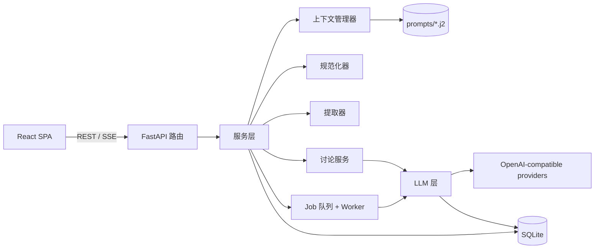
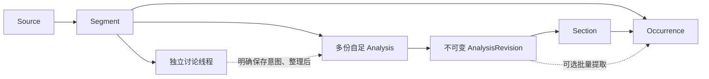
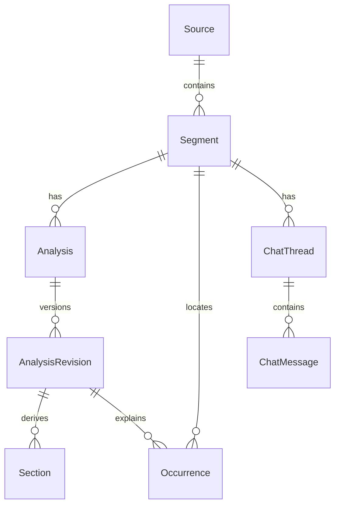

# 架构设计

> 状态：草案 v0.3（2026-09-26）。配套文档：[PRD.md](PRD.md)、[TECH_STACK.md](TECH_STACK.md)、[GLOSSARY.md](GLOSSARY.md)。`[TBD-xx]` 编号与 PRD 一致。
> 本文规定已确认的领域边界、基本操作、片段读取范围与执行规则；具体协议、审核持久化和恢复实现仍待设计。Section 写操作的建议契约见第 4.5 节，不等于已实现的 OpenAPI。阶段性实施基线见 [MVP_IMPLEMENTATION_BASELINE.md](handovers/MVP_IMPLEMENTATION_BASELINE.md)，具体交付顺序仍待编排。

## 1. 总览



分层规则：

- **路由层**只负责参数校验、调用服务层和序列化返回，不包含业务逻辑。
- **服务层**负责编排业务数据写入（Job worker 通过服务层写入）；LLM 层负责记录每次模型调用的 Run。
- **LLM 层**是唯一允许发起模型请求的地方。它统一负责 Run 记录、流式输出、重试和开发缓存。
- **规范化器**是纯函数，不访问数据库，也不访问网络。

## 2. 核心数据流

Segment 是学习的共同起点；片段工作台只是呈现原文、讲解、对话和条目的界面，不是必须按顺序完成的管线。



用户可直接围绕原文讨论，无须先生成解析。系统性解析、专题讲解及讨论整理可以成为各自独立的 Analysis；修改明确选定的已有 Analysis 才生成该文档的新 Revision。Agent 保存讲解与生成待整理候选可分别触发，也可由一次明确请求组合；收录、仅参考或退回待整理由用户直接操作，首轮不向 Agent 开放这些状态工具。普通问答只保存线程消息，不自动生成讲解或条目。首轮暂缓手动创建 Occurrence，保留完整讲解生成与批量候选整理能力；独立快捷入口在闭环后打磨。业务逻辑留在服务层，后续路由或 Shortcut tool 复用能力，不预建所有组合接口。任何模型调用仍经 LLM 层并生成 Run；用户直接整理无需伪造 Run。

Occurrence 归属目标 Segment，定位其原文，并引用具体 AnalysisRevision 及 Section。讨论中得到的新理解需先整理成脱离聊天仍可阅读的讲解，再作为条目出处；不以聊天消息直接替代。历史引用不因新修订而漂移。

Analysis 有创建和删除业务接口，整份删除仅向用户管理界面开放；删除前展示并确认全部修订、Section 及关联 Occurrence（含已收录／仅参考）的影响范围。Segment、其他 Analysis 和属于 Segment 的 ChatThread／消息保留，原有入口可识别来源已删除。Section 删除则是产生新修订的文档编辑，不删除旧修订与引用。迟到任务不能恢复已删除内容，物理清理及调用记录保留方式仍由持久化契约确定。

## 3. 领域模型

当前已落地 Source／Segment 管理、2A设置／模型验证，以及2B片段后台问答与历史。来源与片段具体 API 与字段见[第一阶段契约](handovers/archived/STAGE_1_SOURCE_SEGMENT.md)，实现位于 `models.py`、`schemas.py`、`services/sources.py` 与 `api/sources.py`；设置与验证见第 4 节，其余实体和模块仍为后续设计。Source、Segment 使用 `deleted_at` 逻辑删除，删除来源在同一事务内标记所属片段，查询排除已删除对象。2B接受问答时在同一短写事务保存输入快照、消息与Job，并首次设置`text_locked_at`；原文编辑、来源／片段删除在同一事务边界核对当前状态。

数据库生命周期由应用 lifespan 管理，迁移从空库建立 schema，`just dev`／`just start` 先执行迁移且不自动删库。发布前且数据可丢弃时允许重整初始迁移；需保留日常数据或发布第一版后维护增量升级路径。

### 3.1 实体

所有主键均为 ULID 字符串。所有表都带 `created_at`，可变实体另带 `updated_at`。以下是领域关系草图，不预先固定未讨论的表字段或关联实现。

| 实体 | 关键字段／关系 | 说明 |
|---|---|---|
| `UserProfile` | `native_language`、`explain_language`、`level_note`、`profile_md` | 单用户学习背景 |
| `AnalysisStyle` | `name`、`body_md`、`is_default` | 讲解偏好预设 |
| `Source` | `title`、`note`、来源描述 | 用户声明的来源范围；未来可容纳不同形式的输入，不等于文件或 Collection |
| `Segment` | `source_id`、`text`、可选译文／备注／听写／`source_ref`／`tokens` | 学习目标原文；`source_ref` 当前为自由文本出处，不是素材外键。入库做 NFC；片段顺序不能推断原作相邻或自动语境 |
| `Run` | `kind`、关联的操作、实际 Provider／模型／协议／参数、完整消息、输出、用量、状态、时间 | 每次模型调用均记录，不包含密钥；具体操作关联待设计 |
| `Analysis` | `segment_id`、文档身份与展示元信息 | 一个 Segment 可有多份独立的完整或专题讲解；默认展示选择待设计 |
| `AnalysisRevision` | `analysis_id`、`parent_revision_id?`、`origin`、`run_id?`、`source_md`、`normalizer_version`、`warnings` | 一经生成不可变；`source_md` 为文本真相，来源可追溯 |
| `Section` | `revision_id`、`uid`、`handle`、`kind`、`display_no`、`title`、行号、`raw` | 由规范化器派生，可从原 Markdown 重算 |
| `Occurrence` | `segment_id`、`revision_id`、`section_uids`、原文 `surface`／`spans`、`anchors`／`anchor_keys`、`gloss`、类型／标签／状态、创建来源 | 原文中的学习点实例；引用具体 Revision／Section。是否有提取 Run 取决于创建入口 |
| `ChatThread` | `segment_id`、可选选定资料、标题及权限模式 | 各线程历史独立；参考资料与操作目标分开，不预设主分支结构或永久绑定单一文档 |
| `ChatMessage` | `thread_id`、`role`、`content`、`run_id?` | 消息本身不替代持久讲解出处 |
| `Job` | `kind`、`status`、`payload`、`run_id?`、`attempts`、错误及时间 | 后台 AI 任务状态 |

`Occurrence` 的产品整理状态为 `pending`、`learning`、`reference`，用户可在三者间调整；`reference` 可主动查找和阅读，默认不参与后续学习活动，`learning` 不自动启动排期。删除是独立产品操作，在存储层仍以状态变更软删除，内部删除状态编码待定；不使用 `dismissed` 混合表达忽略与删除，也不提供独立忽略、归档或恢复入口。修订保留历史。再次整理遵循 PRD F5，不自动作废或替换候选，不迁移整理状态或历史引用，也不根据删除建立永久拒绝规则。具体手动／AI 创建来源、引用约束和删除保留策略须在实现前设计。

预留、MVP 不建表的实体：`ReviewItem`、`KnowledgeCluster`、`Lexeme`。未来素材的实体命名与数据关系待需求明确后设计，`MediaAsset` 不是已确定名称。

工具审核需持久记录所属线程、目标及基础版本、具体拟执行操作、用户决定／附加指令与执行结果。这是执行契约的需求，不在此预定新表、实体名称或状态枚举。待审核方案与正式 AnalysisRevision／Occurrence 分开，批准后仍可能执行失败，二者不能混为一条成功记录。

### 3.2 关系



### 3.3 三个版本号

以下三个版本号都以常量形式写在代码中，并记录到产物上：

- `prompt_version`：每个 prompt 模板文件头部声明，渲染时写入 Run。
- `normalizer_version`：规范化器的规则一旦变化就递增。**格式契约 prompt 与规范化器是一对**，修改其中一方时必须检查另一方。
- `extraction_schema_version`：提取 schema 或 anchor 规则 `[TBD-03]` 变化时递增。

### 3.4 2B 问答实现

[2B实施契约](handovers/archived/STAGE_2B_ASYNC_QA.md)固定本阶段的实体字段、API、状态机和验收矩阵；实现位于`chat_models.py`、`chat_schemas.py`、`services/chat.py`、`services/context.py`及`jobs/runtime.py`；API类型已从OpenAPI生成，增量迁移为`0004_chat_jobs`。以上实体表仍是完整MVP草图，2B已落实下列边界：

- ChatThread归属Segment，ChatMessage归属线程和Job；同线程只有一个活动Job，数据库唯一约束与active_job_id共同维护。创建线程不锁原文，接受问答在同一短写事务内保存不可变输入／模型快照、用户消息、助手占位及Job，并首次设置text_locked_at。
- 接受请求以线程内request_id幂等，原样重放返回原身份，异payload或并发新轮冲突；Segment用户编辑revision和Thread.revision用于拒绝陈旧提交。片段编辑、来源／片段删除必须同步参与事务保护，不能只修改新入口。
- Job在接受时存在，Run在实际调用前创建；新增Run.purpose区分verification与chat，旧数据为verification。chat不进入模型验证历史／能力汇总，删除学习内容后也不能通过Run详情重见原文。
- 2B实际输入为现有Source／Segment、学习背景、适用预设、本轮问题及本线程成功的完整历史；管理备注不自动发送，失败／中断残文保留展示但不自动拼入后续请求。messages接受时渲染并保存，worker不读取新的默认值、资料或模板替换输入。未来持久讲解读取须另行落实确切版本及出处。
- 2B没有成果工具、审核等待或修复循环；review／full_access均为文本问答，保留权限字段与空闲切换规则。TBD-16只收口本阶段的接受、幂等、保存核实和单次预算，TBD-17继续保持未决。

## 4. 模块设计

2A 已落地设置与模型验证：`settings_models.py`／`settings_schemas.py`、`services/settings.py` 与 `llm/adapters.py`；配置保存在SQLite，凭据使用数据库旁 `<数据库文件名>.secrets/` 的独立文件（0700目录／0600文件）。验证 Run 固定非敏感配置和凭据引用，后台最多并发2次，每次只调用一次，60秒超时；页面只观察持久记录，重启不自动重放。非流式响应脱敏留存，流式保存脱敏聚合正文与终止元数据，不记录可能重组出密钥的逐包碎片。详见[2A契约](handovers/archived/STAGE_2A_MODEL_SETTINGS.md)。2B已实现片段上下文、单轮问答Job及线程执行；成果工具与多步骤修复仍由后续切片实现。

### 4.1 上下文管理器（`services/context.py`）

职责：按操作把学习背景、片段、偏好及选定资料组装为 messages，是**唯一**拼接 prompt 的地方。首轮 Agent 仅按需读取当前 Segment 的原文、语境、Analysis／Revision／Section／Occurrence、必要 Source 信息、本线程历史与适用的学习背景／偏好；不跨片段检索、不搜索其他线程聊天历史。其他线程保存到本 Segment 的持久讲解可共享，用户界面的跨片段积累库不受此 Agent 边界限制。读取工具由执行层校验对象的 Segment 归属，不能只在 prompt 中限制。内容和执行状态以持久数据为准，来源实际使用情况留痕。

当前2B问答使用 `prompts/chat/system_v2.j2` 和 `user_v1.j2`，输入快照记录组合版本v2。system按本轮意图区分普通讨论、指定范围的专题讲解、总体讲解及讨论成果整理；语言和相关细度偏好可用于问答，预设中的完整文档组织要求仅在适用场景生效，历史报告不使后续追问永久沿用报告格式。当前没有成果写入工具，文本讲解不等于已创建或修改Analysis／Occurrence。已有Job／Run的确切messages和版本不随模板升级改写；数据库中的用户预设不自动覆盖。

后续讲解生成用 prompt 的建议分层顺序（不作为普通问答的强制格式）：

1. `system`：基础角色 + 格式契约（`prompts/analysis/system.j2`）
2. `system` 续：用户画像（`profile_md`、解释语言、水平）
3. `system` 续：选定的讲解偏好（`AnalysisStyle.body_md`）和本次要求
4. `user`：Source 信息、目标片段与用户明确提供的语境；目标和语境分开标记，不按录入顺序自动加入前两条

各层都是独立的 Jinja2 片段，便于在调试视图中逐层查看。渲染结果完整写入 `Run.messages`。

**持久讲解格式契约**（占位，`[TBD-07]`）：

- 可选的前置总述（preamble），建议包含整句翻译和结构概览；
- 每个学习对象用一个二级标题（`## `），标题简洁地点明对象；
- 学习对象内部可用三级标题（`### `）组织，不使用一级标题；
- 不要求 JSON，不规定学习对象的内部写法。

### 4.2 LLM 层（`llm/`）

- **统一接入配置**：Provider、模型和用途默认值通过设置 UI 经服务层维护。`config.py` 负责读取和校验统一配置来源，按 PRD F1 解析用途默认值、片段预选、对话线程选择及单次覆盖，不将 `providers.toml` 设为唯一入口。
- **配置快照**：任务被接受时确定 Provider 配置身份、base_url、模型 ID、有效协议与参数，保存非敏感的实际请求配置。worker 执行时不得重新读取最新默认值来改变目标。凭据引用的保存、变更及失效处理须在实现前固定，不能把密钥复制进 Run 或普通配置响应。
- **协议适配**：基于 `openai.AsyncOpenAI` 分别适配 Chat Completions 与 Responses 的文本请求、响应及流式事件。上层业务使用一致的文本生成和结构化提取能力，不承担协议字段映射；资料检索与写入工具的具体协议待设计。
- **结构化输出**：对已支持的 Provider／模型／协议组合优先采用原生结构化输出；明确采用兼容方式时，在 prompt 中给出 schema 并校验、重试。记录实际使用方式；鉴权、网络等错误不自动触发换协议或换模型，兼容输出同样不得绕过业务校验。
- **模型发现与验证**：列表获取与用户手动模型登记并存；缓存列表并记录刷新结果。列表、文本调用与输出能力分别验证，不能把模型出现于列表当作完整能力声明。验证能力属于具体配置组合，不只属于模型名称。
- **本地对话历史**：首轮文本问答在本地保存完整消息与来源，允许后续回复改选模型；Provider 远端会话标识不是唯一历史依据。协议内部状态的处理留在适配层。
- **Run 记录**：每次模型调用前创建 Run，结束时写入输出、用量和状态；用户触发的模型调用验证同样记录。配置失效明确报告，不悄悄采用其他默认值。
- **有限执行预算**：底层临时故障重试、结构化输出修复和 Agent 继续尝试需受协调后的有限预算约束，不能各自重新获得一套预算而无界叠加。具体次数、时间／调用上限和计数责任在执行契约中确定；所有实际模型调用继续记录 Run。
- **开发缓存**（`app.toml` 中 `dev_cache = true` 时启用）：缓存身份包含 Provider 配置身份与端点、协议、模型、实际参数、消息和输出契约等非敏感请求内容，避免不同接入方式共享错误结果；缓存到 `data/llm_cache/`。测试时的录制与回放复用同一套机制（见第 8 节），不将凭据内容写入缓存。
- **流式观察**：2A轮询持久Run；2B轮询Job的持久聚合正文，不新增SSE。后续SSE须为每个订阅者独立分发并支持从持久记录补读，不能用单个消费队列让不同页面分走事件。离开与重连不重复发起生成，具体协议见 [2B实施契约](handovers/archived/STAGE_2B_ASYNC_QA.md)。

2A 已确定配置持久化与凭据更新规则：每次接入配置或模型参数变更提升版本，旧能力验证失效；运行结果仅在版本仍一致时更新能力状态。停用Provider阻止新验证，不改已接受快照；存在未完成验证时拒绝删除，否则逻辑删除并保留Run。凭据不回显，旧引用暂保留；物理清理策略及未来多步骤Job的凭据生命周期随后续执行契约细化。

模型登记以 `(provider_id, model_id)` 唯一索引约束；重复登记返回 409。单独删除模型只移除登记，拒绝存在 queued/running 验证的删除；历史 Run 保留原内部身份与快照，默认值保留旧 ID 并显示失效，重新登记获得新身份。配置修改、模型登记／删除、接受验证及验证终态更新使用 SQLite 短写事务串行核对与写入；发现请求不持有写锁，返回时检查 Provider 修订，过期结果不覆盖新配置。接入配置变化清除旧发现状态，普通刷新失败仍保留当前配置的缓存。增量迁移遇存量重复登记明确拒绝，不自动合并或删除记录。

### 4.3 规范化器（`services/normalizer.py`）

签名：`normalize(source: str, prev: NormalizedDoc | None = None) -> NormalizedDoc`，是纯函数。

规则：

1. 用 markdown-it-py（CommonMark）解析，只关注 `heading_open` 中的 `h2` 和 `h3`，利用 token 的 `map` 字段取得行号范围（ATX 和 Setext 两种标题写法都能正确处理；代码块中的 `##` 不会被当作标题）。
2. 按**行**切分：第一个 h2 之前的所有行构成 `preamble`（可以为空）；从每个 h2 所在行到下一个 h2 之前的行构成一个学习对象（LO）。
3. h3 只作为 LO 内部的子索引（记录标题和行号），不单独切块。
4. 编号：LO 的 `display_no` 依次为 `LO-1..n`，preamble 为 `P`。每个块有 `uid`（ULID）和 `handle`（`s_` 加 uid 的 4 至 6 位后缀，在同一文档内保证唯一），供 LLM 引用。
5. 若传入 `prev`（修订已有文档时），保持未变动块的 `uid` 和 `handle` 不变，映射由编辑操作显式给出，**不做内容相似度匹配**。
6. 警告（只记录，不阻断）：没有 h2、出现 h1、LO 正文为空、LO 标题重复。

首次持久身份由编排／持久化层分配，或通过显式输入提供；纯函数内部不生成随机 ULID。身份传入与映射接口须在实现前细化，保持与实施基线中的纯函数边界一致。

**不变式**（必须有性质测试覆盖）：

- R1 可复原：`"".join(b.raw for b in blocks) == source`，逐字符相等（包括末尾换行）。
- R2 幂等：对同一输入多次规范化，得到的切分结果（行号范围、标题）相同。
- R3 不改写：规范化器不修改任何文本。

### 4.4 可选批量提取（`services/extraction.py`）

批量提取只整理明确选定的 AnalysisRevision 中已有讲解；目标 Segment 原文用于定位和核对，不读取独立讨论中的补充内容，也不自行补讲。它是创建 Occurrence 的可选入口，不是保存讲解或收录条目的必经阶段。

输出契约带 `extraction_schema_version`，包含受控的 `kind`（`grammar`／`lexis`／`expression`／`other`）、受控 `tags`（见 GLOSSARY 第 4.1 节）、原文 `surface`、`anchors`、语境 `gloss` 与 `section_refs`。`surface` 必须定位到目标原文，`section_refs` 必须属于所选修订；系统补充 Segment、Source、具体 Revision／Section 和提取 Run 的出处。字符偏移以 Python `str` 码点计，anchor 比较使用 NFKC。具体的不连续定位、重复文字消歧及按类型制定的 anchor 规则 `[TBD-03]` 尚待设计。

Agent 创建的条目无论单条还是批量均保存为 `pending`，不能由模型指定非待整理状态；收录由用户直接操作。按能够独立识别、校验和保存的条目反馈结果，成功项保留，失败项仅记录诊断，不形成无效 Occurrence。整个输出无法解析时，不推测哪些条目成功。操作成功表示契约、权限和状态检查通过且实际写入，不保证教学内容正确或知识覆盖完整。

再次整理先读取相关已有条目，补充遗漏候选或明确修改已有 pending；learning／reference 只读参考。新修订下需要更新 pending 的内容与出处时一起形成修改方案；不自动将旧引用指向新内容，不以相同 anchor 或位置合并，也不保证语义重复判断完美。用户需要彻底重做时明确清理选定候选，不给普通再次整理附加整批替换语义。不强制建立用户需管理的提取批次；每次操作及来源仍记录。没有新增学习点可正常结束。

校验失败回传具体问题，由 Agent 在有限预算内修复失败部分，不默认重跑成功项。旧的固定「最多重试两次」不再作为可以与 Agent 循环叠加的独立策略；预算协调见第 4.2 节。产品行为以 PRD F5、F8 为准，保存确认、幂等和继续执行等实现契约见 `[TBD-16]`。

### 4.5 讨论与成果保存（具体协议待设计）

- 线程可从 Segment 原文直接开始，也可围绕明确选定的讲解或条目追问；只读取第 4.1 节范围的资料。使用的 Source、Segment、Revision／Section 等出处可追溯，不默认载入全部共享资料。
- 新建 Analysis 与修改选定 Analysis 均支持。明确指定对象优先，其次可用唯一选中对象消解指代或沿用明确的持续任务目标；选中参考资料本身不授权修改，歧义时才澄清。实际工具操作需带明确身份和基础版本，不能只使用聊天中的标题或指代。
- 普通问答只产生聊天内容与相应 Run，不自动写 Analysis 或 Occurrence。自然语言指令确定任务意图，线程权限模式与操作分类决定是否需要审核；提示词不能代替执行层的权限检查和数据校验。
- 讨论理解若需保存，先形成自足讲解；候选条目必须定位原文并引用实际保存的修订与 Section。保存讲解与生成候选可一次请求组合，也可分别完成，用户之后自行收录或设为仅参考。候选失败不撤销已独立保存的讲解，待审核修改不能提前成为正式修订或条目出处；工具粒度、读写协议及恢复实现仍待设计。
- 修订时保持 AnalysisRevision 不可变；有显式身份映射的块可延续 uid，全量替换若无映射则分配新 uid。纯问答不产生修订。
- 完整解析生成可通过对话和预设任务发起，其结果独立保存为讲解，线程可继续讨论与修改；不以长聊天回复替代 Analysis，也不据此固定模型调用次数。是否设独立快捷按钮留到闭环后，复用服务能力即可。

#### 基本工具与 Section 写操作的建议契约

提供 Analysis 创建、讲解读取和按块编辑，候选查询、创建一个或多个 pending、修改 pending 的基本能力。Analysis 删除业务接口不注册为首轮 Agent 工具；候选手动创建入口暂缓，状态操作保留给用户界面。

建议每次 Section 写操作显式传入以下目标信息，不仅在线程初始化时选择一次 Analysis：

```text
update_section(analysis_id, base_revision_id, sid, title?, body?)
insert_sections(analysis_id, base_revision_id, after_sid, sections[])
delete_section(analysis_id, base_revision_id, sid)
```

- `analysis_id` 表达目标文档，`base_revision_id` 表达本次依据的不可变快照，`sid` 表达该快照中的稳定块身份；不能以展示编号或未限定文档的短 handle 跨文档定位。具体字段编码由正式工具 schema 定义。
- 读取返回可直接用于写操作的文档、修订和块标识。写入检查 Analysis 属于当前 Segment、修订属于该 Analysis、目标块／插入锚点属于该修订，并检查基础修订仍是当前可写版本。标识不一致或版本已变化时反馈冲突，不隐式切换文档或猜测目标。
- `update_section` 省略字段保持原值，改名与正文改写均针对同一块；整体替换指单个 Section 的内容替换。普通块仍需满足一个二级标题对应一个块的格式约束，块身份通过显式编辑映射保留。
- `insert_sections` 插入的每个普通块有独立新身份，`after_sid` 为空可表示插在正文开头、Preamble 之后；空值与字段校验在 schema 中明确。`delete_section` 仅在新修订中移除目标块。
- Preamble 可更新或清空正文，不强制普通标题；不能把它误当普通 Section 改名或物理移除。接口如何标识这种操作在 schema 中说明。
- 审核绑定这些目标信息与具体变更。成功应用返回新的 Revision 及块标识；连续后续修改应基于实际返回的新修订，不能反复提交最初的基线。每次成功应用的文档变更形成新修订，多个基本操作如何组合提交由执行契约明确，不按聊天回合隐式覆盖全部历史。

上述为架构建议签名，不预设提前实现所有路由或高频组合工具；后续 Shortcut tool 应复用相同归属、校验、审批和修订规则。

#### 工具审核与执行边界

- 按 PRD F9 提供线程级审核模式与 Full access，产品初始默认审核模式；用户可改新对话默认值，不修改既有线程。线程只在空闲时切换模式，运行和待审期间拒绝切换，结束或停止完成后才可更改。执行层验证这一限制，不自动批准挂起方案；实际模式与操作决定可追溯。组合方案展示仍见 `[TBD-17]`。
- 审核模式下读／检索、明确要求的新建讲解、创建待整理候选默认可直接执行；修改已有讲解、修改已有待整理候选内容及已开放的删除工具需审核。修改候选后仍为 `pending`，批准修改不表示收录。Full access 省去逐次审批，不扩大工具集合或任务意图。
- 执行层限制 Agent 创建只写 `pending`，内容修改只作用于当前仍为 `pending` 的条目且不能改整理状态。首轮不向 Agent 暴露收录、仅参考、退回待整理的状态操作，不能通过先创建再调用状态接口完成收录。用户界面的状态操作仍由对应业务接口支持，工具范围与用户操作分开。两种权限模式均执行这些约束。
- 按工具实际效果检查权限；混合操作包含修改已有讲解或候选时，应审核对应效果，不能因含有免审创建而跳过。组合方案展示与恢复实现仍待契约细化，已成功保存的独立操作不因其余操作失败而回滚。
- 服务层在执行写入前核对操作是否需审核及对应决定；审核绑定明确对象、基础版本和已展示的具体内容。用户同意只应用该方案，拒绝不写入。同意附加指令在本次应用成功后继续，拒绝附加指令可用于重做；不能以新指令改掉已批准内容后直接写入。
- 应用前检查目标版本；基础版本已变化时不能覆盖新内容，须重新准备。审核模式重新提交方案，Full access 重新核对并准备操作但不增加审批。实际写入需防止重复应用，重试／刷新不得产生重复修订或条目。
- 候选内容写入前也须重新核对整理状态与存在性：若用户已收录、设为仅参考或删除，旧方案不能执行，更不能自动改回待整理来修改。审批不覆盖此约束，执行检查与写入之间不能留出绕过状态边界的竞争窗口。
- 记录审核等待、决定与实际执行结果。拒绝不是可自动重试的模型错误；通过审核也不等于写入成功。两种模式都执行原文定位、引用归属、不可变修订及删除范围校验。
- 用户从管理界面删除整份 Analysis 等对象时保留 PRD F2 的范围确认；Agent 的 delete_section 属于讲解编辑，按线程模式审核并产生新修订。Full access 不开放整份 Analysis 删除或其他未提供的管理工具。

#### 逐项反馈与失败修复

- 工具结果区分已经保存、尚未保存和保存结果需要核实的条目／操作，返回成功记录标识及逐项失败原因。确定是否写入由执行层依据持久化结果判断，不由模型猜测；具体反馈 schema 待设计。
- 字段、原文定位或引用错误不落地该无效结果，反馈给 Agent 修正；目标内容或状态改变先重新读取并遵守现有范围；临时故障允许有限重试。写入结果不确定时先核实本地实际结果，不盲目再创建。
- 等待审核不是失败，用户拒绝或权限不允许不触发技术重试。用户附加的新指令可形成新方案，但不能反复重交已拒绝方案或绕过工具范围。
- 只修复未成功部分，不重建已成功候选或重复应用已成功修改。未成功创建的候选修复仍走创建；已保存候选的内容修复走修改及审核。旧内容在修改失败时保留，单条无效／残缺写入不能计为部分成功。
- 以独立且完整保存的成果为恢复边界：前置讲解成功、后续候选失败时保留讲解；中断或耗尽预算同样保留已保存成果。依赖操作只能引用实际成功保存的内容。
- 执行预算耗尽后停止自动修复，持久保存成功记录与剩余问题，用户之后可继续。后续执行如何识别已完成操作、核实不确定写入和防止重复保存，须在实现前固定；有限预算不能只写在 prompt 中。

### 4.6 Job 与 Worker（`jobs/`）

- 2B使用queued／running／stopping／succeeded／failed／interrupted状态；lifespan先取得同一数据库的单进程排他锁，再恢复中断状态并启动调度。调度按持久queued任务领取，问答与2A验证共用并发上限2，每Job一次生成、60秒调用预算；不新建第二套并发名额或重试循环。细节、取消处理上限及数据字段以[2B实施契约](handovers/archived/STAGE_2B_ASYNC_QA.md)为准。
- 2B调用入口和停止／来源／片段删除的提交共用短进程互斥，并在进入适配器前核对持久状态；互斥不覆盖网络等待。每次进度／终态写入检查execution_token、活动Job身份与对象未删除；停止先持久撤销token，再取消执行，收尾后释放线程。Run、助手消息、Job终态与线程释放同事务提交。以下工具审核与多步骤成果规则属于后续切片，不表示2B提前交付。
- Job 覆盖解析、AI 讨论回复及可选提取等已接受的后台任务；具体任务名和保存工具执行边界随入口协议确定。离开页面不取消任务。
- 同一线程运行或待审核时不接受新一轮，不建立消息排队；输入草稿可保留在界面。同意／拒绝附加指令属于审核反馈而非新轮。不能只靠前端禁用按钮，接受任务时需检查线程是否空闲。一个线程待审不阻止其他独立线程提交任务，worker 可按资源调度。
- 支持主动停止本轮：持久记录停止意图，停止后不启动该轮后续模型请求、修复或工具操作，取消未执行的待审核方案。已保存成果保留；正在提交的操作按实际持久化结果反馈，不声称停止能回滚已提交写入。停止处理完成才释放线程继续发送和切换模式；迟到结果不能重新启动被停止的操作。中断消息与成功讲解区分显示，停止、写入和审核决策之间的并发契约在实现前固定。
- 2B重启将残留queued／running／stopping任务及关联未完成消息、Run统一标为interrupted并释放线程，不自动重放；已终态历史不改。2A验证Run仍沿用其中断语义，不能只修改Run而留下忙碌线程。重复后台实例拿不到进程锁时须直接退出，不运行恢复逻辑。
- 任务级中断或失败不抹去已经保存的逐项成果。查询结果需表达实际成功项、未完成项及原因；Run 调用结束、工具保存成功和整个任务完成分别判断，不用单一成功标记掩盖部分完成。继续执行优先处理未完成项，执行层协调修复预算，避免重复应用。
- 审核等待与模型执行中分开表达。持久保存待审核方案及依赖关系，离开页面或后台重启都不替用户决定或自动执行；返回后可继续处理。依赖写入的后续动作等待其实际成功，恢复与重复决定的幂等契约在实现前细化，不预设等待审核必须占用运行中的 worker。

### 4.7 知识库查询（`services/library.py`）

- 列表：按 `kind`、`status`、`source_id` 筛选；文本搜索匹配 `surface`、`anchors` 和 `gloss`（MVP 用 `LIKE`，P1 改用 FTS5）。
- 分组：`group_by=anchor` 时按 `anchor_keys` 展开后分组；一条 Occurrence 有多个 anchor 时出现在多个组中 `[TBD-08]`。
- 可按待整理、已收录、仅参考筛选；仅参考仍可查找与阅读。已删除记录不进入日常浏览，首轮不提供忽略／归档视图或恢复入口。积累库默认展示哪些未删除状态仍待 PRD 收口；再次整理的保留规则遵循 PRD F5，不强制用户管理批次。

## 5. API 草图

所有接口以 `/api` 为前缀，最终以 FastAPI 生成的 OpenAPI 为准。Source／Segment 管理、选定 Analysis 及 Revision 的阅读、独立线程、Occurrence 创建和整理、Run／Job 查询都需要服务接口。以下仅列稳定资源方向，不预定未讨论的写入端点或工具协议：

```text
/profile, /styles, /sources, /segments
/segments/{id}/analyses, /analyses/{id}/revisions, /revisions/{id}
/segments/{id}/threads, /threads/{id}/messages
/occurrences, /runs/{id}, /runs/{id}/events, /jobs/{id}
```

Provider、模型与用途默认值需有统一配置接口；普通读取响应不得暴露密钥。需要 Analysis 创建与用户确认后的删除接口、Section 基本编辑操作、候选基本操作、停止本轮接口，以及线程权限与新对话默认模式、待审核方案读取和决定／执行结果查询。公开业务接口不等于全部注册为 Agent 工具，注册与执行均遵循当前 Segment 范围及工具权限。正式路径、请求／响应 schema、组合操作及恢复机制在实现前确定。

## 6. 前端结构

片段页的视觉依据是 [A.3 工作台基线](../prototypes/reading-native/VISUAL_BASELINE.md)及[对话列表参考图](../prototypes/reading-native/screenshots/a3-conversations.jpg)：进入片段后使用紧凑工具栏和图标竖栏，桌面阅读与对话并排，各自滚动；右栏在对话列表与详情之间切换。2B只有原文阅读和文本讨论，因此不预建或伪造讲解、学习条目及审核栏。对话返回列表、收起栏位与停止任务是不同操作；布局切换须保留本页草稿与待确认提交。视觉验收须对照参考图的结构、密度与滚动行为，不能仅以接口通畅和没有横向溢出代替。

以下为路由草图，不规定必须独立分屏或页面：

| 路由 | 内容 |
|---|---|
| `/` | Source 列表 |
| `/sources/:id` | Source 详情：片段列表和新增片段入口 |
| `/segments/:id` | 片段工作台：原文、可选的多份讲解及修订、独立讨论线程和 Occurrence；无讲解时仍可讨论 |
| `/library` | 知识库：筛选、搜索、按 anchor 分组，每条都能跳转回来源 |
| `/settings` | 学习背景、讲解预设、Provider／模型／用途默认值的维护，以及模型列表刷新与按需验证 |

诊断入口按 PRD F8 确定，不预设独立完整调试页面为首轮前提。

目录结构：

```
frontend/src/
  api/          # openapi 生成的类型与客户端（禁止手改）+ query hooks
  components/   # 通用组件（含 shadcn/ui）
  features/     # 按业务划分：sources, segments, analysis, occurrences, chat, settings, debug
  routes/
  lib/          # SSE 订阅等工具
```

## 7. 仓库目录

```
.
├── AGENTS.md
├── justfile
├── config/
│   └── app.example.toml  # 应用运行配置；模型接入配置存储另行确定
├── docs/            # PRD.md, TECH_STACK.md, ARCHITECTURE.md, adr/
├── backend/
│   ├── pyproject.toml
│   ├── alembic/
│   ├── prompts/
│   │   ├── analysis/     # system.j2, profile.j2, style.j2, user.j2
│   │   ├── extraction/   # system.j2, anchor_rules.md
│   │   └── chat/
│   ├── src/app/
│   │   ├── main.py       # FastAPI 应用、lifespan、静态文件托管
│   │   ├── api/          # 路由
│   │   ├── schemas/      # Pydantic API 模型
│   │   ├── db/           # ORM 模型、会话
│   │   ├── services/     # context, normalizer, extraction, chat, library ...
│   │   ├── llm/          # config, client, cache, stream
│   │   ├── jobs/
│   │   └── nlp/          # sudachi 封装
│   └── tests/
│       ├── corpus/       # 固定回归语料
│       └── cassettes/    # LLM 录制响应
├── frontend/
└── data/            # 运行时数据（gitignore）：app.db, llm_cache/
```

## 8. 测试策略

- **规范化器**：单元测试加 hypothesis 性质测试（R1、R2、R3），并覆盖边界用例：没有 h2、代码块中的 `#`、Setext 标题、结尾没有换行、CRLF 换行。
- **提取校验**：纯函数测试，覆盖 surface 定位、不连续片段、非法 handle 等情况。
- **再次整理与部分失败**：覆盖已有条目与状态保留、pending 内容及出处修改、旧引用不漂移；部分创建成功保留、无效项不入库、整体不可解析不冒充部分成功、零新增正常完成、已保存讲解不随候选失败回滚。验证错误反馈与实际保存结果一致，写入不确定时先核实、修复不重建成功项、预算耗尽保留成果且不无界重试。
- **多文档与运行边界**：覆盖 Analysis／Revision／Section 错配和陈旧基线拒绝、三种块编辑产生修订及旧引用保留、用户删除 Analysis 保留线程；验证 Agent 不能跨 Segment 或读取其他线程历史，同线程运行／待审不能重复接收新轮或切换模式、待审不占住其他线程，以及停止取消未执行方案、保留实际已保存成果并阻断后续写入。
- **工具审核**：覆盖审核模式分类与 Full access、具体方案同意／拒绝、附加指令不改变已批准内容、离开／重启后待审核可找回、旧版本不覆盖新版本、重复决定不重复写入，以及审批通过后写入失败。验证两种模式均只能创建 pending、修改 pending 后仍保持状态，且审核期间已被用户收录／设为参考／删除的候选不能继续修改。使用离线数据与模拟调用验证，不调用真实模型。
- **LLM 相关流程**：**测试中禁止发起真实网络请求。** 使用录制与回放：以 `RECORD=1` 运行时调用真实模型，把响应写入 `tests/cassettes/`；默认模式只回放，找不到录制就让测试失败。
- **回归语料**：`tests/corpus/` 中放 5 到 10 条代表性片段（包括口语缩略、不连续语法、长句），用于检查提取结果的校验通过率。
- **API**：使用 FastAPI TestClient，配合临时 SQLite 数据库。
- **前端**：以类型检查为主；界面效果由 coding agent 用浏览器能力实际打开页面验证。

## 9. 演进预留

| 方向 | 预留点 |
|---|---|
| 知识点软聚类与 IR | 保留 anchor 检索信息；将来依据实例归属需求设计聚类和用户判断，不在写入时预设同一性 |
| lexeme 挂载 | 将来按词典与分词需求设计 Lexeme 及关联；不要求首轮预存 tokens |
| 主动学习与 SRS | 从具体练习方式确定内容与调度契约；Occurrence 可提供原文和讲解依据，不直接等于卡片，`learning` 不自动启动排期 |
| 素材与多模态 | 将来按实际输入和选取需求设计可选的素材定位；手动录入与素材选取均进入 Segment 学习流程。`source_ref` 当前保留自由文本出处，不预定素材实体、时间区间或播放器集成 |
| 听写诊断 | 保留用户提供的听写，后续按需求讨论与原文对齐及学习反馈，不自动更新用户画像 |
| 后端重写 | 业务规则集中在服务层和纯函数中，API 契约由 OpenAPI 固定 |
