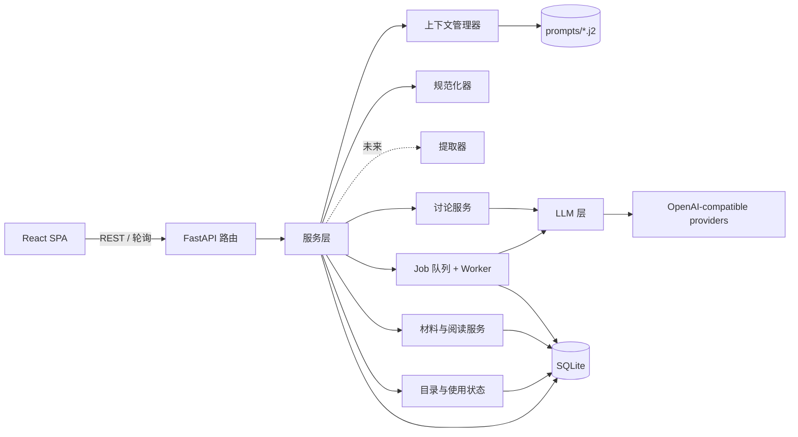
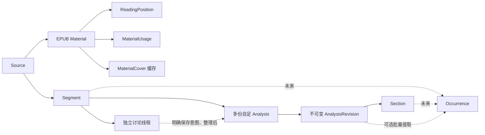
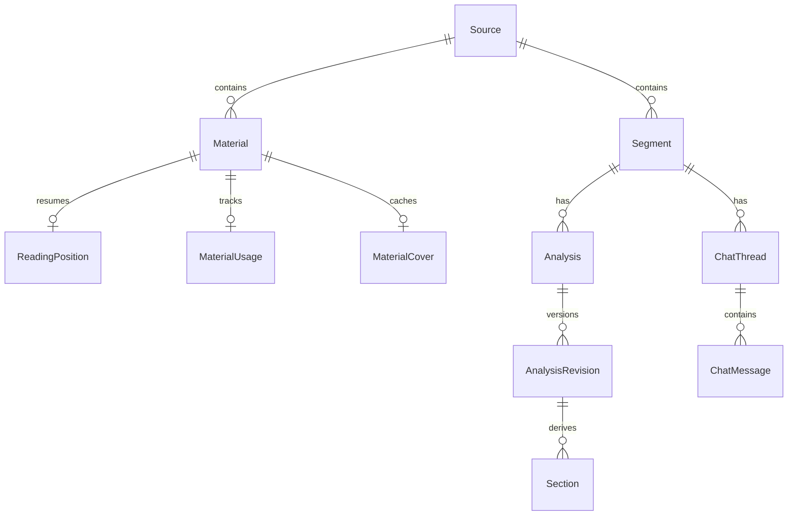

# 架构设计

> 草案 v0.3。本文维护模型、模块、执行机制与不变式，未来草图单独标明。配套文档：[PRD.md](PRD.md)、[TECH_STACK.md](TECH_STACK.md)、[GLOSSARY.md](GLOSSARY.md)。`[TBD-xx]` 编号与 PRD 一致。
> 当前交付状态与验收入口见 [MVP 实施基线](handovers/MVP_IMPLEMENTATION_BASELINE.md)；接口以代码、模板和生成 OpenAPI 为准。

## 1. 总览



分层规则：

- **路由层**只负责参数校验、调用服务层和序列化返回，不包含业务逻辑。
- **服务层**负责编排业务数据写入（Job worker 通过服务层写入）；服务／Job执行层负责持久记录每次经LLM层发起的调用及其Run。
- **LLM 层**是唯一允许发起模型请求的地方。适配器负责协议与流式输出；服务／Job执行层在调用前后持久记录Run并协调预算。当前SDK关闭自动重试（`max_retries=0`），本地开发缓存尚未实现。
- **规范化器**是纯函数，不访问数据库，也不访问网络。

## 2. 核心数据流

当前有两条内容路径：Source 下的 Material 承载 EPUB 阅读，Segment 承载片段讨论与讲解。材料中的选区学习和材料对话按 [PRD 4.7](PRD.md#47-当前-epub-阶段安排)接入。下图同时标出已有关系与未来的 Occurrence 路径。



讨论、成果保存和条目整理的产品路径见[PRD 6.3–6.5](PRD.md#63-形成并阅读讲解)。实现以Segment为共同归属：新建Analysis创建独立身份，编辑已有Analysis创建不可变Revision；Occurrence须定位目标原文并引用实际保存的Revision／Section，历史引用不漂移。当前Analysis已实现，Occurrence和可选提取尚未实现；用户直接整理不伪造Run。

删除范围及用户确认见[PRD F2](PRD.md#f2-source-与片段)。当前Source／Segment／Analysis使用deleted_at逻辑删除，相关事务和迟到结果检查阻止内容重新可见；Section删除只在新修订中移除。Occurrence关联删除与最终物理清理仍待其持久化契约落实。

## 3. 领域模型

当前模型覆盖 Source／Segment、设置与模型验证、讨论与 Analysis，以及材料、阅读位置、使用状态和封面缓存。来源与片段字段见[第一阶段契约](handovers/archived/STAGE_1_SOURCE_SEGMENT.md)，Analysis 执行见第 3.5 节，材料与目录见第 3.1 节。

Source、Segment 使用 `deleted_at` 逻辑删除；删除来源在同一事务内标记所属片段，材料通过 Source 存活门禁变为不可见。接受问答时在短写事务中保存输入快照、消息与 Job，并首次设置 `text_locked_at`；原文编辑、来源／片段删除共用事务校验边界。

数据库生命周期由应用 lifespan 管理，迁移从空库建立 schema，`just dev`／`just start` 先执行迁移且不自动删库。发布前且数据可丢弃时允许重整初始迁移；需保留日常数据或发布第一版后维护增量升级路径。

### 3.1 实体

Source、Segment、Material、Analysis 等独立记录使用 ULID 身份；Profile／Defaults 为单例整数主键，阅读位置、使用状态与封面以 `material_id` 为主键。下表概述已实现实体及 Occurrence 的未来草图，字段以 ORM 和生成 DTO 为准。模型位于 `models.py`、`settings_models.py`、`chat_models.py`、`analysis_models.py` 与 `material_models.py`。

| 实体 | 关键字段／关系 | 说明 |
|---|---|---|
| 学习背景（`Profile`） | `native_language`、`explain_language`、`level_note` | 单用户学习背景 |
| 讲解预设（`Style`） | `name`、`body_md` | 命名预设，默认选择由 `Defaults.style_id` 维护 |
| `Defaults` | 三种用途的模型 ID、`style_id`、`permission_mode` | 新操作与新线程采用的默认设置 |
| `Source` | `title`、`note`、来源描述 | 用户声明的来源范围；未来可容纳不同形式的输入，不等于文件或 Collection |
| `Segment` | `source_id`、`text`、译文、语境、备注、听写、`source_ref`、`text_locked_at` | 学习目标原文入库做 NFC；`source_ref` 为自由文本出处，材料外键与分词数据待后续接入 |
| `Material` | `source_id`、标题、源字节摘要、`version_id`、产物摘要、契约版本、原 EPUB 字节、压缩编译包 | 同 Source 同源字节复用身份；版本、正文与资源不可变，章节及 spine 资源在包内表达 |
| `ReadingPosition` | `material_id`、`revision`、位置与三项阅读设置的 `payload`、`updated_at` | 每材料最多一条，按条件版本更新；位置绑定具体版本、章、part 和资源 |
| `MaterialUsage` | `material_id`、状态、独立 `revision`、`last_opened_at`、`last_action_id` | 每材料最多一条；未开始／进行中／已完成与最近打开独立于位置保存 |
| `MaterialCover` | `material_id`、媒体类型、图片字节、`rule_version`、诊断原因 | 每材料最多一条可重建缓存；`data=NULL` 表示无可用封面，版本 2 可重提旧缓存 |
| `Run` | `purpose`、`job_id`、实际 Provider／模型／协议／参数、消息、输出、用量、状态、时间 | 每次模型调用均记录；以用途和 Job 关联区分验证与讨论调用 |
| `Analysis` | `segment_id`、文档身份与展示元信息 | 一个 Segment 可有多份独立的完整或专题讲解；当前普通入口不自动选第一份，精确入口可指定文档／修订 |
| `AnalysisRevision` | `analysis_id`、`parent_revision_id?`、`origin`、`run_id?`、`source_md`、`normalizer_version`、`warnings` | 一经生成不可变；`source_md` 为文本真相，来源可追溯 |
| `Section` | `revision_id`、`uid`、`handle`、`kind`、`display_no`、`title`、行号、`raw` | 由规范化器派生，可从原 Markdown 重算 |
| `Occurrence`（未来） | `segment_id`、`revision_id`、`section_uids`、原文 `surface`／`spans`、`anchors`／`anchor_keys`、`gloss`、类型／标签／状态、创建来源 | 尚未建表；学习点引用具体 Revision／Section，生产字段契约待落实 |
| `ChatThread` | `segment_id`、选定模型、权限模式、`active_job_id`、`revision` | 各线程历史独立，空闲时可切换模型和权限；资料与写入目标由操作表达 |
| `ChatMessage` | `thread_id`、`job_id`、顺序、角色、状态、正文 | 消息归属线程和 Job，模型调用通过 Job 关联 |
| `Job` | `kind`、`status`、`input_snapshot`、`model_snapshot`、`execution_state`、`execution_token`、错误及时间 | 当前chat_jobs保存后台任务状态，一个Job可关联多个Run |

Occurrence整理行为见[PRD F5](PRD.md#f5-学习条目创建与整理)。存储契约保留pending／learning／reference及独立的软删除编码（待定），不得用dismissed混合忽略与删除。出处引用具体不可变修订，整理或再次调用不能迁移历史引用。创建来源、引用约束及删除保留策略仍须在实现前落实。

预留、不建表的实体：`ReviewItem`、`KnowledgeCluster`、`Lexeme`。EPUB 切片 1 新增 `materials` 与 `reading_positions`，增量迁移为 `0007_materials`；原始字节、不可变编译包和版本身份由 Material 承载，资源与逻辑章节在版本包内表达，不为每个逻辑层单建表。接口与发布／恢复约束见[切片 1 契约](handovers/epub-reading/SLICE_1_DRAFT.md)，验收状态见[阶段入口](handovers/epub-reading/README.md)。

EPUB 已确定的不变式：原始素材字节不可变，材料归属 Source；处理版本保存规则、实际产物与摘要，版本内资源保留原始 spine 身份。引用绑定具体版本、资源、Unicode 码点半开范围及原文快照；正文全局 NFC，ruby 的 `rt`／`rp` 不参与偏移，布局与分词不影响身份。DOM 使用 UTF-16，适配器必须转换并核对正文，不能逐节点规范化后直接相加；不能校验的引用明确失败。材料文本投影与第 4.3 节 Analysis 规范化器分别执行各自契约，不改变后者的可复原保证。具体隔离试验、范围限制和证据见 [EPUB 阶段入口](handovers/epub-reading/README.md)；持久化、删除及权限不由试验自动定案。

阅读章是版本内资源范围的呈现组织：优先采用书内目录标题与入口、按 spine 顺序连续呈现图文，不改变资源局部引用身份。阅读位置保存逻辑章和资源内锚点，百分比派生展示；布局变化允许近似恢复，精确引用仍须严格校验。原书 ruby 优先于未来分词生成注音，自动注音属于可重建显示层，不改核心正文。具体样书调查及切片 1 细化继续见上述阶段文档。

材料导入用受限原始 EPUB 请求体，编译与包的编解码移出事件循环；原始字节及压缩产物同事务发布。来源内相同摘要复用身份，跨来源独立；发布前再次校验 Source 存活。来源删除确认计入材料，读书／保存位置均检查 Source，托管字节暂不物理清理。阅读位置用 `expected_revision` 条件写入，陈旧请求返回 409；版本、章节、part 与资源范围必须吻合。

工具审核需持久记录所属线程、目标及基础版本、具体拟执行操作、用户决定／附加指令与执行结果。当前Analysis工具把具体方案、决定与执行事实保存在Job.execution_state中，状态包含waiting_review；Occurrence及复杂组合方案仍待设计。待审核方案与正式 AnalysisRevision／Occurrence 分开，批准后仍可能执行失败，二者不能混为一条成功记录。

### 3.1.1 目录与材料使用状态

材料使用状态以 material_id 关联，保存可空 last_opened_at、not_started／in_progress／completed 及独立 revision，不变更 Material 版本或 ReadingPosition revision。显式打开 mutation 仅在新进入成功呈现目标章后执行；GET、预取与 refetch 无写入副作用。重复动作去重、条件版本校验拒绝迟到打开覆盖新手工状态；409 后读真实状态，不循环盲重试。状态失败不破坏位置队列，缓存更新不重挂载阅读器。

目录由服务端先完整筛选、排序再分页，返回真实总数；字段白名单，普通文字搜索，标题比较集中测试，ID 破同值，最近打开空值双向置后，分页 50／上限 100。Source 概览有限样本与真实计数；讲解关联未删除 Segment，携带确切修订及原文短摘，避免前端 N+1。查询、封面和写入检查完整 Source 可见性链。

封面规则版本 `2` 优先采用有效的 EPUB3 cover-image／EPUB2 meta name=cover 声明，再按 spine 中 XHTML `img`／SVG `image` 包内引用、manifest 图像顺序回退首张可用静态 PNG／JPEG。坏候选继续，全局归档安全失败整体拒绝。图片限制为 4 MiB、1600 万像素；APNG、GIF、WebP、SVG 不作为有效封面候选，无可用候选时使用占位。标准库执行有界头部／结构校验，浏览器加载失败仍占位。

首次封面读取在线程中提取并缓存成功／失败，资源 URL 带 `?v=2`；旧成功／失败缓存均懒重建，当前失败的目录 URL 为空。缓存保持原始字节、编译包和版本不变，目录不逐书解压。候选和缓存规则见[封面工程契约](handovers/library-a1/API.md)。

迁移 `0008_material_usage` 接续 `0007_materials`，新增 material_usage 与 material_covers；`0009_cover_rules` 增加缓存规则版本和诊断，保留旧数据。旧有效位置初始化进行中，其余未开始，历史打开时间为空、不推断完成。空库／旧库测试核对 ID、原书字节、修订与位置，使用独立测试库。Query key 包含全部条件；导入、状态、Source 和 Analysis 变更刷新受影响目录及计数，旧请求不污染新条件，失效页码回有效页。API 见[目录契约](handovers/frontend-refresh/API.md)，DTO 由 OpenAPI 生成，业务位于 services。

### 3.1.2 阅读器 R1.1 呈现与只读派生查询

实施边界见[阅读器计划](handovers/reader-r1/PLAN.md)，真实 DTO 与参数／错误契约见[API](handovers/reader-r1/API.md)，浏览器与综合验证状态以阶段验收记录为准。R1.1 不新增领域实体、数据库表或位置字段；按原不可变编译包派生搜索与插图清单。服务层在线程中执行有界解压及扫描，每个请求核验 Material、所属 Source 和 version_id；缺失／不可见 404、查询版本不符 409、参数错误 422，不改变原位置验证契约。

搜索按章节／part／spine 顺序扫描资源局部 NFC 正文，排除 rt／rp；字面重叠命中保留原资源码点半开范围，同资源同 spine 的连续 part 可衔接，不跨章或资源拼接。分页响应只保留请求页及真实计数。图库保留版本内每个有效图片出现项，ordinal 是本版本清单序号，导航身份仍是 chapter／part／resource／image_id；受控 content endpoint 不接受任意路径或远程 URL。清单不携带全图 base64，图片逐项按需读取；封面的专用预算不充当正文图片的新规则。GET 均不写 Run、usage 或 reading_positions。

Reader 使用独立外壳与专属 token，保留每 part 的无脚本同源 sandbox iframe 和正文投影。父应用绑定并注销有效 frame 事件；跨 frame 指针坐标转换到阅读视口。工具临时可见性与专注偏好独立，面板与大图阻止静置隐藏；阅读工具面板非模态，不设置正文 inert 或圈定焦点。工具切换递增导航票据，旧定位不能覆盖新意图；目录／搜索同一面板保留查询状态，工具栏只留一个导航入口，两种页签状态均按同一工具开关。左右面板分别持有状态；同侧切换及各侧关闭互不清除另一侧的查询／图库状态，导航完成仅关闭发起侧。正文视口延伸至底部，侧栏底部留12px并采用完整圆角；导航书名／阅读信息／页签为固定区域，内容有独立滚动容器。窄屏保留两侧状态，将被覆盖的一侧暂时移出交互与可访问树；浮动工具栏按内容宽度覆盖，章内进度在工具栏内部，工具栏外区域不阻断正文／面板交互。大图作为图库兄弟层呈现，跨 iframe Escape 优先关闭大图；用户主动选图、翻页或关闭时隔离初始插图定位的迟到结果。主题／ruby 原地呈现；几何设置沿用稳定锚点、有效代次恢复与串行 revision 写队列。搜索高亮使用 DOM Range 与 CSS Highlight，不改定位叶子；重复 spine 按实际出现位置核验，跨 part 范围按其资源局部映射处理。

TanStack Query key 包含材料／版本／查询／分页，输入法组合期间不发中间查询；新输入立即隔离旧结果，约 200ms 后请求。面板卸载和材料切换取消可取消请求，迟到响应仅归属原查询缓存，不重新打开面板。图库仅显示当前有界页，正文图点击按需检索轻量清单后打开大图；浏览不写正文位置，明确前往才进入共享原点及正常保存链路。新增 UI 偏好经枚举／范围校验后保存在浏览器：theme／focus 跨书，font／ruby／width 逐材料版本；Storage 失败保留内存默认，不混入严格位置 DTO。

### 3.2 关系

下图为已实现实体关系。Occurrence 未来关联 Segment 和具体 AnalysisRevision／Section，契约见上表与第 4.4–4.5 节。



### 3.3 三个版本号

以下为版本追溯规则；prompt与normalizer版本已记录到当前调用／产物，extraction_schema_version留待提取实现：

- `prompt_version`：每个 prompt 模板文件头部声明，渲染时写入 Run。
- `normalizer_version`：规范化器的规则一旦变化就递增。**格式契约 prompt 与规范化器是一对**，修改其中一方时必须检查另一方。
- `extraction_schema_version`：提取 schema 或 anchor 规则 `[TBD-03]` 变化时递增。

### 3.4 2B 问答历史基线

[2B实施契约](handovers/archived/STAGE_2B_ASYNC_QA.md)固定本阶段的实体字段、API、状态机和验收矩阵；实现位于`chat_models.py`、`chat_schemas.py`、`services/chat.py`、`services/context.py`及`jobs/runtime.py`；API类型已从OpenAPI生成，增量迁移为`0004_chat_jobs`。以上实体表仍是完整MVP草图，2B已落实下列边界：

- ChatThread归属Segment，ChatMessage归属线程和Job；同线程只有一个活动Job，数据库唯一约束与active_job_id共同维护。创建线程不锁原文，接受问答在同一短写事务内保存不可变输入／模型快照、用户消息、助手占位及Job，并首次设置text_locked_at。
- 接受请求以线程内request_id幂等，原样重放返回原身份，异payload或并发新轮冲突；Segment用户编辑revision和Thread.revision用于拒绝陈旧提交。片段编辑、来源／片段删除必须同步参与事务保护，不能只修改新入口。
- Job在接受时存在，Run在实际调用前创建；新增Run.purpose区分verification与chat，旧数据为verification。chat不进入模型验证历史／能力汇总，删除学习内容后也不能通过Run详情重见原文。
- 2B实际输入为现有Source／Segment、学习背景、适用预设、本轮问题及本线程成功的完整历史；管理备注不自动发送，失败／中断残文保留展示但不自动拼入后续请求。messages接受时渲染并保存，worker不读取新的默认值、资料或模板替换输入。持久讲解的确切版本读取已由2C工具落实，见第3.5节。
- 2B交付时没有成果工具、审核等待或修复循环，单Job一次生成且60秒调用预算；这是历史切片边界。当前2C已增加工具循环、生成分支和具体操作审核，预算见第3.5节。TBD-16的Analysis执行部分已落实，Occurrence部分仍未实现；TBD-17继续保持未决。

### 3.5 2C Analysis 与工具执行实现

`analysis_models.py`、`analysis_schemas.py`、`services/analyses.py`和`services/normalizer.py`实现持久Analysis、不可变Revision和派生Section；增量迁移`0005_analyses`、`0006_analysis_execution`保留已有数据。Analysis.current_revision_id指向最新版本，编辑以基础修订校验并创建新版本；未修改块保留uid和原文。创建／编辑的操作身份与payload共同保证幂等，不能跨Segment重用操作身份。

`jobs/agent.py`执行主对话工具循环与内部写作分支。Job.execution_state持久保存实际协议历史、预算、成果和具体待审方案，一个Job可关联多个Run；Run结束、成果保存和Job完成分别判断。`waiting_review`仍占用线程活动任务身份，批准或拒绝须绑定方案版本；拒绝可附加指令，批准不把附加指令悄悄写进已展示方案。重启中断执行中的任务，待审核方案可重新打开；已保存的成果始终保留。

当前预算常量集中在`jobs/agent.py`：最多8次模型调用，单次调用上限180秒，累计计时上限600秒，输出和上下文各200000字符。累计值通过`execution_state.model_seconds`持久保存各次`_invoke`的实际耗时（包含其内部授权核对／入口等待），不是整个Job的墙钟时长；人工审核等待和外部工具处理不计入。下一次调用时限取180秒与剩余累计时间的较小值。分支与主循环共享计数和全局并发名额，不在审核恢复时重置预算。停止撤销执行标识，后续调用和保存均再核对持久状态；已进入的模型调用仅尽力取消，不能保证远端不再计费。

公开接口包括片段Analysis列表、指定Analysis／Revision读取、删除影响与用户删除，以及Job的具体审核决定。生成／局部写入经Job执行，未提供绕过审核的公开编辑端点。实际字段以生成的OpenAPI和版本化工具模板为准；Occurrence尚未实现，见[2C验收记录](handovers/archived/STAGE_2C_ANALYSIS_TOOLS.md)。

## 4. 模块设计

2A 已落地设置与模型验证：`settings_models.py`／`settings_schemas.py`、`services/settings.py` 与 `llm/adapters.py`；配置保存在SQLite，凭据使用数据库旁 `<数据库文件名>.secrets/` 的独立文件（0700目录／0600文件）。验证 Run 固定非敏感配置和凭据引用，后台最多并发2次，每次只调用一次，60秒超时；页面只观察持久记录，重启不自动重放。非流式响应脱敏留存，流式保存脱敏聚合正文与终止元数据，不记录可能重组出密钥的逐包碎片。详见[2A契约](handovers/archived/STAGE_2A_MODEL_SETTINGS.md)。2B已实现片段上下文与持久问答；2C在此基础上实现Analysis成果工具、内部生成分支、多Run和具体操作审核。Occurrence及复杂组合方案仍留后续切片。

### 4.1 上下文管理器（`services/context.py`）

职责：`services/context.py`组装主对话接受快照与历史，`jobs/agent.py`在实际工具触发点追加模板化写作指令与工具结果。资料范围遵循[PRD 4.5](PRD.md#45-讨论共享资料与成果保存)和[F7](PRD.md#f7-片段讨论与成果整理)：读取工具校验当前Segment归属，不搜索其他线程聊天历史；跨线程只共享本Segment持久成果。内容与执行状态依据持久记录，实际使用的出处留痕，不默认载入全部资料。当前已实现Analysis读取，Occurrence读取仍是目标约束。

当前主对话加载`prompts/chat/system_v4.j2`、`user_v2.j2`和`tools_v4.json`，组合版本记录为`v4+tools_v4`。system区分普通问答、专题／总体讲解及内部写作场景；完整文档组织预设只在明确请求对应产物时生效。背景、预设、材料和本轮要求以user后缀加入，接受时固定。旧Job／Run的实际输入与版本不随升级改写，用户数据库中的预设也不自动覆盖。`generate_analysis`可传入独立的`title`（去除首尾空白并做NFC规范化后为1–200字符），省略时沿用首个二级标题／正文摘录的系统取名；总标题不随Section编辑改写。快捷总体讲解继续由系统自动取名。

内部生成分支以主对话触发点的完整上下文快照启动，保留材料、已讨论要求、已读取资料和截至触发点的有效消息，不先摘要替代全文。分支沿用父调用的Provider、模型、协议、参数、system、工具定义及完整有效消息前缀；真实触发工具调用先以真实委派开始结果闭合，再在末尾追加`analysis/writer_v2.j2`，以`tool_choice=none`直接生成Markdown。快捷总体讲解复用同一能力；没有既有讨论时以片段材料和本次要求建立上下文，不伪造assistant工具调用。生成校验通过后保存Analysis及初始Revision。

保持相同前缀以争取Provider缓存命中，是执行意图而非命中率保证；实际命中通过服务端usage的cached／hit／miss字段观察，缺失值保持未知，不伪造为0。分支不切换解析默认模型或替换system，不以缓存为理由静默省略资料或沿用失效权限。主模型不在工具参数中搬运已有要求、上下文或完整新文档；主对话只接收成果身份、确切修订及真实保存结果，正文按需读取，写作模板与全篇正文不重复回灌主上下文。局部Section编辑在主对话执行，不自动推断Section语义依赖；该分支是Job内部过程，不等于用户可管理的聊天分支树。

同协议历史保留实际reasoning与工具字段。旧版本或协议切换时，无法合法重放的原生消息作为按原顺序保留的历史资料追加，不伪造私有推理或用摘要替代内容。已保存但收尾失败的成果在下一轮以持久事实恢复。渲染后的messages、工具定义和模板版本写入快照及Run；长期依据为[主对话system](../backend/prompts/chat/system_v4.j2)、[本轮输入模板](../backend/prompts/chat/user_v2.j2)、[工具定义](../backend/prompts/chat/tools_v4.json)、[内部写作模板](../backend/prompts/analysis/writer_v2.j2)及[上下文实现](../backend/src/app/services/context.py)。历史转换与成果恢复另使用`chat/history_material_v1.j2`、`saved_artifact_v1.j2`和`recovered_artifacts_v1.j2`；临时聚合审阅快照不是生产依据。

**持久讲解格式契约**（占位，`[TBD-07]`）：

- 可选的前置总述（preamble），建议包含整句翻译和结构概览；
- 每个学习对象用一个二级标题（`## `），标题简洁地点明对象；
- 学习对象内部可用三级标题（`### `）组织，不使用一级标题；
- 不要求 JSON，不规定学习对象的内部写法。

### 4.2 LLM 层（`llm/`）

- **统一接入配置**：Provider、模型和用途默认值通过设置 UI 经服务层维护。`config.py`读取应用运行TOML，模型接入配置由`services/settings.py`维护SQLite来源；服务层按 PRD F1 解析用途默认值、片段预选、对话线程选择及单次覆盖，不将 `providers.toml` 设为唯一入口。
- **配置快照**：任务被接受时确定 Provider 配置身份、base_url、模型 ID、有效协议与参数，保存非敏感的实际请求配置。worker 执行时不得重新读取最新默认值来改变目标。凭据已采用独立文件及内部引用，更新产生新引用，删除检查包含活动Job（含待审核），不能把密钥复制进 Run 或普通配置响应。
- **协议适配**：基于 `openai.AsyncOpenAI` 分别适配 Chat Completions 与 Responses 的文本请求、响应及流式事件。上层业务使用统一文本与原生工具调用接口，不承担协议字段映射。2C覆盖两种协议普通／流式的工具结果、reasoning回放和缓存用量；结构化提取仍待Occurrence切片。
- **结构化提取输出（未来）**：对已支持的 Provider／模型／协议组合优先采用原生结构化输出；明确采用兼容方式时，在 prompt 中给出 schema 并校验、重试。记录实际使用方式；鉴权、网络等错误不自动触发换协议或换模型，兼容输出同样不得绕过业务校验。
- **模型发现与验证**：列表获取与用户手动模型登记并存；缓存列表并记录刷新结果。列表、文本调用与输出能力分别验证，不能把模型出现于列表当作完整能力声明。验证能力属于具体配置组合，不只属于模型名称。
- **本地对话历史**：首轮文本问答在本地保存完整消息与来源，允许后续回复改选模型；Provider 远端会话标识不是唯一历史依据。协议内部状态的处理留在适配层。
- **Run 记录**：每次模型调用前创建 Run，结束时写入输出、用量和状态；用户触发的模型调用验证同样记录。配置失效明确报告，不悄悄采用其他默认值。
- **有限执行预算**：底层临时故障重试、结构化输出修复和 Agent 继续尝试需受协调后的有限预算约束，不能各自重新获得一套预算而无界叠加。当前Analysis主循环和分支由`jobs/agent.py`共享第3.5节预算；2A验证保留单次60秒预算。未来提取修复须复用协调预算；所有实际模型调用继续记录Run。
- **开发缓存（未来预留，当前没有dev_cache配置项或本地缓存实现）**：缓存身份包含 Provider 配置身份与端点、协议、模型、实际参数、消息和输出契约等非敏感请求内容，避免不同接入方式共享错误结果；缓存到 `data/llm_cache/`。未来测试录制与回放可复用同一套机制（见第 8 节），不将凭据内容写入缓存。
- **流式观察**：当前2A轮询持久Run，问答／Analysis轮询Job的持久状态和聚合正文，不新增SSE。后续SSE须为每个订阅者独立分发并支持从持久记录补读，不能用单个消费队列让不同页面分走事件。离开与重连不重复发起生成，具体协议见 [2B实施契约](handovers/archived/STAGE_2B_ASYNC_QA.md)。

2A 已确定配置持久化与凭据更新规则：每次接入配置或模型参数变更提升版本，旧能力验证失效；运行结果仅在版本仍一致时更新能力状态。停用Provider阻止新验证，不改已接受快照；存在未完成验证时拒绝删除，否则逻辑删除并保留Run。凭据不回显，旧引用暂保留；物理清理策略及未来多步骤Job的凭据生命周期随后续执行契约细化。

模型登记以 `(provider_id, model_id)` 唯一索引约束；重复登记返回 409。单独删除模型只移除登记，拒绝存在 queued/running 验证的删除；历史 Run 保留原内部身份与快照，默认值保留旧 ID 并显示失效，重新登记获得新身份。配置修改、模型登记／删除、接受验证及验证终态更新使用 SQLite 短写事务串行核对与写入；发现请求不持有写锁，返回时检查 Provider 修订，过期结果不覆盖新配置。接入配置变化清除旧发现状态，普通刷新失败仍保留当前配置的缓存。增量迁移遇存量重复登记明确拒绝，不自动合并或删除记录。

### 4.3 规范化器（`services/normalizer.py`）

签名：`normalize(source: str, prev: NormalizedDoc | None = None) -> NormalizedDoc`，是纯函数。

规则：

1. 用 markdown-it-py（CommonMark）解析，只关注 `heading_open` 中的 `h2` 和 `h3`，利用 token 的 `map` 字段取得行号范围（ATX 和 Setext 两种标题写法都能正确处理；代码块中的 `##` 不会被当作标题）。
2. 按**行**切分：第一个 h2 之前的所有行构成 `preamble`（可以为空）；从每个 h2 所在行到下一个 h2 之前的行构成一个学习对象（LO）。
3. h3 只作为 LO 内部的子索引（记录标题和行号），不单独切块。
4. 编号：LO 的 `display_no` 依次为 `LO-1..n`，preamble 为 `P`。每个块有 `uid`（ULID）和 `handle`（`s_` 加 uid 的 4 至 6 位后缀，在同一文档内保证唯一），供 LLM 引用。
5. `prev`参数保留但不参与当前纯切分；修订时由持久化服务依据明确编辑操作保持未变动块的`uid`和`handle`，**不做内容相似度匹配**。
6. 警告（只记录，不阻断）：没有 h2、出现 h1、LO 正文为空、LO 标题重复。

首次持久身份由`services/analyses.py`分配；纯函数内部不生成随机ULID。持久化层在新修订中显式延续未修改块身份。行切分只识别CommonMark的CRLF／CR／LF，保留原始文本，不将Unicode段落分隔符误作Markdown换行。

**不变式**（必须有性质测试覆盖）：

- R1 可复原：`"".join(b.raw for b in blocks) == source`，逐字符相等（包括末尾换行）。
- R2 幂等：对同一输入多次规范化，得到的切分结果（行号范围、标题）相同。
- R3 不改写：规范化器不修改任何文本。

### 4.4 可选批量提取（未来模块，`services/extraction.py`尚不存在）

产品范围与再次整理行为见[PRD F5](PRD.md#f5-学习条目创建与整理)。未来批量提取以明确选定的AnalysisRevision为讲解依据，目标原文仅用于定位核对，不读取独立讨论补充或自行补讲。

输出契约带 `extraction_schema_version`，包含受控的 `kind`（`grammar`／`lexis`／`expression`／`other`）、受控 `tags`（见 GLOSSARY 第 4.1 节）、原文 `surface`、`anchors`、语境 `gloss` 与 `section_refs`。`surface` 必须定位到目标原文，`section_refs` 必须属于所选修订；系统补充 Segment、Source、具体 Revision／Section 和提取 Run 的出处。字符偏移以 Python `str` 码点计，anchor 比较使用 NFKC。具体的不连续定位、重复文字消歧及按类型制定的 anchor 规则 `[TBD-03]` 尚待设计。

未来写入层将Agent创建限制为pending；每项必须可独立识别、校验并完整保存，失败项只存诊断，不形成无效Occurrence，整体不可解析时不猜测部分成功。校验通过不证明教学正确或覆盖完整。内容与出处修改须作为同一方案保存，不能按相同anchor或位置自动合并，不能迁移历史引用；不强制建立用户管理的提取批次，但每次操作及来源须可追溯。

校验错误回传具体问题，恢复核实与幂等见第4.5节，预算见第4.2节。旧的固定“最多重试两次”不能作为与Agent循环叠加的独立策略。候选保存与继续执行协议仍见`[TBD-16]`；用户整理及部分失败行为由[PRD F5](PRD.md#f5-学习条目创建与整理)、[F8](PRD.md#f8-状态与诊断)维护。

### 4.5 讨论与成果保存（Analysis已实现，Occurrence待设计）

讨论行为及目标判定见[PRD F7](PRD.md#f7-片段讨论与成果整理)。执行层要求实际操作带明确对象身份与基础版本，不能用标题或聊天指代替代定位，提示词不能替代权限／数据校验。候选必须引用实际保存的Revision／Section，待审方案不能充当正式出处。修订保持不可变；显式身份映射可延续uid，全量替换无映射则分配新uid。生成内部机制集中在第4.1节。

#### 已实现Analysis工具与Section写操作契约

当前提供Analysis生成／保存、列表／确切版本读取和按块编辑；候选查询、创建一个或多个pending、修改pending仍为首轮目标，尚未实现。Analysis 删除业务接口不注册为首轮 Agent 工具；候选手动创建入口暂缓，状态操作保留给用户界面。

当前Section写操作显式传入目标信息；实际工具名称和字段见[tools_v4.json](../backend/prompts/chat/tools_v4.json)：

```text
update_analysis_section(analysis_id, base_revision_id, sid, title?, body?)
insert_analysis_sections(analysis_id, base_revision_id, after_sid?, sections[])
delete_analysis_section(analysis_id, base_revision_id, sid)
update_analysis_preamble(analysis_id, base_revision_id, body)
```

- `analysis_id` 表达目标文档，`base_revision_id` 表达本次依据的不可变快照，`sid` 表达该快照中的稳定块身份；不能以展示编号或未限定文档的短 handle 跨文档定位。当前sid使用读取返回的uid，section_ids也使用uid；展示handle不能替代uid。
- 读取返回可直接用于写操作的文档、修订和块标识。写入检查 Analysis 属于当前 Segment、修订属于该 Analysis、目标块／插入锚点属于该修订，并检查基础修订仍是当前可写版本。标识不一致或版本已变化时反馈冲突，不隐式切换文档或猜测目标。
- `update_analysis_section` 省略字段保持原值，改名与正文改写均针对同一块；整体替换指单个 Section 的内容替换。普通块仍需满足一个二级标题对应一个块的格式约束，块身份通过显式编辑映射保留。
- `insert_analysis_sections` 插入的每个普通块有独立新身份，`after_sid`省略表示插在正文开头、Preamble之后；当前工具schema未声明JSON null，不能把省略和null混为一谈。`delete_analysis_section` 仅在新修订中移除目标块。
- Preamble 可更新或清空正文，不强制普通标题；不能把它误当普通 Section 改名或物理移除。当前由`update_analysis_preamble`单独表达。
- 审核绑定这些目标信息与具体变更。成功应用返回新的 Revision 及块标识；连续后续修改应基于实际返回的新修订，不能反复提交最初的基线。每次成功应用的文档变更形成新修订，当前逐操作应用与审核，复杂组合提交仍待设计，不按聊天回合隐式覆盖全部历史。

编辑规则集中在 `services/analyses.py`：审核与保存共用目标归属／基础版本读取和纯 Markdown 变换，统一 NFC、标题空白、二级标题边界、插入锚点、行终止与块身份映射。审核中的原内容和拟保存内容来自该变换；Job 负责权限、等待审核及执行授权。实际保存仍在写事务中重新核对目标、当前基础版本和操作身份，再生成不可变 Revision，不使用审核预览缓存代替执行校验。

以上为当前基本工具；生成通过`generate_analysis(title?)`进入内部写作分支，列表／读取通过`list_analyses`和`read_analysis`完成。不预设所有高频组合工具；后续Shortcut tool应复用相同归属、校验、审批和修订规则。

#### 工具审核与执行边界

用户权限模式、操作分类及同意／拒绝附加指令的行为由[PRD F9](PRD.md#f9-agent-工具权限与审核)维护，删除范围见[F2](PRD.md#f2-source-与片段)。执行层保留以下机制：

- 线程空闲检查控制模式切换；模式与实际操作决定留痕。按工具实际效果核对权限，混合效果不能借免审创建跳过修改审核；Full access不扩大工具集合。整份Analysis删除不注册为Agent工具，Section删除仍形成新修订。复杂组合展示／恢复保留`[TBD-17]`未决。
- 审核方案持久绑定明确对象、基础版本与已展示内容；决定只应用该方案，附加指令不改写已批准payload。应用前重新检查版本；陈旧方案不能覆盖新内容，需重新准备。审核模式重新提交方案，Full access重新核对但不增加审批；操作身份与payload幂等防止重复应用。
- 未来候选写入限制创建pending、只修改当前pending且不改变整理状态。写入前同时核对存在性、内容及整理状态；检查与写入不得留下竞争窗口，旧方案不能把已收录／仅参考／删除的目标退回pending。两种模式均执行原文定位、引用归属、不可变修订和删除范围校验。
- 审核等待、决定与实际执行结果分别记录；拒绝／权限不允许不触发技术重试，审批通过不代表写入成功。依赖操作只有实际成功保存后才可继续。

#### 保存核实与失败恢复

产品反馈与修复行为由[PRD F8](PRD.md#f8-状态与诊断)维护。执行层依据持久结果区分已保存、未保存及待核实，返回成功身份与具体错误；当前Analysis通过artifacts、工具结果及Job错误反馈，候选逐项schema仍待设计。

- 无效字段、定位或引用不落库；目标内容／状态改变先重新读取。写入不确定先核实本地实际成果，不盲目重复创建。
- 完整独立保存的成果是恢复边界；失败修改保留旧内容，后续失败／中断／预算耗尽不回滚已保存成果。只修复未成功部分，未保存创建仍走创建，已保存对象走修改及其审核，不重建成功项。
- 操作身份／payload支持Analysis保存核实和去重，已保存但收尾失败的成果在后续轮恢复为持久事实。候选继续执行、核实与去重须在实现前落实。预算耗尽停止自动修复，持久保存成功记录及剩余问题；预算由执行层协调，不能只写在prompt中。

### 4.6 Job 与 Worker（`jobs/`）

- 当前Job使用queued／running／waiting_review／stopping／succeeded／failed／interrupted状态；lifespan先取得同一数据库的单进程排他锁，再恢复中断状态并启动调度。调度按持久queued任务领取，问答／Analysis与2A验证共用并发上限2。2B交付时每Job一次生成、60秒调用预算；当前工具循环及内部写作分支使用第3.5节统一预算，不新建第二套并发名额或独立重试循环。实际实现见[`jobs/runtime.py`](../backend/src/app/jobs/runtime.py)与[`jobs/agent.py`](../backend/src/app/jobs/agent.py)，2B历史边界见[归档契约](handovers/archived/STAGE_2B_ASYNC_QA.md)。
- 调用入口和停止／来源／片段删除的提交共用短进程互斥，并在进入适配器前核对持久状态；互斥不覆盖网络等待。每次进度／终态写入检查execution_token、活动Job身份与对象未删除；停止先持久撤销token，再取消执行，收尾后释放线程。当前多个Run及已保存成果分别留存，助手消息、Job终态与线程释放由收尾事务维护，不能用2B单次调用的终态规则推断整轮成果回滚。
- 当前Job.kind为`chat_reply`和`generate_analysis`，覆盖普通讨论／工具循环与快捷总体讲解；可选提取任务仍为预留，尚无对应实现。离开页面不取消任务。
- 接受事务检查线程空闲，数据库唯一活动Job约束和active_job_id阻止同线程运行／待审时接收新轮；审核决定走既有Job，不建立消息队列。独立线程按全局资源调度。用户草稿与等待行为见[PRD 6.6](PRD.md#66-异步操作与离开页面)。
- 停止语义见[PRD 6.6](PRD.md#66-异步操作与离开页面)。执行层持久记录停止意图、撤销token并取消未执行方案；后续调用／修复／保存再核对授权，提交竞争依据实际持久结果反馈，收尾完成才释放线程。迟到结果不能恢复旧任务或方案；Analysis并发保护已落实，候选写入仍待其切片。
- 当前重启将残留queued／running／stopping任务及关联未完成消息、Run统一标为interrupted并释放线程；waiting_review不在中断集合内，保留具体方案与线程活动身份供用户继续决定，不自动重放；已终态历史不改。2A验证Run仍沿用其中断语义，不能只修改Run而留下忙碌线程。重复后台实例拿不到进程锁时须直接退出，不运行恢复逻辑。
- Run调用结束、工具保存成功和Job完成分别判断，查询依据持久成果返回成功项与未完成原因；恢复及预算复用第3.5／4.5节机制，不因任务终态抹去成果。产品反馈见[PRD F8](PRD.md#f8-状态与诊断)。
- 审核等待与模型执行中分开表达。持久保存待审核方案及依赖关系，离开页面或后台重启都不替用户决定或自动执行；返回后可继续处理。依赖写入的后续动作等待其实际成功，Analysis已实现方案版本绑定、重复决定幂等和待审恢复，待审不占用模型并发名额；复杂组合依赖和候选恢复仍待设计。

### 4.7 知识库查询（未来模块，`services/library.py`尚不存在）

- 列表：按 `kind`、`status`、`source_id` 筛选；文本搜索匹配 `surface`、`anchors` 和 `gloss`（MVP 用 `LIKE`，P1 改用 FTS5）。
- 分组：`group_by=anchor` 时按 `anchor_keys` 展开后分组；一条 Occurrence 有多个 anchor 时出现在多个组中 `[TBD-08]`。
- 查询排除已删除记录；整理行为见[PRD F5](PRD.md#f5-学习条目创建与整理)，阅读与筛选范围见[F6](PRD.md#f6-知识库)。积累库默认展示哪些未删除状态仍待PRD收口。

## 5. 当前API与未来草图

所有接口以 `/api` 为前缀。以下列出主要路由，方法与完整请求／响应见生成 OpenAPI 和[`前端类型`](../frontend/src/api/schema.d.ts)；实现位于[`api/`](../backend/src/app/api/)。

```text
/sources/{source_id}/materials
/materials, /materials/{material_id}
/materials/{material_id}/chapters/{chapter_id}
/materials/{material_id}/reading-position
/materials/{material_id}/search, /materials/{material_id}/illustrations
/materials/{material_id}/illustrations/{ordinal}/content
/materials/{material_id}/usage, /materials/{material_id}/opened
/materials/{material_id}/cover, /catalog/sources
/sources/{source_id}/catalog/segments, /sources/{source_id}/catalog/analyses
/settings, /settings/profile, /settings/styles, /settings/defaults
/providers, /providers/{provider_id}/refresh-models, /providers/{provider_id}/models
/provider-models/{model_id}, /provider-models/{model_id}/verifications
/sources, /sources/{source_id}, /sources/{source_id}/segments, /segments/{segment_id}
/segments/{segment_id}/analyses, /analyses/{analysis_id}, /analyses/{analysis_id}/delete-impact
/segments/{segment_id}/threads, /threads/{thread_id}, /threads/{thread_id}/messages
/threads/{thread_id}/jobs, /threads/{thread_id}/jobs/by-request/{request_id}
/jobs/{job_id}, /jobs/{job_id}/stop, /jobs/{job_id}/decision
/runs, /runs/{run_id}
```

指定历史讲解通过`GET /analyses/{analysis_id}?revision_id=...`读取；当前没有独立`/revisions/{id}`路由。Analysis生成／保存和Section编辑走Job执行及工具审核，没有绕过审核的公开编辑端点；整份Analysis删除提供影响预览及用户DELETE接口。线程权限与新对话默认模式、具体审核决定、停止及保存核实接口已实现。普通读取不返回密钥，公开业务接口不等于全部注册为Agent工具。

Occurrence创建／整理与积累库、可选提取及SSE事件接口仍是未来资源方向；尚无`/occurrences`或`/runs/{id}/events`路由。其字段、组合操作和恢复机制须在对应切片确定，不从本节草图推定交付。

## 6. 前端结构

片段页沿用[A.3工作台基线](../prototypes/reading-native/VISUAL_BASELINE.md)的安静阅读气质和独立滚动区域。2C后的界面打磨改为普通入口默认阅读、讨论按需展开；原文与讲解同时参照，讲解列表不自动选择第一份文档。讲解、确切修订和讨论目标通过查询参数定位，指定对象须核对当前Segment归属。返回来处与查看所属Source分开。具体导航与当前/未来边界见[阅读与导航](INFORMATION_ARCHITECTURE.md)。

收起讨论与返回讨论列表不卸载当前挂载的ThreadPanel，不等同于停止任务；保留本页草稿、待核实提交与审核补充要求。Segment按身份切换时重新挂载以隔离局部状态，同一Segment的查询参数变化不重新挂载。生成与审核继续使用已有Job／Run和确切成果引用，不新增后台协议或自动模型调用。视觉验收覆盖长原文与讲解对照、桌面独立滚动、窄屏和返回路径。

`chat/discussion.ts` 集中讨论受理、按同一 `request_id` 核实、Job 版本合并与终态刷新／成果通知。直接受理和核实受理进入同一处理函数，以函数式更新只清除尚未改写的提交草稿；轮询、停止和审核返回的 Job 共用版本合并规则。页面保留本地草稿、显示状态和 URL 导航适配，阅读保护绑定首次提交时的确切讲解／Revision，不因响应丢失后的重试覆盖该快照。终态通知在当前讨论实例内按 Job 身份去重，不新增状态库、队列或刷新恢复契约。

缓存合并保留较新的 Job；相同或较旧版本的重复观察不再写入缓存，避免共享查询订阅形成更新循环。普通讨论成果由协调器在终态通知页面，快捷生成的成果观察与自动阅读仍由 `SegmentPage.tsx` 承接；两者共用阅读位置判断。轮询可能先于受理核实发现成果，此时也按 Job 的 `request_id` 查找首次提交快照。

以下标明已注册路由与未来入口，实际定义见[`App.tsx`](../frontend/src/App.tsx)：

| 路由 | 内容 |
|---|---|
| `/` | 替换式跳转 `/materials?type=book` |
| `/sources` | 来源目录；S2 普通进入上次有效来源，否则选择当前排序首项 |
| `/sources/:id` | S2 为概览／素材／片段／讲解四视图，默认概览；素材视图保留 `expanded=book` 窗口 |
| `/materials` | 跨 Source 书籍目录 |
| `/materials/:id` | 独立 EPUB Reader；目录／搜索、图库、设置、专注及既有位置／状态 |
| `/segments/:id` | 片段阅读与按需展开的讨论；`analysis`／`revision`／`thread`／`chat`定位已有内容。Occurrence仍未实现 |
| `/library`（未来，尚未注册） | 知识库：筛选、搜索、按 anchor 分组，每条都能跳转回来源 |
| `/settings` | 学习背景、讲解预设、Provider／模型／用途默认值的维护，以及模型列表刷新与按需验证 |

S2 路由适用范围与提交状态见 [MVP 实施基线](handovers/MVP_IMPLEMENTATION_BASELINE.md#1-当前实现差额与验收依据)。诊断入口按 PRD F8 确定，不预设独立完整调试页面为首轮前提。

当前前端按页面及 `catalog`／`materials`／`chat`／`analysis`／`settings` 模块组织。API 类型在 `api/schema.d.ts` 生成，各模块 `api.ts` 封装调用，TanStack Query 维护查询与 mutation；讨论推进见 `chat/discussion.ts`，阅读位置队列见 `materials/persistence.ts`。后台状态由轮询读取。

## 7. 当前仓库目录

```text
.
├── AGENTS.md / justfile
├── config/app.example.toml      # 运行配置；模型配置在SQLite
├── docs/                       # 长期规范与handovers
├── backend/
│   ├── pyproject.toml / uv.lock
│   ├── alembic/
│   ├── prompts/
│   │   ├── model_verification_v1.j2 / default_explanation_style_v1.j2
│   │   ├── chat/                # system、user、工具定义和历史／成果模板
│   │   └── analysis/            # writer版本化模板
│   ├── src/app/
│   │   ├── main.py / config.py / db.py / ids.py
│   │   ├── models.py / schemas.py
│   │   ├── settings_models.py / settings_schemas.py
│   │   ├── chat_models.py / chat_schemas.py
│   │   ├── analysis_models.py / analysis_schemas.py
│   │   ├── material_models.py / material_schemas.py / epub_schemas.py
│   │   ├── catalog_schemas.py
│   │   ├── api/                 # health、sources、settings、chat、analyses、materials、catalog
│   │   ├── services/            # 下列为 Python 模块（.py）
│   │   │   ├── health / sources / settings / context / chat / analyses / normalizer
│   │   │   └── epub / materials / material_usage / catalog / covers / reader_queries
│   │   ├── llm/adapters.py       # 两种协议与文本／工具调用适配
│   │   └── jobs/                # runtime与agent
│   └── tests/                   # 离线API、服务、迁移、适配器与运行边界测试
├── frontend/src/
│   ├── api/                     # 生成类型与客户端
│   ├── App.tsx / SourcePages.tsx / SegmentPage.tsx
│   ├── Shared.tsx / Forms.tsx / navigation.ts / content.ts / styles.css
│   ├── catalog/                # 素材库、Source 视图与目录状态
│   ├── materials/              # 阅读器、工具面板、定位与位置保存
│   └── analysis/ / chat/ / settings/
└── data/                       # gitignore：默认app.db与独立凭据目录
```

`services/extraction.py`、`services/library.py`、`nlp/`、`prompts/extraction/`、测试`corpus/`／`cassettes/`与`data/llm_cache/`尚未建立；上文相关规格保留为未来规则，不表示当前存在这些模块。

## 8. 测试策略

当前`just test`运行后端pytest与前端Node.js纯逻辑测试。现有覆盖见[`backend/tests/`](../backend/tests/)；下列Occurrence／提取规则是未来实现的验收要求，不能作为当前通过证据。

- **规范化器**：单元测试加 hypothesis 性质测试（R1、R2、R3），并覆盖边界用例：没有 h2、代码块中的 `#`、Setext 标题、结尾没有换行、CRLF 换行。
- **提取校验（未来）**：纯函数测试，覆盖 surface 定位、不连续片段、非法 handle 等情况。
- **再次整理与部分失败（候选部分为未来）**：覆盖已有条目与状态保留、pending 内容及出处修改、旧引用不漂移；部分创建成功保留、无效项不入库、整体不可解析不冒充部分成功、零新增正常完成、已保存讲解不随候选失败回滚。验证错误反馈与实际保存结果一致，写入不确定时先核实、修复不重建成功项、预算耗尽保留成果且不无界重试。
- **多文档与运行边界**：覆盖 Analysis／Revision／Section 错配和陈旧基线拒绝、三种块编辑产生修订及旧引用保留、用户删除 Analysis 保留线程；验证 Agent 不能跨 Segment 或读取其他线程历史，同线程运行／待审不能重复接收新轮或切换模式、待审不占住其他线程，以及停止取消未执行方案、保留实际已保存成果并阻断后续写入。
- **工具审核（候选部分为未来）**：覆盖审核模式分类与 Full access、具体方案同意／拒绝、附加指令不改变已批准内容、离开／重启后待审核可找回、旧版本不覆盖新版本、重复决定不重复写入，以及审批通过后写入失败。验证两种模式均只能创建 pending、修改 pending 后仍保持状态，且审核期间已被用户收录／设为参考／删除的候选不能继续修改。使用离线数据与模拟调用验证，不调用真实模型。
- **LLM相关流程**：**测试中禁止发起真实网络请求。** 当前由`conftest.py`自动禁用socket连接，使用假适配器、内存流及`httpx.MockTransport`验证真实协议字段和运行状态。尚无`RECORD=1`录制／回放入口；未来需要真实LLM响应时由人类录制并保存至`tests/cassettes/`，默认测试只回放，缺录制应失败，不在测试中绕过网络禁令。
- **回归语料（未来）**：`tests/corpus/` 中放 5 到 10 条代表性片段（包括口语缩略、不连续语法、长句），用于检查提取结果的校验通过率。
- **API**：当前使用`httpx.AsyncClient`与`ASGITransport`，配合临时SQLite数据库及应用lifespan；覆盖接受幂等、并发／停止／删除、审核恢复及空库／增量迁移。
- **前端**：TypeScript类型检查加Node.js测试，覆盖导航、确切成果链接、恢复显示、审核及布局状态；讨论测试使用真实QueryClient和假API，覆盖受理／核实的组合推进、条件清草稿、版本合并、终态通知和重复观察的缓存事件。页面挂载、收起／返回列表及实际阅读仍由浏览器验证，证据见[阅读导航记录](handovers/archived/READING_NAVIGATION_ACCEPTANCE.md)和[架构重构验收](handovers/archived/ARCHITECTURE_REFACTOR_ACCEPTANCE.md)。离线验收不证明真实模型教学质量或第三方工具兼容性。

## 9. 演进预留

| 方向 | 预留点 |
|---|---|
| 知识点软聚类与 IR | 保留 anchor 检索信息；将来依据实例归属需求设计聚类和用户判断，不在写入时预设同一性 |
| lexeme 挂载 | 在固定材料正文之上按需增加可重建分词派生结果，版本与定位正文分开管理；token 位置与 lexeme 归并分别表达，不要求首轮预存 tokens。边界见[EPUB 材料基线](handovers/epub-reading/MATERIAL_BASELINE.md#8-分词与派生数据的后续接入)，当前未实现 |
| 主动学习与 SRS | 从具体练习方式确定内容与调度契约；Occurrence 可提供原文和讲解依据，不直接等于卡片，`learning` 不自动启动排期 |
| 素材与多模态 | 已接入 EPUB 托管与定位；从材料选取进入 Segment、消息引用及其他媒体按后续需求接入。`source_ref` 当前保留自由文本出处 |
| 听写诊断 | 保留用户提供的听写，后续按需求讨论与原文对齐及学习反馈，不自动更新用户画像 |
| 后端重写 | 业务规则集中在服务层和纯函数中，API 契约由 OpenAPI 固定 |
