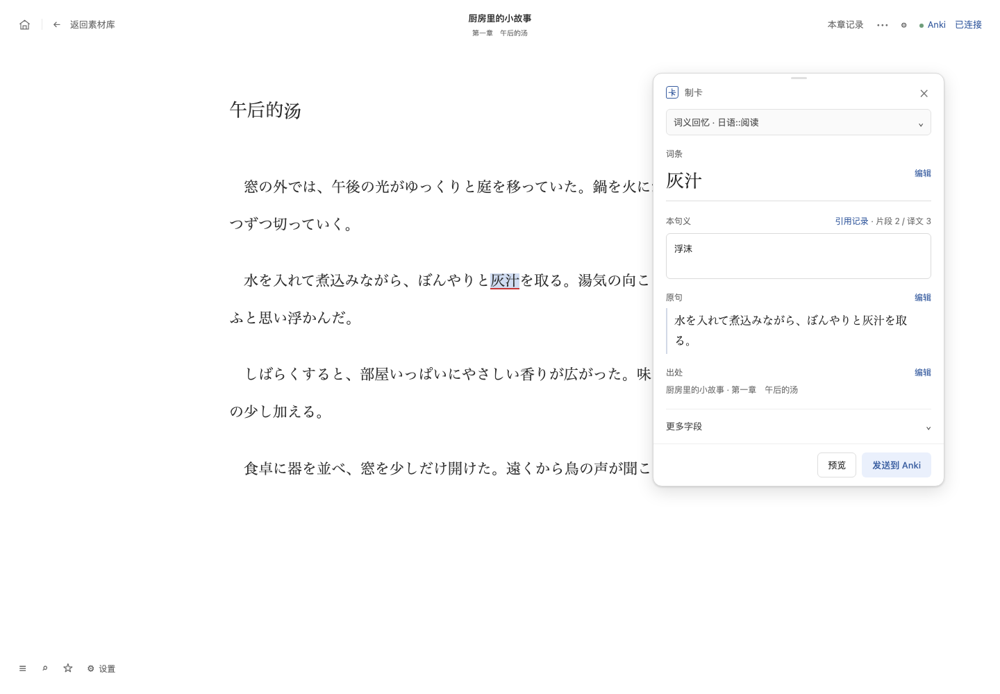
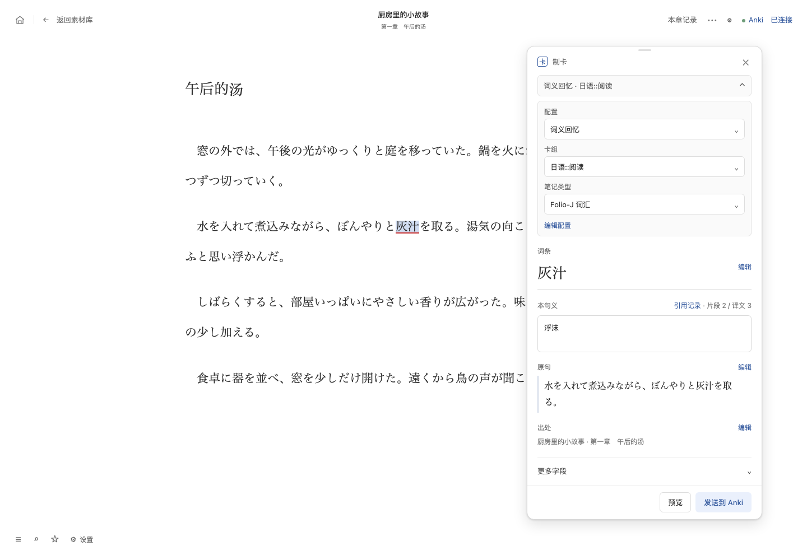
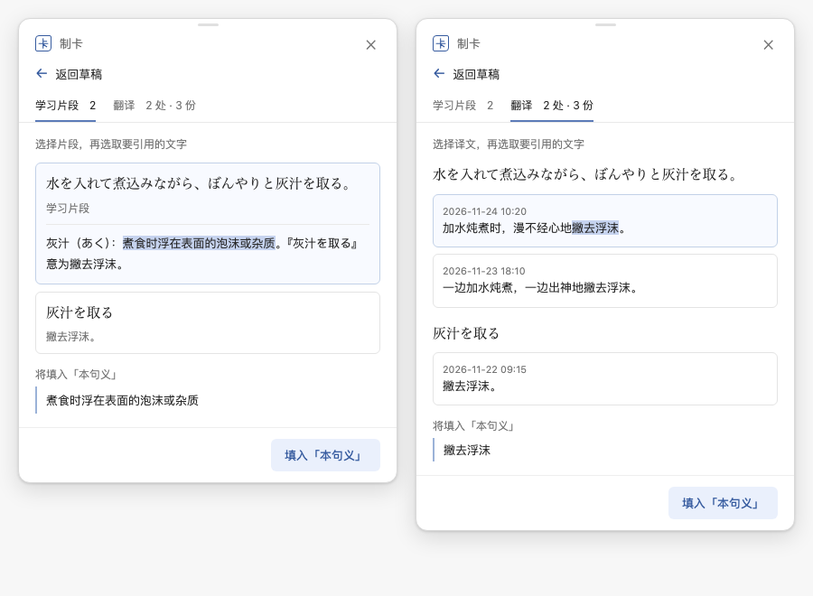
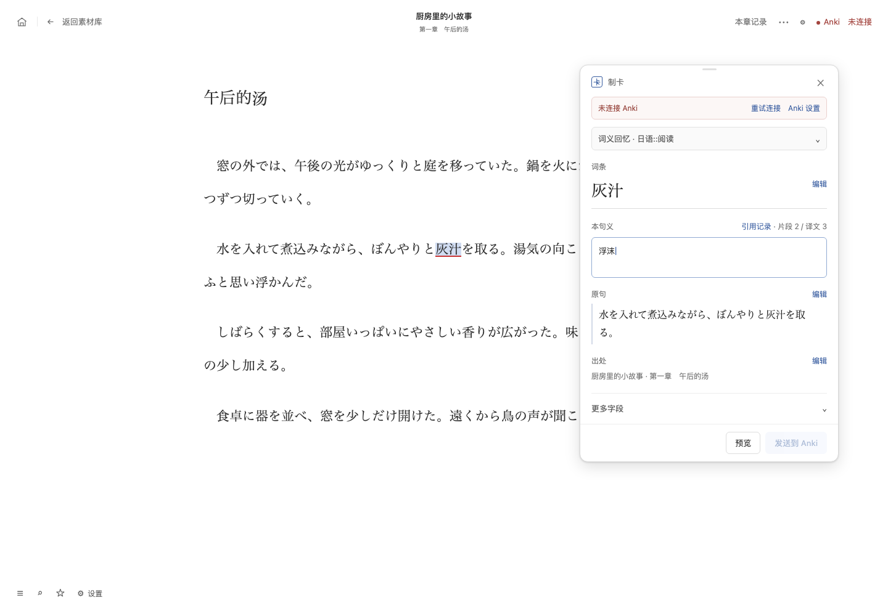
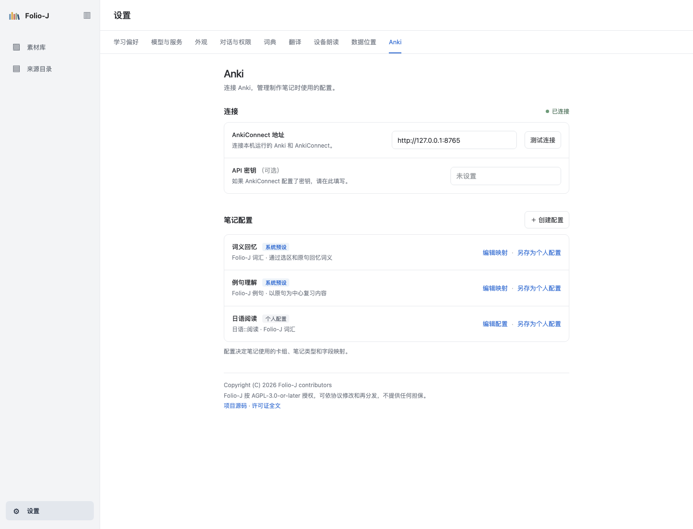
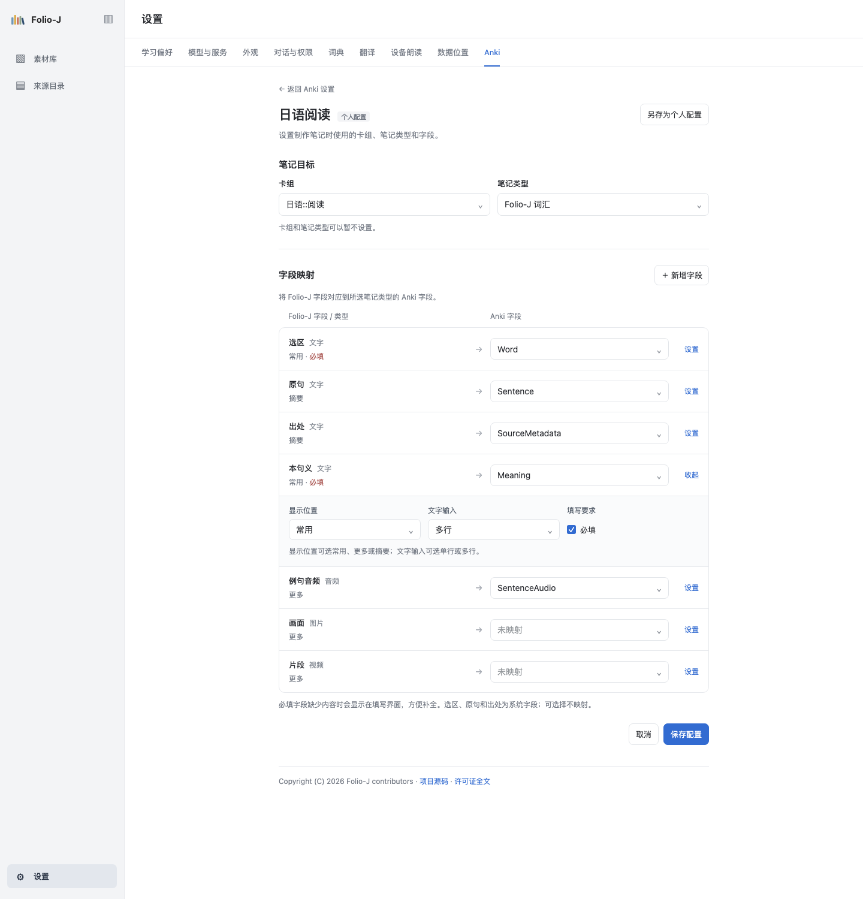
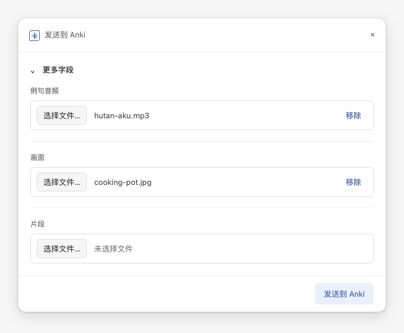

# 阅读器向 Anki 单向导出笔记

2026-11-25 · 阅读器制卡交互与早期设计图。图和手板保留评审时的外观，操作以正文为准。读者在 EPUB 中划词、查词或回看已有翻译／片段，借用原句、出处、词典与已有资料，填写当前笔记，发送到自己的 Anki 卡组。**Folio-J 保存连接设置与可复用的导出配置。一次导出的内容只在当前会话中存在，Anki 拥有创建的笔记和卡片。**

> 2026-11-24 评审修订：
> 1. **宽屏双栏参考**：参考资料改为按需展开的左侧参考栏（左参考 + 右草稿，窄屏退回抽屉／切页），统一承载**词典 / 翻译 / 学习片段**，不再在单栏里往返切页。
> 2. **多入口发起**：除选区工具栏的「制卡」外，在**词典根词卡**、**翻译卡片**和**此处记录**增加轻量「制卡」入口；从词典发起时自动预填词典形与读音（可手改），并在左侧展开当前词条供采摘义项。
> 3. **浮窗交互简化**：词条、原句与出处改为点击就地内联编辑；顶部摘要展开只允许切换「配置」与临时改「卡组」（改笔记类型与增删字段统一在设置映射页处理，同标签返回保留草稿）；顶栏 Anki 入口改为低干扰图标与轻量状态浮层。
> 4. **系统预设只读对齐后端**：设置页的系统预设只提供「查看」与「以此创建配置（另存）」，个人配置支持命名、排序、增删字段及删除配置。
> 5. **最近选择记忆**：浏览器本地记住最近选用的配置 ID 及无默认卡组预设在对应集合下最近使用的卡组。

例如，选中「水を入れて煮込みながら、ぼんやりと**灰汁**を取る」里的「灰汁」，点「制卡」。沿用上次的「词义回忆 · 日语::阅读」，填写或引用“浮沫”，点「发送到 Anki」并继续阅读。设置齐全时只需决定这次要记什么。[可直接打开的交互手板（模拟发送）](../../../prototypes/anki-reader-export/index.html) · [上一轮的本地笔记与复习回流提案](VOCABULARY_PLAN.md)

## 阅读器入口

左、右两侧都用现行选区组件与 CSS 渲染，同一处原生选区的正文外框为示意。提案在最后一组的「保存」右侧增加 16px 线性卡片加号图标和可见文字「制卡」，沿用普通按钮样式。原有两处分隔、蓝色的保存按钮及其“保存为学习片段”提示保留。按钮可用键盘触达，窄窗沿现有分组换行或收拢至可视区。片段详情共享工具栏组件，首期只有阅读器传入此动作。[现行选区组件](../../../frontend/src/selection/SelectionActions.tsx)

阅读器顶部栏右侧的 Anki 图标打开连接状态浮层。读者可以测试连接、查看活动 profile，或进入 Anki 设置更改地址，再返回原书。打开制卡浮窗时也会核对当前连接和目标。[当前阅读器](../../../frontend/src/materials/MaterialReader.tsx)

## 阅读时填写和引用

**默认单栏。** 词汇预设把词条作为可编辑的词头展示，读音紧接词条，必填的词汇释义获得初始焦点。点击原句引文可就地编辑，移开焦点后以引文展示当前草稿，保留换行。可在原句编辑框划选文字，点「设为重点」指定卡背强调的位置。词性按需修改或留空。原句下方的例句释义可填简短意译，也可留空。章级出处占一行，例句音频、图片和视频列在底部。底部保留「预览」和「发送到 Anki」。发送成功后关闭浮窗、保留原文位置并显示当次结果。读者可以直接填写并发送，引用资料和预览均为可选操作。

沿用「此处记录」的浮窗表面与焦点机制。题头「卡」印记用 18px 外框和居中的 14px 线条字形，避免字体基线把字压到下缘。桌面在选区旁有足够空间的一侧打开，拖动标题可停驻，输入和选择文字不触发拖动。窄屏用底部浮卡，内容独立滚动。普通点原文标记仍按现有方式浏览记录，只有明确点击「制卡」才产生草稿。同一处只开一个容器。卡外点击或阅读滚动不应悄悄丢弃已开始编辑的内容。[现有浮窗规则](../../INFORMATION_ARCHITECTURE.md#原处预览与记录浮窗) · [已有记录展开态](../archived/text-study/evidence/reader-records-joint/study-expanded.png)

**按需调整目标。** 展开「词义回忆 · 日语::阅读」摘要可切换配置或本次发送的卡组。下方显示笔记类型，可进入设置查看或另存系统预设、编辑个人配置。发送前会指出缺失的必填字段。

### 取材上下文与本次草稿

打开时冻结材料版本、资源、spine 出现和码点范围。选区原文、按原范围扩展的完整句和出处是只读取材依据。下表给出草稿第一次取值的方法。用户把词条改成词典形、重写释义、编辑原句之后，仍然可以查阅最初划中位置的记录。

| 应用侧字段 | 首次打开时的内容 |
|---|---|
| 选区 | 读者实际划中的基字原文，排除注音和内嵌译文。可将活用形手动改为词典形。 |
| 原句 | 在同一章可核验的原文中，从选区起点所处句的句首扩到终点所处句的句末。覆盖两句就保留两句。用既有日语句界、闭引号和 Unicode 处理规则。若无法可靠扩句，保留可核验选区，允许手填。 |
| 出处（SourceMetadata） | 按“来源 · 材料书名 · 章节”连接已有名称，相邻同名去重。默认到章，不附百分比、文件路径或坐标。例如「厨房里的小故事 · 第一章 午后的汤」。只有映射到目标字段时才导出。 |
| 自定义字段 | 按配置显示可命名的文字、音频、图片或视频输入。词汇释义、例句释义、读音等可由读者填写或从参考栏摘录。在设置中增删个人配置的字段、选择映射目标，同一配置可跨书复用。 |

复用阅读器已有的精确选区和句界。宿主以冻结的原范围读取相交记录，查询结果带回其取材身份和加载状态，迟到的上一选区结果不能进入新草稿。记录正文按需读取。当前会话只需共享这些取材值、读取入口和浮窗位置，草稿单独持有可编辑字段及文件。无需增加持久化的 StudyContext，也无需在原有记录组件内引入 Anki 协议。[现有原文范围与分句实现](../../../frontend/src/materials/study-context.ts)

### 从记录中取一段文字

**只要覆盖到，就能作为参考。** 在同一材料版本、同一资源及其同一次 spine 出现中，任一段记录范围和原始选区共享至少一个正文码点就计入。完全相同、记录包住选区、选区包住记录、两端部分重叠均命中。半开区间只在端点相邻则不命中。例如划选「灰汁」，整句的两版译文和「灰汁を取る」的短译都出现。若选的是「灰汁を」，一条只覆盖「を取る」的记录也出现。扩句补进来的文字、其他位置的同文、只经过另一条候选间接连上的记录都不扩大范围。可直接复用 `recordReferencesOverlap` 判断原选区与每条记录的交集。普通点击标记的浏览仍可按相连范围归组。[范围相交与既有浏览分组](../../../frontend/src/materials/chapter-records.ts)

图中保留了早期单栏手板的摘录步骤。完整视图见[学习片段摘录](ui/record-quote.png)与[翻译版本选择](ui/record-translations.png)。

1. **选填入目标。** 展开参考栏，选择词典、翻译或学习片段。底部的「填入目标」可在文本字段间切换。
2. **选记录与版本。** 相交的片段分别列出。译文按原文位置分组，可以继续加载历史版本。每组显示原文摘要，便于区分整句译文和局部说明。
3. **填整条或摘一段。** 点条目旁的弯箭头可填入整条内容，目标字段已有文字时追加。划选参考正文后，底部显示确切摘录和目标字段，已有值时可选择替换或追加。

宽屏从草稿左侧展开参考栏，收起时草稿右边缘保持原位。窄屏在参考资料与草稿之间切换。启用系统「减少动态效果」时直接切换。

词典页顶部可输入日语词查当前词典。从查词浮窗制卡时，搜索框带入词头，先展示当时选中的词典结果。改查其他词只更新参考资料；点击条目旁的填入按钮才会改动目标字段。

### 断线时继续编辑

| 时机 | 可用操作 |
|---|---|
| 打开时未连接 | 有本地内置或个人配置即可取材、填字段、选附件，允许打开适用的本地预览。不知道目标卡组时可暂留空。若本地字段定义也无法取得，才显示选择可用配置、重试或前往设置的引导。 |
| 编辑途中失联 | 保留当前草稿，可继续编辑和引用 Folio-J 已有记录。停用发送、远端卡组／类型列表刷新和类型安装。缓存的目标显示为待核验。 |
| 恢复连接 | 重新核对活动 profile、卡组、类型和映射。目标变化时保留字段输入，提示重选。恢复连接不会自行发送。 |
| 发送后回执丢失 | 显示“结果未确认，请先在 Anki 中查看”。恢复连接也不自动重发。 |

经浮窗进入设置或映射编辑器再返回，同一标签内恢复草稿。明确关闭、刷新页面或离开此次阅读会话后即释放。编辑离线草稿不引入持久化或发送队列。

## 全局设置与字段映射

全局设置增加「Anki」。连接区提供服务地址（默认 `http://127.0.0.1:8765`）、可选 API 密钥和「测试连接」。检测由本机 Folio-J 后端执行，使用正在编辑的地址并区分服务不可达、鉴权失败、未打开集合与所需接口不可用。地址或密钥变更后旧状态失效。可用时显示目标 Anki profile，配置信息在所有材料之间共享。API 密钥走现有私有凭据存储。

需要区分**配置中的字段定义**和**这一次准备发送的值**。配置里可保存一个名叫“例句音频”的音频字段。读另一本书时会再次看到这个输入框，之前选的文件和填过的释义都会留在之前那条 Anki 笔记中。

| 配置项 | 编辑与生效规则 |
|---|---|
| 名称与目标 | 用户可创建、命名、编辑或另存个人配置。系统预设可另存个人版，多套配置可以指向同一个 Note 类型。卡组与 Note 类型各自单选，也可任一留空后保存。发送时需选定两者，卡组选当前集合中的普通卡组。来源名称不自动决定卡组。 |
| 字段定义 | 每行有稳定的应用侧字段 ID、显示名、类型、取值来源和映射目标。同一显示分组内按配置顺序排列，词汇预设将读音排在词条下。改名保留同一行映射。配置可标记哪些字段必填，并为文字选择单行或多行输入。 |
| 字段显示 | 字段随草稿直接显示。预填的词条与原句可就地转编辑。「摘要」用一行展示当前值，点开修改。「靠后」字段排在常用和摘要字段之后，词条与读音相邻。已有附件显示文件名。显示位置不改变导出值。发送前提示缺失的必填项。配置标为必填的字段须有有效目标映射。 |
| 目标字段 | 从目标 Note 类型实际字段中单选，可留“未映射”。首期一行对应一个目标，同一目标最多接收一行，以免覆盖。漏配、重名冲突、目标类型改名或删字段时标出具体行。有效的部分可继续编辑。 |
| 生效时机 | 允许离线编辑个人配置、保存不完整配置。没有可核对的类型时，已存映射标为待核验。重新选择类型时只保留能明确对应的字段，其余要求重选，发送前再读取实际结构。浮窗中切换配置，按应用侧字段 ID 和类型保留兼容的本次输入，切回原配置仍可找回本次手改值。发送只采用当前配置中已映射的字段。「保存配置」排除所有本次字段值和媒体。 |

用户截图中的 asbplayer 将卡组、笔记类型和字段映射放在 Anki 设置中，这三项值得沿用。Folio-J 的编辑器把应用字段与 Anki 字段并排显示，做成一次设置、多本书复用。日常制卡保留目标选择，把空间让给原句与参考资料。[asbplayer 设置说明](https://docs.asbplayer.dev/docs/reference/settings/#anki) · [用户提供的对照图（本机）](../../../data/acceptance-evidence/anki-design-reference/asbplayer-settings.png)

### 媒体字段

自定义字段使用本机文件选择器，每行一次选一份文件，按音频／图片／视频限制可选类型，可替换或移除。草稿保留本次选择的文件对象。服务器核验格式与体积，只在实际发送时交给 Anki。先验证文字、映射和目标，再上传媒体，使用 Anki 返回的真实文件名组合字段值。图片使用图片引用，音频及兼容视频使用 Anki 媒体播放引用。若媒体已传而笔记未能创建，说明可能留有未使用媒体。一次发送中多个字段引用同一附件时，只上传一次。跨设备的播放能力按实际客户端验证。首个实机样例用 MP3、PNG／JPEG、MP4。[固定版本协议参考](../../../references/anki-connect/README.md) · [Anki 媒体手册](https://docs.ankiweb.net/media.html)

## 内置配置与已有笔记类型

系统提供「词义回忆」「例句理解」两套导出配置，各自定义取材、填写和映射方式，默认卡组留空。另附词汇和例句两种用途的 Note 类型，分别维护字段顺序、Card 模板与 CSS。设计样本用 `exportPresets[].noteTypeRef` 引用 `noteTypes[]` 的身份和版本。个人配置可以复用同一个内置类型，也可指向用户已有类型。配置名称不会成为学习任务或知识点身份。

| 配置 | 随附 Note 类型和模板 | 默认用途 |
|---|---|---|
| 词义回忆 | `folio-j.vocabulary-recall@2`，Folio-J 词汇 v2，一张识读卡 | 正面词条和可选原句，背面显示词汇释义；填写例句释义时，在原句下方显示。读音、媒体与出处按需填写。 |
| 例句理解 | `folio-j.sentence-reading@1`，Folio-J 例句，一张理解卡 | 正面完整原句，背面用户写的译文或说明、目标表达、可选媒体与出处。 |

首次对外发布前，卡面与字段调整沿用当前模板版本。此前已安装「Folio-J 词汇 v2」时，在 Anki 中新增 `PartOfSpeech` 字段，再同步卡面与共用样式；例句 v1 可直接更新卡面与样式。已保存的个人配置继续使用原先选定的笔记类型版本。系统预设首次使用 v2 时，按现有流程确认创建独立类型；Anki 中原有的词汇笔记仍使用 v1。

在当前集合中核对类型身份、字段及所需模板。随附模板用 HTML 注释携带类型 ID 和版本，无需在每条用户笔记中加一个 Folio-J 身份字段。已有且兼容即可发送，用户改过颜色或版式仍保留其编辑。缺失时在首次实际发送前展示将创建的类型、模板和目标卡组，点击「创建并发送」才写入，返回继续编辑则保留草稿。同名异构、身份不明或所需字段已缺失时，发送会暂停，可在配置中选择其他类型并重新映射。已有类型的字段、模板和样式都不自动覆盖。创建成功而发送失败时，下次先重新探测，避免重建类型。[随包的内置类型与预设](../../../backend/src/app/anki_builtin_types.json) · [早期 v1 设计样本](builtin-note-types.json)

**日常预览。** 发送前可随时点「预览」，内置类型使用与安装确认相同的正反面视图，把当次草稿值填进随附模板。离线或用户在 Anki 改了模板时，明确标“内置样式预览”。对无法可靠渲染的自定义类型，显示“待发送字段”供核对。AnkiConnect 的 `cards.render` 需要现存 Card ID，首期不会为预览临时写入笔记。已有类型可以带多套 Card 模板，成功以 Note 创建为准，实际生成的卡数沿用外部结果。[上游接口参考](../../../references/anki-connect/README.md)

## 持久化与发送结果

| 所在位置 | 保存什么 |
|---|---|
| Folio-J 设置 | 服务地址、凭据引用、个人导出配置保存在应用设置的 SQLite 存储。可记最近选用的配置 ID。已选卡组／类型引用带目标连接及 profile 的范围，在另一集合需重新核对。内置模板随应用分发。 |
| 当前会话内存 | 选区出处、展开的原句、已有资料引用、手改字段、文件、本次卡组和发送进度。成功回执和 Note ID 只用于当次反馈。业务数据库、浏览器持久存储、URL 和常规日志不记录导出正文、媒体或逐次导出历史。原有阅读位置与读者主动保存的资料沿用现行规则。 |
| Anki | 笔记、实际生成的卡片、媒体和后续复习记录。读者在 Anki 里编辑、删除和复习。这个阶段不维护本地笔记目录、来源卡组绑定、离线队列、复习回流或卡片同步。 |

**不留导出账本的代价是，关闭会话后无法在 Folio-J 恢复草稿，也不能保证跨重启辨认一笔结果未知的提交。** 推荐接受这个取舍。发送时锁定重复点击，先用当前集合核验目标和原生必填／重复规则，再建笔记。明确收到重复提示时，可返回调整，或由读者为“同词不同义”明确选择仅本次允许重复。写入后超时或连接中断则显示“结果未确认，请先在 Anki 中查看”，不自动重发。用户已有笔记类型保持自己的字段和判重规则。文字按普通文本转义，媒体引用由适配模块生成，传输中使用的临时资源在请求结束或失败时释放。

实现上将读取配置、探测连接／卡组／类型、核验映射、安装内置类型、上传媒体与创建笔记封装在后端业务服务及 AnkiConnect 适配模块内。路由传递有明确用途的请求，不提供任意 Anki 动作转发。前端复用现有选区、句界、记录查询与浮窗机制，卡片内容用临时草稿管理。固定协议参考用于核对 v1 与 legacy v6 所需子集。真实安装决定用哪套协议。手动制卡无需 LLM Run。引入设置 schema 时照常做迁移、生成客户端。[协议版本与离线副本](../../../references/anki-connect/README.md)

## 施工顺序与验收

1. **先评图和交互手板。** 从「灰汁」打开草稿，用一条已有讲解中的几个字填写词汇释义，再返回预览。观察填写时遮住多少正文、能否找回之前手改的值。图中的连接状态和笔记预览均为示例。确认后将已选行为转入相应长期规范。
2. **用测试替身验证。** 覆盖完全重合、包含、部分重叠、只接壤、间接相交、同文异址与重复 spine。演练同处两条片段、两处三份译文，选较早版本、摘取部分文字、取消和替换已有值。检查靠后显示的必填项、跨配置切换、离线起草与恢复核验，以及窄屏、纵排和键盘返回。
3. **在独立 Anki profile 验收。** 分别导出到一个会生成多张卡的用户类型，以及两套各生成一张卡的内置类型。核对字段、实际卡面、章级出处及预览与实卡的差别。分别验证相同首字段 Word 的不同义项、相同首字段 Sentence 的不同目标，只有用户明确选择才允许单次重复。另测同名异构类型、媒体部分成功、结果未知与 Anki 中实际播放。检查本地只留下设置与配置。自动化测试保持模拟连接，实机结论单独记录。
