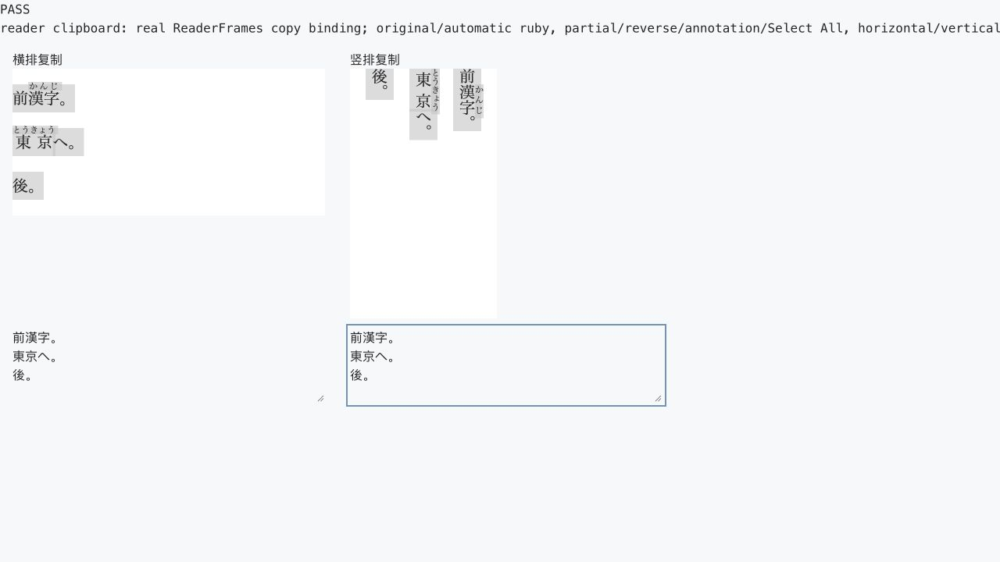

# 阅读器复制正文验收

2026-10-23。交付状态见[实施基线](../../MVP_IMPLEMENTATION_BASELINE.md)，产品行为见 [PRD 注音与复制规则](../../../PRD.md#47-当前-epub-阶段安排)，日常操作见[使用指南](../../../USAGE.md#复制原文与外部-ai-提示词)。

## 修复范围

旧复制逻辑克隆选区后删除 rt／rp；仅选中注音内部文字时，克隆结果可能只剩裸文本，无法通过标签过滤。现在由 ReaderFrames 管理复制事件，按当前正文投影提取原生选区中的字符，排除原书与自动注音，保留编译正文的换行与空白。粘贴内容为纯文本，复制不修改 DOM、选区或注音显示；卸载及失效 frame 不处理复制。

## 验证

- `just lint`、`just test` 通过：后端 585 项、前端 413 项。
- `just build`、`just check-docs` 与 `git diff --check` 通过。生产前端已重新构建；Vite 保留现有的大包体积提示。
- `just test-browser` 通过。新增 `frontend/browser-tests/reader-clipboard.ts` 使用真实 ReaderFrames 与 sandbox iframe，覆盖原书 ruby／rp、自动注音、局部／反向选择、注音端点、仅注音、正文全选、横竖排、三种显示方式、换行、扩展输入框目标及清理后的事件。合成 ClipboardEvent 检查纯文本载荷、HTML 清除与选区／DOM 不变。
- Codex 内置浏览器打开独立回归页，分别聚焦横排和竖排正文，实际执行 ⌘A → ⌘C，再到文本框执行 ⌘V。样例同时显示原书「漢字／かんじ」和自动「東京／とうきょう」注音，两次粘贴均为下列三行，两个换行保留：

```text
前漢字。
東京へ。
後。
```



本轮使用隔离样例，没有修改日常书籍、学习资料或阅读位置。未新增依赖、接口或 TBD。实际快捷键验证覆盖内置浏览器；Safari、Firefox、移动端及实体扩展兼容性未在本轮验证。复制保留编译正文的源码空白，富文本样式不进入剪贴板。
