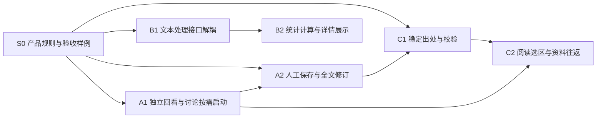

# 文本处理与学习资料独立入口实施计划

> 2026-10-20。用户已批准计划，S0 → B1 → B2 → A1 → A2 已完成本轮工程验收，C 暂不实施。当前交付状态由 [MVP 实施基线](../MVP_IMPLEMENTATION_BASELINE.md)维护。产品规则已由 S0 同步至 [PRD](../../PRD.md)、[GLOSSARY](../../GLOSSARY.md)及其他负责规范；计划保留整体范围，不能据此推定后续切片已交付。

本轮让文本分析脱离 EPUB 呈现，让讲解保存与回看脱离 AI 对话，并接通阅读选区与持久资料的准确出处。沿用模块化单体、现有材料正文、分词代次、Analysis 修订和阅读恢复机制，以功能切片验证架构调整的效果。

## 1. 交付范围与停止条件

原计划覆盖三条路径，当前交付前两条；第三条对应 C1／C2，保留为后续目标：

1. 无需配置模型，用户能在 Segment 下直接保存手写或外部 Markdown、编辑全文产生新修订，并从来源重新打开。
2. 普通文本资源能直接进行词法分析和统计；书籍详情读取后端汇总，不挂载阅读器、不下载全书 token。
3. 从 EPUB 选择原文，创建或显式选用有确切出处的 Segment，保存讲解，从来源找回并返回原文。

架构改动是各切片的正式交付项：B1 收窄文本处理接口并分开分析资产与 EPUB 章节适配；A2 集中资料写入的内容约束；A1 分开讲解浏览与讨论生命周期；C2 收拢 iframe 生命周期及选区适配。验收同时覆盖接口依赖和用户行为，不以文件行数减少为完成依据。

本轮不实现翻译服务、TTS、OCR／ASR、第二种媒体导入、材料对话、Occurrence、Lexeme、SRS、通用任务引擎或完整正文版本管理。统计不包含难度评分、逐汉字读音、平均自然句长、卷数或学习者掌握率。既有聊天执行继续使用 chat_jobs；新增能力不伪造线程、Job 或 Run。不新增依赖，不做全仓 schema 搬迁。

C1／C2 完成后，三条路径应可独立使用；现有导入、注音、讨论审核、迟到响应保护、历史修订和阅读恢复均须保持。翻译／TTS 的持久化承诺、上下文范围和任务恢复留在后续具体切片中收口，不作为本计划阻塞项。

## 2. 当前代码起点与复用范围

下表记录 `85d8725` 时的实施起点，供理解各切片的改动范围；交付后的当前实现见[架构](../../ARCHITECTURE.md)与实施基线。

| 位置 | 当前事实 | 本轮处理 |
| --- | --- | --- |
| [tokenization.py](../../../backend/src/app/nlp/tokenization.py) | generate 接收 CompiledBook，实际读取资源 ID、正文和摘要 | 提取格式无关的文本输入；保留原始 token 与代次语义 |
| [readings.py](../../../backend/src/app/services/readings.py)、[readings_schemas.py](../../../backend/src/app/readings_schemas.py) | 构建／发布／代次读取与 EPUB 章节裁剪同处；结果已独立保存 | 分开完整分析资产读取与章节投影，复用发布事务与旧结果保留 |
| [analyses.py](../../../backend/src/app/services/analyses.py)、[公开路由](../../../backend/src/app/api/analyses.py) | 写服务支持空 run_id，但只 flush；公开 API 仅读取与删除 | 增加人工创建／全文修订用例及事务入口，沿用底层修订保存 |
| [sources.py](../../../backend/src/app/services/sources.py)、[chat.py](../../../backend/src/app/services/chat.py) | Segment 原文目前在聊天受理时锁定；revision 包含备注等变化 | 扩大原文保护触发范围；人工保存校验原文摘要，不把记录 revision 当正文版本 |
| [SegmentPage](../../../frontend/src/SegmentPage.tsx)、[AnalysisPanel](../../../frontend/src/analysis/AnalysisPanel.tsx)、[Workbench](../../../frontend/src/chat/Workbench.tsx) | 讲解已独立查询；面板混合生成控制，隐藏工作台仍挂载 | 讲解浏览独立组合；讨论首次需要时启动，启动后收起保活 |
| [MaterialReader](../../../frontend/src/materials/MaterialReader.tsx) | 已复用布局、位置队列、返回点和偏好提交；每个 chapter part 使用独立 iframe | 提取 iframe 装载／事件／就绪／销毁协调，不重写现有状态机 |
| [材料定位契约](../epub-reading/MATERIAL_BASELINE.md) | 已规定有序多资源范围、码点与快照校验；生产 Segment 尚无精确出处 | 落实出处存储、严格校验、原生选择与返回；不另建通用引用注册系统 |

EPUB 的 resources 按 spine 出现保存，可能含相同 resource_id 的重复条目。B1 保留这一输入语义；B2 明确统计去重规则，C1／C2 区分原文资源与阅读序列中的出现位置。

## 3. 切片与依赖

| 切片 | 前置条件 | 可独立交付的结果 |
| --- | --- | --- |
| S0 | 本计划 | 负责规范、施工默认和回归范围一致，未决范围不混入实现 |
| A1 | S0 | 纯回看不启动讨论查询，已启动讨论收起后不丢状态 |
| A2 | S0、A1 的前端组合接口 | 无模型的讲解创建／粘贴导入／全文编辑闭环；后端可与 A1 并行 |
| B1 | S0 | 普通文本可分词，完整分析结果可独立读取，EPUB 适配留在格式侧 |
| B2 | B1、统计口径样例 | 书籍详情展示有明确范围的统计和覆盖曲线 |
| C1 | S0、A2 的原文保护规则与写入约定 | 可持久保存、验证和读取 Segment 的材料出处 |
| C2 | A1、A2、C1 | 阅读选取 → 保存资料 → 来源回看 → 精确返回 |

A 线与 B 线可并行。C1 的 schema 和样例可提前设计，涉及 sources 服务的实际改动在 A2 集成后进行。C1／C2 不依赖统计完成，也不以 B1 的新接口作为精确定位前提；其依据始终是不可变材料正文。

## 4. S0 产品规则同步与施工默认

以下范围已随本计划获批，由 S0 写入负责规范；后续切片据此实现，A／B 线已完成工程验收。规则确认与代码交付分开记录。已有 TBD 不在本轮自动关闭，PRD 版本号遵守审订期间统一收口的约定。具体样例见[验收矩阵](TEST_MATRIX.md)。

| 事项 | 已确认范围摘要 | 负责规范与关联切片 |
| --- | --- | --- |
| 人工入口 | Segment 下直接输入或粘贴 Markdown，统一记录用户保存，不要求区分编写与粘贴；保存不要求模型配置。首版不做批量文件导入、URL 抓取或富文本编辑 | PRD F3、6.3；GLOSSARY 3；A2 |
| 原文固定 | AI 任务首次受理、持久讲解首次保存、精确材料出处首次建立，任一成功即固定原文。打开编辑器、取消或失败保存不锁定；删除讲解和任务失败不解锁 | PRD F2、GLOSSARY 1、ARCHITECTURE 写入契约；A2、C1 |
| 全文修订 | 编辑当前修订，提交携带基础修订；冲突保留草稿。旧修订只读。无显式块映射的全文替换产生新块身份，沿用既有规则 | PRD F3、GLOSSARY 3.2、INFORMATION_ARCHITECTURE；A2 |
| 讨论生命周期 | 普通回看和人工编辑不启动 Workbench；显式展开、未显式收起的线程直达或快捷生成才启动。启动后在当前 Segment 页面内保活，离页后的草稿持久化不扩张 | PRD 4.4／4.5、ARCHITECTURE 6、INFORMATION_ARCHITECTURE；A1 |
| 统计范围 | 当前材料版本的全部可提取正文，按 resource_id 去重；同一资源重复 spine 只计一次，不按文字摘要合并不同资源。包括目录、后记，不标作小说正文 | PRD 4.2.1、GLOSSARY 统计术语；B2 |
| 统计含义 | 按固定分词配置和词典形统计词次／词种；保留助词助动词，排除空白、标点及零跨度等指定记录。累计覆盖是本材料高频词的词次占比 | PRD 4.2.1；ARCHITECTURE 统计规则；B2 |
| 阅读选区与范围 | 首版在单个 chapter part 的 iframe 内使用原生选择；支持跨 DOM 节点，不承诺跨 iframe 拖选。底层出处及回读支持同一逻辑章内的有序多资源范围，跨章目标留待后续 | PRD 4.7、材料定位契约、INFORMATION_ARCHITECTURE；C1／C2 |
| 片段复用与语境 | 只按确切出处提供已有片段候选，由用户选择；不按相同文字自动合并。首版无自动语境，沿用用户填写前后文；选中文字不调用模型 | PRD 4.3／4.7、GLOSSARY、INFORMATION_ARCHITECTURE；C2 |
| 从出处回读 | 返回确切版本与出现位置，校验后高亮；失配保留可见资料的历史文字并明确无法定位。材料已删除时保留片段与历史出处，明确不可回读；Source／Segment 已删除时继续遵守不可见门禁 | PRD 4.7、材料定位契约、INFORMATION_ARCHITECTURE；C1／C2 |

AGENTS 的产品简介在 S0 对齐“原文阅读、独立资料与按需讨论”的重心，工程规则保持原位。TECH_STACK 记录采用状态与无新增依赖；实现接口与未来接口在 ARCHITECTURE 中分开。MVP 基线只更新状态和证据入口，不复制本计划。

S0 同时建立可复用验收样例清单：空正文、纯标点、兼容字符、非 BMP、跨节点 NFC、原书 ruby、自动注音、重复 spine、同文不同资源、无模型设置、两个编辑页面、响应丢失、软删除及旧修订。测试先锁住涉及重构的行为，再修改实现。

## 5. A1 独立讲解回看与讨论按需启动

**架构改动。** 从 AnalysisPanel 提取持久讲解列表／详情／确切修订呈现，生成状态、停止操作和快捷生成由页面或讨论组合层提供。沿用现有查询、Markdown 渲染、链接安全与归属校验，不新增讲解读取系统或独立路由体系。

SegmentPage 区分“尚未启动讨论”与“启动后隐藏”。启动状态以 Segment 身份隔离；同一 Segment 的查询参数变化不重挂整个页面。未显式收起的线程直达、展开讨论和快捷生成均能正确激活；URL 中 chat=0 优先于 thread，首次进入时保持纯回看；普通讲解直达不查询 settings、providers、threads 或 jobs。已激活的 Workbench／ThreadPanel 保留草稿、待核实提交、审核说明及协调器状态。

**改动范围。** frontend/src/analysis/AnalysisPanel.tsx、SegmentPage.tsx、chat/Workbench.tsx 及其查询组合和测试。保留 DiscussionCoordinator、首次提交阅读快照、Job 版本合并与迟到成果保护；不重写讨论推进协议。

**验收。**

- 无 Provider 的全新页面直接打开讲解及历史修订，原文和正文可读；浏览器网络记录没有讨论、模型设置或任务查询，没有创建 Thread／Job／Run。
- 进入列表、确切修订、刷新、来源返回、错误及删除目标路径正确；读取失败不显示失效缓存正文。
- 激活讨论后输入草稿、收起再展开，草稿和审核补充要求保留；响应丢失的同请求核实继续有效。
- 普通讨论与快捷生成的成果均不抢走用户后来选择的讲解；“已保存成果但后续回答失败”仍准确显示。
- 桌面与窄屏实际验证原文／讲解对照和讨论显隐；不能只用纯逻辑测试证明组件没有挂载。

## 6. A2 人工讲解保存与全文修订

**用户路径。** 在 Segment 讲解区新建，输入或粘贴 Markdown，直接保存；直接打开刚保存的确切修订。当前讲解支持全文编辑，旧修订保持只读。空白正文、超限、冲突和保存失败均保留草稿；取消有未保存修改时沿用项目草稿确认模式。首版不承诺关闭页面后恢复人工草稿。

**架构改动与接口建议。**

- POST /api/segments/{segment_id}/analyses 创建讲解；POST /api/analyses/{analysis_id}/revisions 提交人工全文修订。请求带 request_id、expected_text_sha256、source_md；修订额外带 base_revision_id。创建可带可选标题，界面统一记录用户保存；API 保留 import 值的兼容，见下项。最终字段以 OpenAPI 及其生成前端类型为准。
- Segment 读取返回服务端计算的 NFC 原文摘要；人工保存比较该摘要，避免备注变化造成无关冲突。现有 Segment.revision 继续表示整条记录修订，不新增正文版本表。
- 新建界面统一写入 manual；API 的 import 和已有历史记录保留兼容；全文修订写入 manual_edit，run_id 为空。客户端不能声明 agent 或附加虚构 Run。外部出处可随 Markdown 保留，首版不做来源自动抓取。
- 在 services 中设置明确的写入用例入口，统一祖先存活、原文保护、基础修订、幂等和提交规则。底层 create_analysis／修订保存仍可 flush；聊天路径继续保留自身 Job token、停止和审核校验，并复用内容约束。避免嵌套事务或把任务授权移给人工入口。
- 同一短写事务先核对对象可见性，再识别已完成同请求；同 payload 重放返回原修订，早于陈旧基础版本判断，不将成功重试误报为版本冲突。新请求再检查原文依据和基础修订，原子锁定原文与保存 Revision／Section。失败全部回滚。
- request_id 经服务端添加操作类型前缀，创建和全文修订不碰撞现有工具 operation_key；同键不同 payload 冲突。提交响应不确定时使用原请求核实／重放，禁用以新 request_id 盲目重建；重放也不得绕过删除门禁。
- 全文替换不猜测 Section 映射，分配新 uid／handle；历史修订及原块身份保留。Agent 块编辑继续使用原来的显式映射和基础版本校验。前端不提交未变化的正文；服务端对新请求的无变化保存返回明确的 no_changes 校验结果，不产生空修订或成功操作凭据。已完成操作的重放仍优先返回原结果。

**存量保护。** 实施前检查有历史 Analysis 但未锁定的 Segment，包括仅剩软删 Analysis 的情况。保守冻结当前原文，记录本次保护生效时间，不伪造历史受理时间，也不把当前正文补成历史讲解的真实原文快照。记录异常数量和无法追溯的限制；正常锁定、Markdown 和历史 Revision 不改写。数据变更使用可审阅迁移，不在启动时修改或清库。

**验收。**

- 无模型配置完成手写／外部 Markdown 保存、全文修订、来源找回及重启后读取；没有 Thread、Job、Run 增量。
- 人工保存与改原文竞争：改原文先成功则保存冲突且不锁、不产生讲解；保存先成功则后续改原文失败。失败保存、取消编辑不锁定，删除讲解不解除固定。
- 人工全文编辑与 Agent 块编辑竞争、两个人工编辑竞争，只接受有效基础修订；失败保留草稿，旧修订可精确读取。
- 创建／修订双击、同请求重试、响应丢失后核实、同键改 payload、已保存后又有更新的重放，都返回正确身份且不重复创建。
- Source／Segment／Analysis 删除与迟到提交相遇时不能恢复内容；旧数据四类（正常锁定、有讲解未锁、仅软删讲解、无讲解）均有迁移样例。
- 无二级标题 Markdown 可保存；R1／R2／R3 规范化性质、NFC 保存约定和全文新块身份有回归。首次保存会固定原文的提示在提交前可见。

## 7. B1 文本处理接口与分析资产解耦

**架构改动。** 建立窄的有序文本输入，每项仅表达 resource_id、text、text_sha256。词法分析 module 的 interface 不接收 CompiledBook、HTML、CSS、章节或阅读位置；通过普通文本样例即可调用与测试。EPUB 在现有构建入口转换输入。

分开词法数据契约与阅读 API DTO：token／资源分析结果供分析与统计复用，MaterialReadingsPrepare／Response 等保留 API 职责。若移动类型，保持 wire format，并集中调整引用；纯移动与行为改动分开审阅。

完整资产的解码和有界校验供统计与注音共用；章节资源筛选保留为 EPUB 适配。构建／发布继续沿用不可变代次、当前指针和迟到保护。持久化入口目前仍从 EPUB Material 取正文，本切片不宣称已经具备通用媒体导入与存储。

**兼容边界。** 保留资源顺序及重复条目、原始 token、configuration、payload 结构、摘要和 token_count 的含义；不在此步去重、过滤或改分词配置。完整资产读取校验针对可信本地生成数据，不增加任意外部分析包导入能力。B2 的统计投影不得反写资产。

**改动范围。** backend/src/app/nlp/、readings_schemas.py、services/readings.py 及 services/materials.py／epub.py 的调用接点；仅在确有归属需要时移动内部契约。原则上无数据库变更；若公开 schema 形状变化，运行 just gen-api 并检查客户端兼容。

**验收。**

- 普通文本资源直接完成分词；核心接口与测试无需构造 EPUB 对象，也不导入 EPUB schema。
- 用改动前固定样例记录结果，改动后 configuration、解压 payload、asset digest、token_count 一致；覆盖重复 spine、空资源、兼容字符和零跨度 token。
- 完整分析读取不需要 chapter_id；EPUB 章节接口保持原响应语义。新增重复 spine 与章节投影组合测试，发现的现有缺陷单列修复，不借解耦静默改变计数。
- 新书仍完整分词成功后原子发布；旧书补算、重建失败保留、相同结果去重、确切旧代次读取、迟到发布及 Source 删除竞争全部通过。
- 未变更材料正文、版本、历史引用与阅读位置；分词重算仍不生成 Run。

## 8. B2 统计计算与书籍详情

**统计规则 v1。** 已同步至 PRD 与架构，集中在纯计算 module，结果标明规则版本；输入是正文资源与确切代次的完整词法结果，不从章节注音响应累加。

| 项目 | 初版计算口径 |
| --- | --- |
| 范围 | 全部可提取正文，resource_id 去重。同 ID 须具有相同正文摘要及相容分析结果；不同 ID 即使文字相同也分别计入 |
| 有效词次 N | 原文跨度 end > start、表层非空白，词性首项不在空白／記号／補助記号集合；保留助词、助动词、数字及未登录词。原始零跨度条目保留在资产中 |
| 归并 | 词典形为键；缺失、空白或明确占位值时回退 surface。不得使用表层读音参与键，也不称为 Lexeme 身份；过滤和回退集合集中定义并用样例固定 |
| 词种 V、单次词种 H | 对有效词次按上述键统计，H 为频次等于 1 的键数量；单次词种比例为 H/V |
| 覆盖曲线 | 频次降序，同频按键稳定排序；前 k 种的累计频次除以 N。80%／90%／95% 阈值取满足条件的最小整数 k |
| 字符数 | NFC 定位正文的 Unicode 码点数，含空白与标点；排除 rt／rp 已由材料正文保证，不再次读取 DOM |
| 汉字统计 | 按 Unicode 名称中的 CJK UNIFIED IDEOGRAPH 与 CJK COMPATIBILITY IDEOGRAPH 计数，记录 unicodedata 版本；提供不同汉字数与只出现一次的汉字数，不作 NFKC 折叠。々、〇及兼容符号展开不计作上述汉字 |
| 空输入 | 数量为 0；分母为 0 时比例、覆盖阈值为 null，界面显示“—”，曲线为空，不虚构 100% |

界面称“词次（按词典形统计）”“词种”等，在统计说明中说明分词粒度、过滤与范围。曲线横轴明确为“本书最高频的前 k 种词”，纵轴为“词次覆盖率”。不把 OOV 标成用户不会的词，不用“理解率”命名。

**接口与性能。**

- 建议增加 GET /api/materials/{material_id}/statistics，支持明确的 version_id 和可选 generation_id；返回范围、规则版本、正文统计、词法统计和实际采用的代次。不扩展 details 请求的成功条件，详情独立加载统计。
- 后端计算完整频次；曲线响应最多 512 个点，保留首尾和阈值点，阈值数字从完整频次计算。前端不接收全书 token，不用抽样曲线反推阈值，不新增图表依赖。
- 字符／汉字统计只依赖正文、范围和字符规则；词法统计另依赖确切分词代次与词法规则。更改标题、封面、阅读状态或位置不使统计失效。
- 首版按需计算，解压和遍历离开事件循环，不持有数据库写事务。使用按输入身份索引的有界内存缓存，集中条目数／内存上限；同键并发合并计算，不同键的计算并发也设集中上限。重启后可重新计算，不新增持久统计表或后台队列，不占用聊天 Job 的执行名额。
- 无可用分词代次时，正文统计仍可用，词法部分明确“尚未准备”；统计 GET 不隐式补算分词。失败可重试，读书和既有注音准备不等待统计。打开统计不更新 usage、最近打开、位置或 Run。
- 缓存命中前及耗时计算返回前重新检查材料可见性；响应带确切输入身份。计算期间代次变化不混用结果，前端不将旧响应当作新代次；Source 删除后不通过缓存暴露资料。

**改动范围。** 后端新增统计纯逻辑、服务和 schema／路由；完整资产读取复用 B1。前端 catalog/BookDetailsPage.tsx、catalog/api.ts 及局部统计展示；读取通过 TanStack Query 和生成类型。

**验收。** 固定小语料手工核算 N、V、H、比率、覆盖阈值与汉字；覆盖同资源重复 spine、同文不同资源、零跨度、纯标点、空输入、活用词典形归并、OOV、扩展区汉字及 ruby。普通文本可直接计算；输入资产不被修改。验证缓存命中／淘汰／失败重试、代次与规则切换、元信息变化不重算、计算中删除及并发请求。用仓库可用大样本记录首次计算时间、响应大小与缓存规模，不将统计性能加入导入就绪条件。浏览器验证详情独立加载、说明、曲线、空态、失败、窄屏和来处恢复。

## 9. C1 稳定材料出处与校验

**范围。** 落实 Segment 的可选材料出处及严格解析服务；复用既有不可变 Material.version_id。首版只在创建 Segment 时建立出处，不允许事后静默换绑或解除后编辑目标；手动 Segment 无出处仍有效。消息引用、译文和 TTS 将来可以复用引用值和校验，但本切片不创建这些关系。

**数据与校验。**

- 引用值带契约版本、material_id、version_id 和有序 ranges。每段带 resource_id、码点半开区间 start／end、exact，可保存服务端提取的限长 prefix／suffix 供识别，不自动作为模型语境；EPUB 出现定位另带 spine_index，供校验和返回使用，不能用章节标题或字号代替正文身份。
- 建议以 Segment 一对一材料出处记录保存 Material 外键、版本和范围 payload，另存本次创建操作身份及原始请求依据供幂等核实；不建设通用成果／引用注册表。Material 与 Segment 必须归属同一活跃 Source。
- 扩展现有 Segment 创建入口接受可选出处和 request_id；有出处时，服务端从校验后的范围形成 text。各 exact 按顺序直接拼接后整体 NFC，记录该组装规则；不添加虚构间隙，不接受客户端另交不匹配正文。
- 一份出处的 ranges 表达同一逻辑章内一个连续目标在资源／part 边界上的拆分，按阅读序列排列；拒绝空范围、逆序、重叠、跨章或跳过中间文本的拼凑。章节只用于校验首版支持范围，不进入持久引用身份。多处比较、不连续及跨章目标留到后续切片。同一资源在不同 spine 的出现不能误判为重复范围。
- 服务端验证顺序与切片后，将同 resource_id／spine_index 的相邻区间合并成规范范围；不通过排序修复逆序输入。同一出处的比较键由 material_id、version_id、规范范围中的资源／出现位置／码点区间组成，prefix／suffix 和显示章节不参与身份。exact 先校验再保存，不能用它代替位置判等。
- 校验资源／版本／出现位置、范围上界、正文摘要和 exact 等于原文切片。范围数量与快照大小使用集中限额；超限明确失败，不截断文本。编译包读取与重计算尽量移出写锁，提交时重查存活、版本和被校验的不可变内容身份。
- 创建、出处、幂等结果和原文固定在同一事务提交。保存失败不留下孤立 Segment 或出处；响应丢失可用原 request_id 找回同一 Segment，不按 hash(text) 合并对象。
- 读取资料仍遵守祖先删除门禁。材料独立删除保留 Segment、固定原文与历史出处，定位解析明确材料已删除；重导同字节产生的新材料不接回旧出处。可见资料的材料版本不可用或快照失配时保留历史文字，返回明确定位状态；不在全书搜同文后自动重挂。持久出处读取与精确定位解析不能复用 PositionAnchor 的近似恢复。
- 返回原文前验证引用；由 EPUB 适配器把资源范围与 spine 出现映射到当前版本的章／part，章名和显示偏好不进入引用身份。出处校验与定位解析不要求分词代次存在；实际进入阅读器仍遵守现有注音准备门禁，本轮不新增无代次阅读模式。

**改动范围。** 后端 Segment 出处模型与增量迁移、schema、services/sources.py、材料正文校验服务及读取路由。前端类型随 schema 生成；C1 通过 API 集成测试交付，用户操作由 C2 接通。

**验收。** 单范围与同章有序跨资源范围、同资源重复出现、不同拆分表达同一出处、prefix／suffix 变化不改变匹配、跨节点 NFC／非 BMP、错误版本／资源／snapshot、乱序重叠／跨章与限额、同 Source 归属、保存与删除竞争、重复提交、重启后读取。人工 Segment 不受材料要求影响；材料出处 Segment 创建即锁定，改目标必须重新选取。空库与保留数据的迁移均通过，旧 Segment／Analysis／位置数据不被重写。

## 10. C2 阅读选区与资料往返

**架构改动。** 提取 MaterialReader 中 iframe 装载、DOM 事件绑定、资源就绪与清理的协调，提供捕获选择、校验范围、定位和高亮的窄接口。调用者取得稳定引用值，不接收 iframe Document 或原始 DOM Range。高亮接口接受规范范围列表，内部投影到同章各 iframe；现有单范围搜索高亮作为调用场景保留。呈现失败返回明确结果；只有实际定位成功才认为导航完成。

继续组合 ReaderLayout、PositionQueue、persistence、JumpReadingSession、ReaderPreferenceSubmission；保持“已成功呈现位置”与“待恢复目标”分开。销毁时提交最后成功呈现位置、排空队列；重开等待旧写入。重排采样门禁、迟到 frame／请求失效、返回点消费规则不散落到学习按钮中。

**用户路径。**

1. 单个 iframe 内原生划选，选择动作本身只保留临时状态；点击“保存为片段”后捕获并固定范围快照，展示目标原文及所属来源。
2. 有界查询同一材料版本、相同 ranges 和出现位置的已有 Segment，供显式选用；无匹配则新建。查询结果不自动合并，提交时复核仍可见及出处相同。
3. 创建后进入既有片段／讲解界面，可使用 A2 保存人工讲解，也可显式开启已有讨论能力。前后文由用户填写；不自动发送全文，不扩展片段 Agent 权限。
4. 来源的片段／讲解列表继续直达已有路由和确切修订。带材料出处的片段提供“返回原文”；深链接以已保存 Segment 身份解析出处，不把任意全文放入 URL。
5. 阅读器完成现有准备流程后，以第一段范围的起点定位，校验并高亮同章所有目标范围，采用当前显示设置。某段无法投影时明确报告定位不完整，不能把仅首段成功显示为完整成功。等待或准备失败时保留此次定位意图，不能先恢复普通阅读位置后丢弃目标。来源来处、临时跳转返回点和材料位置保存各自沿用原规则。失败保留资料与重试入口，不标记定位成功。

跨 iframe 拖选、跨章选择和追加多个不连续选区不在首版界面范围。用 API fixture 预置同章多范围 Segment，实际验证其回读与全部高亮；跨章范围在 C1 创建校验时拒绝，遇到未知契约也明确反馈，不截成单章冒充成功。用户发生不支持的选择时不给出虚假的完整范围。

**改动范围。** frontend/src/materials/MaterialReader.tsx、DOM／高亮适配与导航、SegmentPage 及来源入口；必要的匹配查询和出处解析服务由 C1 扩展。正文和资产没有格式迁移，不顺便重写阅读布局或更换引擎。

**验收。**

- 从原文选取 → 新建或选用 → 保存人工讲解 → 来源重新打开 → 返回并高亮同一位置；刷新和重启后路径成立，浏览器没有隐式模型调用。
- 原书 ruby／全量注音、横竖排、字号、行距、窗口变化后范围不漂移；相同文字不同位置、重复 spine 能返回正确出现位置。更换分词代次不改变出处。
- 切章／重排／离页期间迟到选择或请求不绑定到新正文；旧 iframe 无法提交为当前选区。定位失败不保存未呈现目标，不覆盖原位置，不提前消费返回点。
- Source／Segment 删除、错误版本及材料不可用明确反馈；选用候选失效时不新建替代、不默默跳转其他片段。
- 回归长段落、纯图片章、章末恢复、连续跳转与继续阅读、注音迟到、旧书需补算时定位意图保留、准备失败后重试、关闭重开和写队列排空；桌面／窄屏／键盘实际操作并截图核对。

## 11. 变更组织与数据保留

每个切片使用短期 codex/* 分支，按“负责规范与回归 → 接口／内部提取 → 行为实现 → UI → 集成验收”顺序提交可独立审阅的部分。纯移动单独提交；不把缺测试的行为变化混进重命名。提交遵循中文 Lore 协议。

主代理拥有范围、契约、生成客户端、共享文档和集成验收。A 线负责 Analysis／讨论组合，B 线负责 NLP／分析资产／统计，C 线负责出处／阅读适配；sources.py、material schema／routes、OpenAPI 及导航等共享文件由主代理安排单一写入负责人。后端契约确定并生成类型后，前端与独立测试可并行；实现者与审查者分开。

按需要保留用户日常数据处理：新增 schema 和数据保护采用增量迁移，不再次压缩既有初始迁移，不重建现用库。迁移前备份须包含 SQLite WAL 的一致性；验证空库升级和保留数据升级。不可变正文、旧分词代次、历史修订与用户封面等保留。恢复操作不得删除已保存新资料；如需撤回失败部署，使用经过验证的备份恢复或前向修复，不凭降级脚本丢弃新增内容。

## 12. 验证与文档收口

每个切片先运行能证明改动的目标测试，再运行仓库完成检查。新增纯逻辑通过公共 interface 测试；复杂重构先补缺失的回归样例，独立审查再核对调用者是否仍需理解内部状态。

| 切片 | 重点复用的现有测试／证据 | 新增验证重点 |
| --- | --- | --- |
| A1／A2 | test_analyses、test_analysis_agent、test_chat_races、test_source_segment；analysis/state、chat/discussion／navigation | 无模型路径、挂载与请求、人工保存竞态、全文身份、重放、旧数据保护 |
| B1／B2 | test_tokenization、test_material_readings、test_epub_compiler、test_materials | 格式无关接口、资产等价、重复资源、统计口径、空分母、缓存与删除竞争 |
| C1／C2 | test_materials、test_reader_queries、test_source_deletion；DOM／ruby／reader-layout／position／persistence／return-origin 等 | 生产出处、多范围校验、单 iframe 选择、精确往返、重复出现与迟到事件 |

切片完成运行 just lint、just test、just build、just check-docs 和 git diff --check；后端 schema 改动运行 just gen-api 并核对生成结果。测试禁真实网络和模型；浏览器使用独立测试库与可说明来源的 fixture。只有真实浏览器检查才能验收挂载、网络请求、iframe 选择、几何恢复和视觉结果。

每个切片完成后在本目录新增对应验收记录，写明版本、命令结果、浏览器所见、数据迁移情况和未验证项；未执行项不能写为通过。MVP 基线更新交付状态并链接记录，负责规范写回最终行为和接口，阶段入口只维护顺序。

本轮沿用 TBD-07 的宽容 Markdown 展示，不修改规范化格式契约；沿用 TBD-16／17 已实现的 Analysis 幂等、审核和恢复约束，新人工入口不向 Agent 扩大权限。TBD-02／03 的 Occurrence 类型和 anchor 设计不进入本轮。当前统计与选区限制记录在负责章节，不复用既有 TBD 编号表达无关决定。
