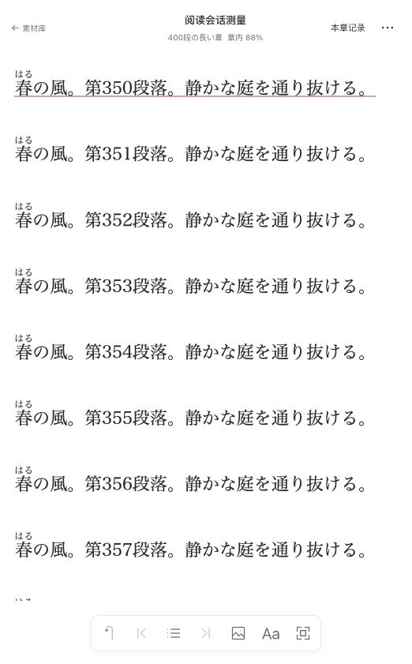

# 阅读会话保留与加载测量

## 范围与实施顺序

2026-10-24，用户确认先测量阅读器各阶段加载耗时，再保留最近一个阅读会话；返回时刷新学习状态，并保留现有片段原文定位行为。实现以当前工作区为基准，保留已有片段交互改动。

1. 使用隔离浏览器、离线材料与长章夹具记录初次打开及阅读器—片段—返回的材料读取、出处读取、注音准备、章节读取、iframe 建立与稳定呈现。分别记录请求与 DOM 阶段，不将夹具请求耗时当作真实后端或模型性能。
2. 先保留现有精确定位与位置写入行为的回归证据，再增加一个有容量和时限的会话保留 module。集中管理身份、激活、暂停和淘汰，使其他入口可以复用；阅读器自行负责材料可用性、版本和定位语义。
3. 保留最近一本书的阅读器与 iframe。暂离期间停止输入处理、布局采样及延迟位置保存，完成已有写入；返回先核验材料，再刷新学习标记、译文和相关资料。有 `segment` 参数时继续定位该片段原文。
4. 覆盖重复往返、横竖排、窗口变化、材料或来源删除、版本变化、位置保存冲突、超时及切换材料的淘汰。比较相同夹具的前后耗时及 iframe 文档身份。
5. 运行工程检查、浏览器回归及独立审查，更新现行规范和实施基线。

## 测量与验收

2026-10-24，在本机 macOS、隔离 Chrome 中使用 400 段、3 个 iframe、400 个自动注音的离线长章夹具。历史基线固定为 `ae44fc8` 的阅读器及三个配套模块，只在 Vite 内存替换，不改工作树；每种窗口、实现各采样三次，表中为中位数，单位 ms。

| 窗口／路径 | 首个可见 iframe | 全部 iframe 与注音 | 可读状态 | 首次观测保存完成 |
| --- | ---: | ---: | ---: | ---: |
| 1280 初次打开，基线 | 46.0 | 75.9 | 100.2 | 667.4 |
| 1280 初次打开，保留版 | 68.8 | 81.8 | 107.3 | 673.9 |
| 1280 片段返回，基线 | 15.5 | 50.0 | 86.9 | 639.6 |
| 1280 片段返回，保留版 | 62.2 | 62.3 | 95.6 | 95.6 |
| 390 初次打开，基线 | 43.7 | 78.4 | 101.6 | 657.5 |
| 390 初次打开，保留版 | 44.2 | 81.8 | 104.6 | 672.8 |
| 390 片段返回，基线 | 12.5 | 47.9 | 82.1 | 631.8 |
| 390 片段返回，保留版 | 57.3 | 57.3 | 93.3 | 93.3 |

初次打开仍读取材料、准备注音、读取章节并呈现正文。返回保留材料／出处核验与注音代次核验，刷新来源、使用状态、本章学习标记、译文及翻译活动；同章正文和注音不再重取，3 个 iframe 及其 Document 身份全部复用。该夹具每次返回的请求由 11 次降为 9 次。恢复刷新先精确取消旧请求；其缓存新鲜期由恢复协调负责，避免自动重取抢先产生重复请求，明确失效仍能刷新。

这些实测没有显示可读时间稳定下降。夹具响应制作通常约 0–0.3ms，不包含真实后端解压、数据库及网络等待；保留版返回前的核验门禁也使旧正文暂不可见。表中首个 iframe 指首次观测可见，不等于新建文档；可读状态使用轮询和呈现证据，时间受采样粒度影响。保存列受到原有 550ms 延迟保存与同章导航即时写入的差异影响，不能当作加载提速。当前可确认的优化是省去章节载荷及文档重建，真实书籍的端到端提速仍需在实际阅读中测量。

每阶段请求起点、请求数量及身份断言见[测量数据](evidence/reader-session/measurements.json)。复测命令与口径见[开发指南](../../DEVELOPMENT.md#阅读会话性能测量)。

## 实现与回归

- 通用 `RetainedRoute` 与纯会话策略管理一个条目、暂停十分钟、路由冻结、恢复代次和淘汰；Reader 处理材料／版本／注音代次、CAS、精确出处和学习状态刷新。不增加依赖，不改数据库或生成接口。
- 暂停保留正文，停用全局阅读输入、朗读、布局／位置采样、查询轮询和翻译预提交。真正卸载清理资源。恢复前排空已有写入，用会话自有队列 revision 校验，材料查询缓存回收不破坏十分钟保留；失败队列安全重开。
- 返回的材料、出处和学习数据分别精确取消旧 flight，再读取当前状态；旧请求的迟到结果不能被新激活接收。暂停立即清理临时搜索高亮。版本、代次或外部 CAS 变化重开，已删除材料或失效出处不先展示旧正文。
- 同章导航保留文档，既有临时高亮测试改以新的 Highlight 对象确认目标替换，同时继续验证旧计时器隔离和淡出，避免将销毁文档当作行为要求。

工程检查通过：`just lint`、后端 673 项测试、前端最终 602 项测试、`just build`、文档链接检查及 `git diff --check`。完整离线浏览器回归 55 个场景通过；最后调整恢复查询调度后，再次通过三组会话回归（1280 横排、390 横排、1280 竖排）。构建保留现有大 chunk 提示。

浏览器覆盖精确定位及普通返回、iframe／Document 身份、学习记录刷新、后台快捷键、材料替换、十分钟淘汰、404、出处失效、校验等待期间隐藏旧正文、版本变化。真实 QueryClient／QueryObserver 回归另覆盖有／无缓存的旧请求、快速退出、材料读取旧 revision、已删除出处、缓存 GC、失败队列和主动失效刷新。真实材料后端耗时、设备内存压力及浏览器回收不在本次离线夹具范围；未触及 TBD。

独立审查发现的旧请求回填、缓存 GC 后 CAS 误判、失败队列复用和暂停搜索高亮残留均已修复并增加回归。浏览器实际打开预览后，原文定位到第 350 段，显示注音及学习下划线，章内进度约 88%，工具栏保持可用。

## 2026-10-25 译文保留回归

提交前审查发现，阅读会话恢复后再次重译，新结果读取延迟或失败时，刷新门禁会同时隐藏已核验的旧译文。修复后，可读快照记录目标会话与激活代次；当前代次的重译可继续展示已核验译文，新结果完整读取后替换。再次返回仍重新核验，失败时不回显上一代次的缓存或回退快照；显式历史浏览沿用原有选择语义。

浏览器回归通过真实 `ViewActivityProvider` 暂停、恢复两次，覆盖浮卡与嵌入面板、主动面板与共享任务的跟随面板，以及新结果延迟、503、重试成功和第二次恢复核验失败。修复前已复现“新结果读取完成前保留旧译文”的断言失败，修复后宽窄屏定向回归通过。实际打开 503 预览时，原文、已留存译文与读取失败提示同时可见，版本快捷入口保持禁用。测试使用离线接口夹具，未调用真实模型；未触及 TBD。

提交前最终检查通过：`just lint`、`just test`（后端 673 项、前端 602 项）、`just build`、`just check-docs`、`git diff --check`，以及包含新增回归的 55 组完整离线浏览器场景。独立复审未发现阻塞问题；构建仍有既有大 chunk 提示。
